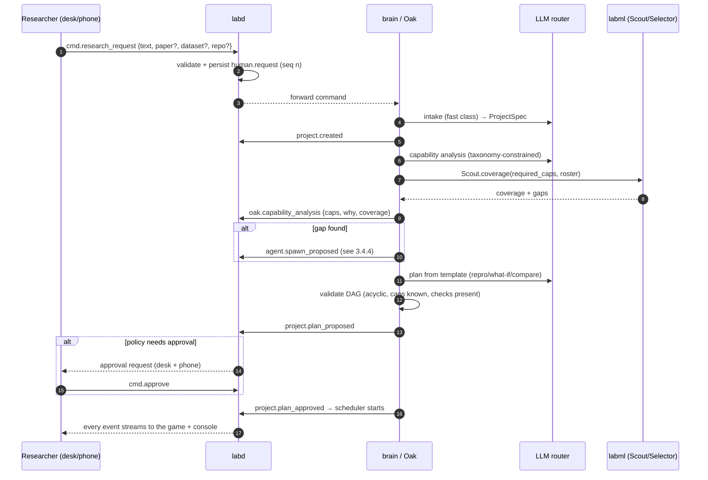
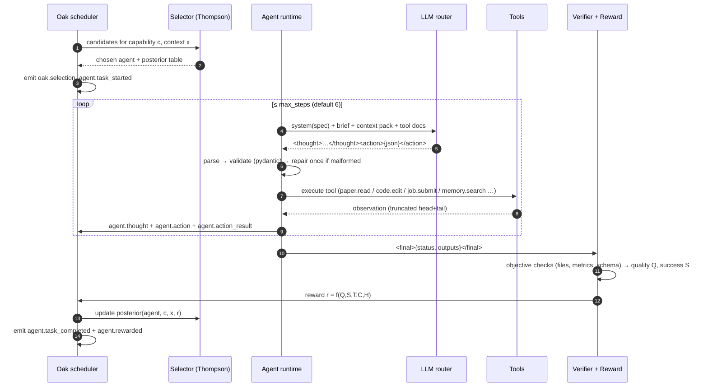
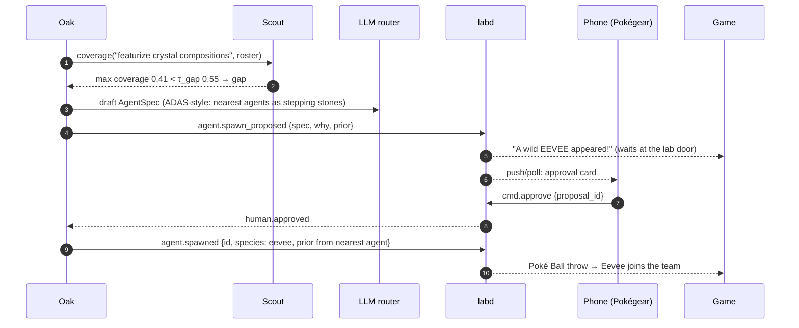
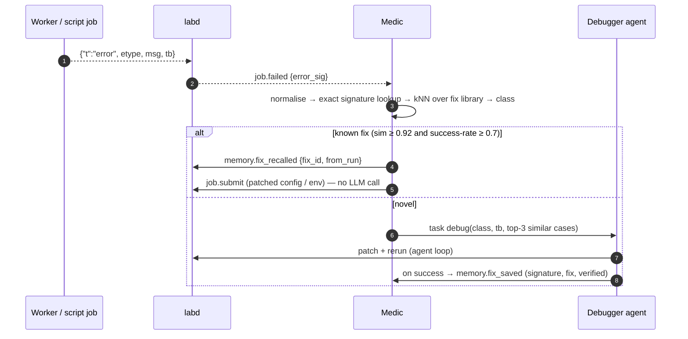
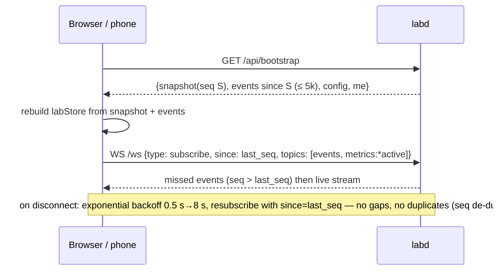

# POKéLAB — SYSTEM ARCHITECTURE & BUILD BLUEPRINT

> **Document:** `docs/SYSTEM-ARCHITECTURE.md` · **Version** 1.0 · **Date** 2026-10-10
> **Event** Elevate 1.0 (DJSCE, Mumbai, 10–11 Oct 2026) · **Problem statement** PS03 — *An Evolving AI Research Environment* (portal code likely **EL02**, confirm in the team dashboard)
> **Builder** Abhishek (solo) + Claude (Opus 5.5 wrote this blueprint; Sonnet 5 builds from it)
> **Project root** `~/elevate-ps03/` (this folder) · **Working name** **PokéLab** — *Professor Oak's Evolving Research Lab*
> **Status** Design frozen for P0. Every later decision must cite or amend a section of this document.

---

## HOW TO READ THIS DOCUMENT

| If you are… | Read | Skip |
|---|---|---|
| **The human building and presenting it** | `docs/OVERVIEW.md` first (plain-language tour, ~30 min). Then Part 1 (what the PS demands), Part 2 (the experience), Part 12 (demo + acceptance tests). | Field-level contracts in Part 10 |
| **The AI agent writing the code** | **Everything relevant to your sub-phase.** Part 13 (the build plan) is your work order; each sub-phase names the sections it depends on. Parts 5–10 are the specs. Never "re-design" what a section already decides — cite it (`per §6.4`). | Nothing your sub-phase cites |
| **A reviewer agent checking the code** | Part 1.4 (demand matrix), Part 10 (contracts), Part 11 (non-functional rules), Part 12.3 (acceptance tests AC-1…AC-25) | — |

**Conventions used throughout:**

| Marker | Meaning |
|---|---|
| `[PS-Dn]` | Traces to demand *Dn* of the problem statement (§1.3). Not negotiable. |
| `[DECISION]` | A design decision. Rationale is always given. Can be revisited only with a reason written into §14.2. |
| `[MEASURED]` | A number we produced on *this* laptop or *this* gateway. Only these numbers may go on slides. |
| `[TARGET]` | A number we are aiming for. Never shown to judges as a result. |
| `[RESEARCH]` | Grounded in a cited paper/repo (links in §14.6). |
| `[RISK]` | A known failure mode with a stated mitigation (full register §14.1). |
| `[STRETCH]` | Build only after every non-stretch item of its phase is green. |
| `⚠️` | A verified gotcha — the obvious approach breaks here. |
| 🔥 | Sub-phase needs the GPU at full power: **plug in the charger, set Performance mode, fans on.** |
| 🧠 | Sub-phase is ML-heavy (training, evaluation, model math). |
| 🔑 | Sub-phase needs an API key / account (listed in §13.0.4). |
| 🌐 | Sub-phase needs a good network (downloads). Do it on the phone hotspot if the campus Wi-Fi blocks it. |
| 🟣 Opus / 🔵 Sonnet | Which Claude model should run that sub-phase (Part 13.0.3). Default is 🔵 Sonnet. |
| ★☆☆☆☆ … ★★★★★ | Difficulty of a phase / sub-phase. |

**The three rules this document enforces:**

1. **Real or nothing (the binding rule).** Every sprite movement, speech bubble, HP bar, evolution, number and chart on screen is driven by an event that a real component emitted. The game is a *lens* onto the lab, never a costume. If the backend is idle, the game shows idleness (agents sleep). `[PS-D26]`
2. **Never buffer.** No interaction may leave the screen frozen. Anything slower than 150 ms streams progress; anything slower than 2 s shows *real* intermediate state (agent thoughts, live curves, forecasts). A judge must always see something true moving.
3. **Every claim is measured.** Reproduction numbers, Oracle accuracy, compute saved, BO efficiency — all come from `var/reports/*.json` produced by our own runs (`make eval`). The UI reads those files; it never hard-codes a metric.

---

## DOCUMENT MAP

| Part | Title | Answers |
|---|---|---|
| 1 | The problem statement | What exactly did they ask for? (verbatim + gist + 27 numbered demands + traceability) |
| 2 | The product & the experience | What is PokéLab, how does it feel, how does the Pokémon world map onto the PS? |
| 3 | System architecture | What are the boxes and wires? Processes, data flow, sequence diagrams |
| 4 | Technology stack & repository | Which languages/frameworks/versions, why, and where every file lives |
| 5 | `labd` — the Rust lab core | Event store, gateway, job supervisor, metrics pipeline, telemetry, auth |
| 6 | `brain` — Professor Oak & the agents | Meta-controller, agent runtime, action protocol, LLM router, papers, memory, lifecycle, reward |
| 7 | The ML layer — Oak's Instruments | Oracle, Navigator, Selector, Medic, Scout, Compute Router, Analysts — real ML that makes the lab faster |
| 8 | Workers, kits & the papers | Warm GPU pool, experiment kits, remote Kaggle/Colab, the paper packs and their what-ifs |
| 9 | The game & the console | Phaser scenes, the Director, sprites, audio, React console, mobile Pokégear |
| 10 | Contracts, data model & APIs | Event catalogue, SQLite schemas, WebSocket/HTTP/worker protocols |
| 11 | Non-functional design | Performance budgets, reliability, network plan, security, observability, testing |
| 12 | Demo & acceptance | Storyboard, wow moments, acceptance tests AC-1…AC-25 |
| 13 | **The build plan** | Phases → sub-phases → exact technical steps → done-when gates, difficulty, GPU/ML/API flags |
| 14 | Risks, decisions, references | Risk register, decision log, open questions, glossary, every link and local path |

---

# PART 1 — THE PROBLEM STATEMENT

## 1.1 PS03 verbatim (from `~/Downloads/Telegram Desktop/Elevate 1.0 PS list.pdf`, pp. 5–7)

> **PROBLEM STATEMENT 03 — An Evolving AI Research Environment**
>
> **Background**
>
> Machine learning research increasingly spans papers, datasets, code, notebooks, compute platforms, documentation, experiments, collaborators, and countless disconnected applications. Reproducing published work is difficult because implementation details, dependencies, configurations, preprocessing, datasets, and reported results may differ across sources and environments. Even after an experiment runs, researchers repeatedly face debugging, dependency conflicts, data issues, hyperparameter choices, model comparisons, failed experiments, and unanswered "what if?" questions. Valuable knowledge from these successes and failures is rarely retained in a way that helps future research. As research scales, the researcher spends increasing time managing the machinery around experimentation rather than investigating the research itself.
>
> AI agents are increasingly capable of reading papers, writing and debugging code, and running experiments. However, most agentic systems still depend on predefined agents, fixed roles, manually designed workflows, and known task boundaries, while every paper and research question needs a different mix of skills. A research environment built on agents therefore requires more than capable individual agents – it requires a system that can dynamically organise, coordinate, evaluate, and evolve its agents around the research itself.
>
> **Problem Statement**
>
> Build an intelligent research environment, powered by a dynamic team of AI agents, that can support the researcher across the complete lifecycle of machine learning research. The system should be capable of taking a paper, research question, algorithm, dataset, codebase, or experimental idea and working with the information required to turn it into meaningful experimentation. It should be able to execute research across environments such as local machines, Kaggle, Colab, remote servers, or other available compute, while handling the practical problems that arise during execution including dependencies, incompatible environments, data issues, implementation errors, resource constraints, configuration choices, and hyperparameter decisions.
>
> Rather than relying on a fixed set of predefined agents, a meta-controller should determine the capabilities each research task requires – such as reading papers, implementation, environment setup, debugging, experiment design, and analysis – coordinate existing agents, and spawn or adapt new specialised agents when existing capabilities are insufficient. Agents should be evaluated through a meaningful reward loop based on research outcomes, compute cost, and researcher feedback. Agents that consistently produce valuable results should be refined, while those that fail to justify their cost or contribution should be merged, replaced, or retired.
>
> The system should go beyond checking whether a paper can be reproduced. It should be capable of running experiments, observing results, diagnosing failures, repairing and improving implementations, comparing multiple papers or approaches under meaningful conditions, and determining why results differ from reported findings. When a researcher asks questions such as "what if this dataset is changed?", "what if this architecture is modified?", or "what happens under these conditions?", the system should be capable of investigating multiple possibilities rather than requiring every experiment to be manually designed and executed.
>
> Experiments should not exist as isolated runs. What the system learns from successful and failed executions, debugging decisions, configurations, comparisons, and outcomes should remain useful for future research. Over time, the system should become better at deciding what to try, how to execute it, how to recover when it fails, which direction is worth pursuing next, and which agents are best suited to each task.
>
> The research environment should also bring together the surrounding work that normally lives across thousands of tools: discovering and reading papers, managing research notes and Markdown files, working with datasets and code, creating documents and research outputs, maintaining experimental records, and collaborating with other researchers and authors. A researcher should be able to control ongoing work remotely, including through a mobile interface, while longer-running computation and experimentation may continue elsewhere.
>
> The challenge also extends to research autonomy. Multiple possible hypotheses, methods, datasets, or experimental conditions may need to be investigated simultaneously, with the system determining which directions deserve further exploration based on evidence and previous outcomes. The researcher should remain able to inspect, intervene, guide, approve, reject, or redirect this process.
>
> The system should be demonstrated on modest compute, such as a laptop CPU or free-tier Kaggle and Colab, choosing model sizes, dataset subsets, and experiment budgets that still produce meaningful evidence. Participants should take at least one paper – for example from the research directions below, spanning materials science, edge and efficient ML, CPU-scale machine learning, and 3D – reproduce its key result autonomously, investigate at least one meaningful "what if?" extension, and explain where and why their results differ from the paper.
>
> Finally, the system may contain a very large number of concurrent agents, activities, decisions, experiments, resources, documents, and research threads. How these are organised and exposed to the researcher is itself a major part of the challenge. The interface should make clear what the agents are doing, why they are doing it, how they are performing, and how the team is evolving, making a complex autonomous research environment understandable and controllable without reducing the underlying capability to a simple notebook or chat interface.
>
> **CORE QUESTION** — *How can you build a single environment where a researcher can conduct, control, and collaborate on their entire research process while an evolving team of AI agents continuously executes, investigates, learns, and improves alongside them?*
>
> **Suggested Research Directions** — *Participants may choose any paper; the papers below are starting points that are feasible on a CPU or free-tier compute as supported by our sponsors.*
>
> - **Materials science:** CGCNN — Xie & Grossman (PRL 2018) · MEGNet — Chen et al. (Chem. Mater. 2019) · Roost — Goodall & Lee (Nat. Commun. 2020) · Matbench — Dunn et al. (npj Comput. Mater. 2020) · CHGNet — Deng et al. (Nat. Mach. Intell. 2023), using the pretrained model on CPU
> - **Edge and efficient ML:** Jacob et al., integer-arithmetic-only quantization (CVPR 2018) · Hinton, Vinyals & Dean, *Distilling the Knowledge in a Neural Network* (2015) · Frankle & Carbin, *The Lottery Ticket Hypothesis* (ICLR 2019) · Sandler et al., *MobileNetV2* (CVPR 2018) · Lin et al., *MCUNet* (NeurIPS 2020)
> - **Machine learning on a CPU:** Chen et al., *SLIDE* (MLSys 2020) · Power et al., *Grokking* (2022) · Liu et al., *KAN* (2024) · Raissi et al., *PINNs* (J. Comput. Phys. 2019) · Hollmann et al., *TabPFN* (ICLR 2023) · Grinsztajn et al., *Why do tree-based models still outperform deep learning on tabular data?* (NeurIPS 2022)
> - **3D:** Qi et al., *PointNet* (CVPR 2017) · Wang et al., *DGCNN* (ACM TOG 2019) · Park et al., *DeepSDF* (CVPR 2019), on a few shapes · Mildenhall et al., *NeRF* (ECCV 2020), as a low-resolution "tiny NeRF" · Fridovich-Keil et al., *Plenoxels* (CVPR 2022)

## 1.2 The gist, in plain words

They want **one place** where a researcher hands over research work — a paper, a question, a dataset, some code, an idea — and **a team of AI agents that organises itself** does the work: reads, implements, sets up environments, debugs, runs experiments on whatever compute is around (laptop, Kaggle, Colab), and analyses results. Four things make it hard and are what the judges will probe:

1. **The team is not fixed.** A *meta-controller* works out which skills a task needs, picks agents, **creates new specialists when skills are missing**, and **scores every agent** on outcomes, compute cost and the researcher's feedback — then **refines the good ones and merges/replaces/retires the bad ones.**
2. **It does real science, not a reproduction checkbox.** Run → observe → diagnose → repair → compare → **explain why our numbers differ from the paper's**, and answer **"what if…?"** questions by investigating *several* possibilities on its own.
3. **It learns.** Every run, failure, fix and comparison is kept and makes the system **measurably better** next time at choosing what to try, how to run it, how to recover, where to go next and which agent to use.
4. **A human stays in command, and can see everything.** Inspect, approve, reject, redirect — **including from a phone** — through an interface that shows *what* agents do, *why*, *how well*, and *how the team evolves*, and that is **not a notebook or a chatbot.**

Hard deliverable: **≥ 1 paper's key result reproduced autonomously on modest compute + ≥ 1 meaningful what-if + an explanation of where and why results differ.** Our plan exceeds it on purpose: one hero paper in full depth (Grokking) plus one paper in each of the other PS domains (Part 8), because "every paper needs a different mix of skills" is exactly what makes the team visibly *re-organise* itself.

## 1.3 The demands, numbered (D1–D27)

| ID | Demand (paraphrased tightly from §1.1) | Kind |
|---|---|---|
| **D1** | An intelligent research environment powered by a **dynamic team of AI agents** across the **complete ML research lifecycle** | Core |
| **D2** | Accepts **a paper, research question, algorithm, dataset, codebase or experimental idea** and turns it into meaningful experimentation | Input |
| **D3** | Executes on **local machines, Kaggle, Colab, remote servers, other compute** | Compute |
| **D4** | Handles **dependencies, incompatible environments, data issues, implementation errors, resource constraints, configuration choices, hyperparameter decisions** | Robustness |
| **D5** | A **meta-controller determines the capabilities** each task needs (reading papers, implementation, env setup, debugging, experiment design, analysis) | Agents |
| **D6** | It **coordinates existing agents** | Agents |
| **D7** | It **spawns or adapts new specialised agents** when existing capabilities are insufficient | Agents |
| **D8** | Agents are evaluated by a **reward loop** on **research outcomes, compute cost and researcher feedback** | Agents |
| **D9** | Consistently valuable agents are **refined** | Evolution |
| **D10** | Agents that don't justify cost/contribution are **merged, replaced or retired** | Evolution |
| **D11** | Beyond reproduction: **run experiments, observe results, diagnose failures, repair and improve implementations** | Science |
| **D12** | **Compare multiple papers or approaches** under meaningful conditions | Science |
| **D13** | **Determine why results differ** from reported findings | Science |
| **D14** | **What-if questions** (dataset changed, architecture modified, conditions changed) → **investigates multiple possibilities** without manual design | Science |
| **D15** | **Experiments are not isolated runs**: learnings from successes, failures, debugging decisions, configs, comparisons, outcomes **remain useful** | Memory |
| **D16** | **Gets better over time** at: what to try · how to execute · how to recover · which direction next · which agent for which task | Learning |
| **D17** | Brings together surrounding work: **discovering & reading papers, research notes & Markdown files, datasets & code, documents & research outputs, experimental records, collaborating with researchers and authors** | Workspace |
| **D18** | **Remote control including a mobile interface**, while long computation continues elsewhere | Control |
| **D19** | **Research autonomy**: multiple hypotheses/methods/datasets/conditions **simultaneously**; the system **decides which directions deserve more exploration from evidence and previous outcomes** | Autonomy |
| **D20** | The researcher can **inspect, intervene, guide, approve, reject, redirect** | Control |
| **D21** | Demonstrated on **modest compute** (laptop CPU, free Kaggle/Colab) with model sizes, subsets and budgets that **still produce meaningful evidence** | Constraint |
| **D22** | **≥ 1 paper** (suggested directions) — **key result reproduced autonomously** | Deliverable |
| **D23** | **≥ 1 meaningful "what if?"** extension investigated | Deliverable |
| **D24** | **Explain where and why** results differ from the paper | Deliverable |
| **D25** | Organise and expose a **very large number of concurrent** agents, activities, decisions, experiments, resources, documents, threads | Interface |
| **D26** | Interface shows **what agents are doing, why, how they perform, how the team evolves** | Interface |
| **D27** | **Understandable and controllable without reducing it to a notebook or chat** | Interface |
| **CQ** | *Conduct, control and collaborate on the entire research process while an evolving team of agents continuously executes, investigates, learns and improves alongside the researcher* | North star |

## 1.4 Traceability matrix — every demand → where it lives → how a judge sees it → how we prove it

> If a row here has no module or no acceptance test, the build is not done. Acceptance tests are defined in §12.3.

| ID | Module(s) that satisfy it | What the judge sees | Proof |
|---|---|---|---|
| D1 | Whole system; Oak (§6.2) + agent runtime (§6.3) | Professor Oak's lab with a live team of Pokémon-agents working on several projects | AC-1, AC-4 |
| D2 | Intake (§6.2.1), Paper service (§6.6), dataset/codebase importers (§6.6.4) | Drop a PDF / type a question / drop a CSV / paste a repo path → a project starts | AC-24 |
| D3 | Job engine (§5.5), Compute Router (§7.7), remote runners (§8.8) | A job flies to "Kaggle Island" / "Colab Peak" and its curve streams back | AC-16 |
| D4 | Env agent + `uv` envs (§8.9), Medic (§7.4), config validation (§6.3.5), resource scheduler (§5.5) | A missing-dependency failure is diagnosed and fixed; OOM is auto-retried smaller | AC-13, AC-17 |
| D5 | Capability analysis (§6.2.2), capability taxonomy (§6.4.1) | Oak's quest board: "this task needs: read, implement, run, analyse" with reasons | AC-5 |
| D6 | Scheduler + Selector (§6.2.4, §7.3) | Oak's choice card: posteriors of candidate agents, chosen one walks to the station | AC-6 |
| D7 | Scout (§7.5) + lifecycle (§6.8) | "A wild Eevee appeared!" → approve on phone → Poké Ball → joins the team | AC-7 |
| D8 | Reward engine (§6.9) | After each task: reward breakdown (quality, success, speed, cost, human) + XP bar | AC-11 |
| D9 | Refinement / GEPA-lite (§6.8.3) | Evolution animation "Charmander → Charmeleon", lineage edge v1→v2, measured gain | AC-8 |
| D10 | Merge / retire policies (§6.8.4–6.8.5) | Day Care merge (egg hatches), faint → Bill's PC with retirement reason | AC-9, AC-10 |
| D11 | Experiment loop (§6.2.5), Medic (§7.4), implementer/debugger agents | A crash → triage → repair → rerun, all visible | AC-13 |
| D12 | Comparison projects (§6.2.6), multi-paper gyms (Part 8), comparison arena (§8.6) | Two approaches under identical budgets, side-by-side curves and a verdict | AC-4 |
| D13 | ReproComparator + diagnostic runs (§6.10) | "Paper: ~10k steps; ours: 19.8k. Likely: seed variance (measured ±x), optimizer β2…" with evidence links | AC-3 |
| D14 | Navigator BO (§7.2), what-if designer agent | The Safari-Zone map lifts its fog as the lab explores weight-decay × data-fraction | AC-2, AC-15 |
| D15 | Event log + Pokédex memory (§6.7), config-hash dedup | Resubmit an identical config → "Found in the Pokédex — run #12" instantly | AC-12 |
| D16 | Oracle, Navigator, Selector, Medic, Router all trained on the lab's own history (Part 7) | "Oracle accuracy vs runs seen" and "tokens saved by Medic" charts that rise over the session | AC-14, AC-15 |
| D17 | Paper library + reader (§6.6), notes/Markdown (§6.11), datasets/code views, reports, collaborator links, author-email drafts | The Library, Notes and Reports panels; a shareable read-only link | AC-20, AC-25 |
| D18 | Pokégear mobile PWA (§9.8), tunnel/LAN (§11.3) | Judge approves a spawn from *their* phone | AC-18 |
| D19 | Parallel what-ifs (§6.2.5), Navigator acquisition, Oracle early stops | 3 runs battle at once; doomed ones retreat early; the next suggested point blinks on the map | AC-2, AC-15 |
| D20 | Approval gates & autonomy policy (§6.2.7), redirect (§6.2.8), kill/pause | Approve / reject / redirect / kill from desk or phone; plan diff shown on redirect | AC-18, AC-19 |
| D21 | Model/data scaling per kit (Part 8), measured budgets | Every run card shows device, wall-time, GPU-seconds; all on one laptop + free tiers | AC-1, AC-4 |
| D22 | Paper packs + kits + autonomous project template (Part 8) | Badge earned when the key result is reproduced, with the run as evidence | AC-1, AC-4 |
| D23 | What-if designer + Navigator | wd=0 battle: our runs never land a hit; Oracle calls the retreat | AC-2 |
| D24 | ReproComparator report | Report panel + Markdown file with evidence table | AC-3 |
| D25 | Region map + console filters/aggregation + Director time-compression (§9.5) | 6+ agents, 3+ runs, 2 projects on screen at once without chaos | AC-21 |
| D26 | Binding rule, bubbles, choice cards, reward bars, lineage tree | Click any Pokémon → what/why/how-well/history | AC-21 |
| D27 | Game + console + phone (Part 9); chat exists only as one input among many | No notebook, no chat-box UI as the main surface | AC-21 |
| CQ | Everything above, continuously | The lab keeps working, learning and improving while the researcher watches and steers | AC-22, AC-23 |

## 1.5 What the judges will probe (and the one-line answers we build towards)

| Likely question | Our answer (must be *demonstrable*, not just sayable) |
|---|---|
| "Is the team really dynamic or are these hard-coded roles?" | Agents are **data** (spec rows), not code. Watch one get spawned from a detected skill gap, another refined from its own failure traces, two merged, one retired — each with the measured reason. |
| "Where is the learning?" | Seven learned components trained on **this lab's own history** (Part 7); their accuracy/compute-saved charts move during the demo. |
| "Is the reproduction real?" | The run is live on this laptop's GPU; seed, config hash, device, wall-time and the W&B run link are on the card; rerunning the same config returns the memory hit with the same numbers. |
| "Why does your result differ from the paper?" | The ReproComparator's evidence table — and the diagnostic runs it scheduled itself to test its hypotheses. |
| "What if I change X?" | Type it (or say it on the phone). The Navigator designs a small batch, the Oracle prunes losers, the map fills in. |
| "Isn't the game just decoration?" | Toggle the event-id overlay: every animation names the event that caused it. Pause the backend and the world goes still. |
| "What if the Wi-Fi dies?" | LLM cache + Groq fallback + local GPU + REPLAY mode of a recorded session, clearly labelled. |

---

# PART 2 — THE PRODUCT & THE EXPERIENCE

## 2.1 One sentence

**PokéLab is an evolving multi-agent ML research lab you can watch, play and steer like a Pokémon game: Professor Oak (the meta-controller) staffs research quests with Pokémon (AI agents), every battle is a real training run on real hardware, every evolution is a measured agent improvement, the Pokédex is the lab's memory — and seven small ML models trained on the lab's own history make it faster and smarter with every run.**

## 2.2 Design pillars (every later decision defers to these)

| # | Pillar | Means in practice |
|---|---|---|
| P1 | **Real or nothing** | The game only *renders* backend events. No timers that fake progress, no canned animations without a cause. Idle lab = sleeping Pokémon. |
| P2 | **Never buffer** | Warm GPU workers (< 0.3 s to start a kit job), cached LLM answers, ML decisions in milliseconds, LLM latency covered by *real* intermediate state. |
| P3 | **The lab learns** | Every decision/run/failure is an event; every learned component retrains in the background (< 1 s) and its improvement is charted. |
| P4 | **Human in command** | An explicit autonomy policy decides what needs approval; approve/reject/redirect/kill work from desk and phone in < 1 s. |
| P5 | **Honest science** | Numbers carry provenance (run id, seed, device, config hash). Memory hits and replays are labelled. Claims in reports are checked against the evidence table. |
| P6 | **Fail soft** | Any process can die and come back; the event log is the truth; provider fallbacks and replay mode keep the demo alive. |

## 2.3 The metaphor map (locked)

| PS concept | In PokéLab | Bound to (real backend state) |
|---|---|---|
| The researcher | **Ash** (the player avatar you walk with) | Human commands: requests, approvals, redirects, feedback |
| Meta-controller | **Professor Oak** | `brain/oak/*`: capability analysis, planning, selection, lifecycle (§6.2) |
| Agents | **Pokémon** (roster §2.4) | `AgentSpec` rows (§6.4): role, capabilities, prompt, model tier, version, lineage, stats |
| Agent selection | Oak "sends out" a Pokémon | Selector posterior draw (§7.3) — the choice card shows the numbers |
| Agent level / XP | Level & XP bar | Posterior mean reward ×100 / number of rewarded tasks |
| Spawn new specialist | **"A wild Eevee appeared!" → Poké Ball** | Scout skill-gap detection (§7.5) + approval → new spec inserted |
| Adapt / refine | **Evolution** (Charmander → Charmeleon) | GEPA-lite reflection + shadow evaluation passed (§6.8.3) |
| Merge | **Day Care** (two enter, an egg hatches) | Merge policy + approved merged spec (§6.8.4) |
| Retire | **Faints → sent to Bill's PC** | Posterior below threshold with confidence (§6.8.5) |
| Research domain | **Town** with a **Gym** | Paper pack domain (Part 8) |
| Paper's claimed result | **Gym Leader** | `PaperPack.claims[]` (§6.6) |
| An experiment run | **A Gym battle** | A job: HP of *our* side = remaining compute budget; HP of the *leader* = remaining gap to the paper's number |
| A what-if sweep | **Triple battles / tournament bracket** | Concurrent jobs designed by the Navigator (§7.2) |
| Early stop of a doomed run | **"Got away safely!"** | Oracle P(success) below threshold → kill (§7.1) |
| The hypothesis space | **Safari Zone map with fog of war** | Navigator Gaussian-process posterior (§7.2) |
| Memory | **Pokédex** | Event log + config-hash index + lessons + fix library (§6.7) |
| Debugging | **Pokémon Center (Nurse Joy = Medic)** | Failure triage + fix recall (§7.4) |
| Remote compute | **Kaggle Island / Colab Peak** (boat/flight) | Remote runners (§8.8) + Compute Router (§7.7) |
| A reproduced paper | **Badge** | Comparator verdict REPRODUCED/PARTIAL with evidence (§6.10) |
| Phone control | **Pokégear** | Mobile PWA `/m` (§9.8) |
| Lab memory browsing | **Pokédex terminal** | Memory views (§9.7) |

## 2.4 The cast — base roster and evolution lines

All Pokémon are Gen 1–2 (sprites already mirrored in `assets/vendor/showdown/`, walking sprites from PMD SpriteCollab, §9.6). A line's stage = the agent's **version**; evolving means a *promoted* refinement. Species are configuration, not code (`brain/config/roster.toml`).

| Role (capabilities) | Line (v1 → v2 → v3) | Why this Pokémon |
|---|---|---|
| **Paper Reader** (`paper_read`, `spec_extract`, `claim_extract`) | Pichu → **Pikachu** → Raichu *(seeded at v2: it was refined once during the build — real history, logged)* | The user's pick; Electric = fast reader |
| **Implementer** (`implement`, `code_edit`) | **Charmander** → Charmeleon → Charizard | The user's pick; Fire = forging code |
| **Environment Engineer** (`env_setup`, `dependency_fix`, `data_prep`) | **Bulbasaur** → Ivysaur → Venusaur | Grows the roots everything stands on |
| **Debugger** (`debug`, `repair`) | **Squirtle** → Wartortle → Blastoise | Washes bugs away |
| **Analyst / Comparator** (`analyze`, `repro_compare`, `explain`) | **Abra** → Kadabra → Alakazam | The Psychic brain that sees hidden structure |
| **Experimenter** (`experiment_design`, `run_experiment`, `whatif_design`) | **Porygon** → Porygon2 | A digital creature that lives in machines |
| **Compute Runner** (`compute_ops`, `remote_run`) | **Magnemite** → Magneton | Electric/Steel — hardware |
| **Scribe** (`notes`, `report_write`, `author_email`) | **Hoothoot** → Noctowl | The scholarly owl |
| **Scout** (`literature_search`, `paper_discover`) | **Zubat** → Golbat → Crobat | Echolocation = search |
| **Spawned specialist** (any new capability) | **Eevee** → evolves by specialisation: **Espeon** (theory/maths), **Jolteon** (edge/efficiency), **Flareon** (3D/rendering), **Vaporeon** (materials/chemistry), **Umbreon** (robustness/debugging) | Eevee *is* "adapt to what is needed" |

| Character | Sprite | Role |
|---|---|---|
| **Ash** | `trainers/ash.png` (portrait) + FireRed **Red** overworld walker (pret/pokefirered) | The researcher (player) |
| **Professor Oak** | `trainers/oak.png` + FireRed Prof. Oak walker | Meta-controller avatar; speaks Oak's decisions |
| **Nurse Joy** | trainer sprite (Pokémon Center) | Voice of the Medic |
| **Bill** | trainer sprite | Keeper of the PC (retired agents, archives) |
| **Gym leaders** | Sabrina (Grokking/CPU-ML), Lt. Surge (Edge ML), Blaine (3D/NeRF), Brock (Materials), Erika (comparison arena) | Each speaks for a paper's claims |

## 2.5 The world: the Research Region

```
                          ┌───────────────────────┐
                          │     KAGGLE ISLAND      │ ◄── boat dock (remote jobs sail here)
                          └───────────▲───────────┘
   ┌───────────────┐                  │                  ┌────────────────┐
   │  CRYSTAL CAVE │                  │                  │   LUMEN TOWN   │
   │  (Materials)  │◄──── Route 2 ────┼──── Route 3 ────►│   (3D / NeRF)  │
   │  Brock's Gym  │                  │                  │  Blaine's Gym  │
   └───────┬───────┘        ┌─────────┴─────────┐        └───────┬────────┘
           │                │   PALLET CAMPUS   │                │
           │                │ ┌───────────────┐ │                │
           └──── Route 1 ───┤ │  OAK'S LAB    │ ├─── Route 4 ────┘
                            │ │ (HQ, stations)│ │
                            │ └───────────────┘ │
                            │ Pokémon Center ✚  │   ← Medic / debugging
                            │ Pokédex Library 📖 │   ← memory
                            │ Day Care 🥚 · PC 💾│   ← merges · retired agents
                            └───┬───────────┬───┘
                ┌───────────────┘           └──────────────┐
       ┌────────┴───────┐                         ┌────────┴────────┐
       │  MODULO CITY   │                         │   EDGE PORT     │
       │ (CPU-scale ML) │                         │ (Edge & efficient│
       │ Sabrina's Gym  │                         │  ML) Surge's Gym│
       │ Safari Zone 🌫 │ ← Navigator map          └─────────────────┘
       └────────────────┘                      ▲ COLAB PEAK (cable car)
```

- Built with the PokeStonks procedural map builder (`maps.ts` `Builder`), themes reused: Modulo City = `tech`, Edge Port = `energy`, Lumen Town = `meme` (neon), Crystal Cave = `crypto` (obelisks read as crystals), Pallet Campus = `bluechip`.
- **Where an agent stands is a pure function of its current task** (§9.4.2): `paper_read` → Lab library desk; `implement` → Lab code bench; `env_setup` → Lab server rack; `debug` → Pokémon Center; `run_experiment` → the paper's Gym; `remote_run` → Kaggle Island / Colab Peak; memory work → Pokédex Library; idle → asleep on the campus lawn. No randomness decides positions.

## 2.6 Three zoom levels + two control surfaces

| Level | Scene | Shows (PS) | Reads from |
|---|---|---|---|
| **L1 Region** | `RegionScene` | *All* research at once: every agent's location = its current task; projects as quest flags on towns; jobs as boats/cable cars to remote compute; badges `[PS-D25]` | Agents, tasks, jobs, projects |
| **L2 Oak's Lab** (the heart) | `LabScene` | One project in detail: stations, the quest board (plan DAG), Oak's choice cards, speech bubbles with the agent's *current thought*, wild-Pokémon spawns at the door, evolutions `[PS-D5,D6,D7,D9,D26]` | Plan, agent thoughts/actions, selections, lifecycle |
| **L3 Gym battle** | `GymScene` | Experiments: our runs vs the paper's claim; HP = budget vs gap; Oracle cone; "super effective!" on real jumps; retreats on early stops `[PS-D11,D14,D19,D23]` | Job metrics (downsampled), forecasts, kills |
| **Console (PC/Pokégear)** | React panels | The serious instrument: quest log, activity feed with *why*, team & lineage, live curves, Safari map, Repro report, Pokédex, Library, Notes, Compute, Budget, Autonomy policy `[PS-D17,D20,D25–27]` | Same store |
| **Phone (Pokégear app)** | `/m` PWA | Approvals inbox, project status, kill/pause, redirect by text or **voice** (Whisper on Groq) `[PS-D18,D20]` | Same store, via tunnel/LAN |

Layout modes (hotkeys `1/2/3`): **Game** (full-screen game + slim HUD), **Split** (game 60 % | console 40 % — the demo default), **Console** (full instrument). The HUD always shows: LIVE/REPLAY badge, GPU utilisation, active jobs, approvals waiting, tokens left today, power mode warning.

## 2.7 The binding table — what each visual means (and which event causes it)

| On screen | Cause (event kind, §10.2) | Rule |
|---|---|---|
| Pokémon walks to a station | `agent.task_started` (capability → station map) | Path via grid-engine `moveTo`; if > 1.5 s behind real time, *poof-teleport* (Director time compression, §9.5) |
| "…" bubble | `llm.call_started` for that agent | Removed on `llm.call_finished` |
| Thought bubble text | `agent.thought` (≤ 140 chars of the agent's *actual* reasoning) | Never invented |
| Working animation (PMD *Attack/Charge*) | `agent.action` in progress | Stops on `agent.action_result` |
| Hurt animation + red "!" | `agent.task_failed` / `job.failed` | Followed by walk to Pokémon Center if Medic routes it |
| Level-up jingle, XP bar fills | `agent.rewarded` | Shows reward breakdown tooltip |
| Wild Pokémon at the door | `agent.spawn_proposed` | Poké Ball throw only after `human.approved` → `agent.spawned` |
| Evolution animation | `agent.evolved` | Only after shadow eval passed |
| Egg at Day Care | `agent.merged` | Parents walk in first (from `agent.merge_proposed`) |
| Faint + into PC | `agent.retired` | Shows reason text |
| Gym: our attack lands | `job.metric` checkpoint where the target metric improved | Damage = Δmetric normalised to the gap |
| "It's super effective!" | improvement > 3× rolling mean improvement (e.g. the grok jump) | — |
| "X is confused!" | loss spike > 2σ (e.g. slingshot) | — |
| Our HP drains | elapsed budget fraction | Exact |
| "Got away safely!" | `job.killed{reason:"oracle_early_stop"}` | Shows GPU-seconds saved |
| Badge | `project.badge_awarded` (comparator verdict) | — |
| Pokédex glow + "Found in the Pokédex" | `memory.hit` | Shows the original run id |
| Fog lifts on Safari map | `ml.navigator_updated` | Tiles = GP posterior |
| Boat sails to Kaggle Island | `compute.route_decided{target:"kaggle"}` + `job.started` | Returns on `job.completed` |

A debug overlay (`Shift+E`) prints the event `seq` next to every animation that is playing — the honesty proof for judges (AC-21).

## 2.8 What PokéLab is not

| It is not | Why |
|---|---|
| A chat app with a game skin | The main surfaces are the world, the console instruments and the phone; chat is one input among many (`cmd.ask`). |
| A fixed pipeline of hard-coded agents | Agents are data; the team at the end of the demo is not the team at the start. |
| An LLM that "grades itself" | Rewards come from objective verifiers first (§6.9); LLM-judging is a minority, flagged term. |
| A pre-recorded animation | Runs are live on the GPU (62 s for the full grokking reproduction, `[MEASURED]` plugged in); REPLAY mode exists only as a labelled fallback. |
| A custom-trained "AI brain" replacing the LLM | LLMs read, plan, code and explain; small ML models do what LLMs are bad at — calibrated numbers, fast routing, forecasting, statistics (Part 7). |

---

# PART 3 — SYSTEM ARCHITECTURE

## 3.1 The one-page architecture

```
╔══════════════════════════════════════════════════════════════════════════════════════════════════════════════╗
║  PRESENTATION PLANE (TypeScript)                                                                              ║
║  ┌───────────────────────────────────────────────┐  ┌────────────────────────────┐  ┌──────────────────────┐ ║
║  │ Desk browser — web/ (Next 16 static export)    │  │ Phone — /m Pokégear PWA     │  │ Collaborator (view)  │ ║
║  │  Phaser 3.80 + grid-engine: Region/Lab/Gym     │  │  approvals · kill · redirect│  │  read-only reports   │ ║
║  │  Director (event→animation, time compression)  │  │  voice redirect (Whisper)   │  │  & notes link        │ ║
║  │  React console: quests · feed · team/lineage   │  └──────────────┬─────────────┘  └──────────┬───────────┘ ║
║  │  curves(uPlot) · Safari map · Repro · Pokédex  │                 │ HTTPS via LAN/tunnel       │             ║
║  │  Library · Notes · Compute · Budget · Policy   │                 │                            │             ║
║  │  zustand labStore = projection of events       │                 │                            │             ║
║  └──────────────────────┬────────────────────────┘                 │                            │             ║
╚═════════════════════════╪══════════════════════════════════════════╪════════════════════════════╪═════════════╝
                          │ WS /ws (events, metrics, cmds) + HTTP /api/*  (one origin :7700)       │
╔═════════════════════════▼══════════════════════════════════════════════════════════════════════▼═════════════╗
║  CONTROL & DATA PLANE — labd (Rust · tokio · axum)                         one binary, supervises everything   ║
║  ┌──────────────┐ ┌───────────────┐ ┌──────────────────┐ ┌──────────────────┐ ┌───────────────┐ ┌──────────┐ ║
║  │ Gateway      │ │ Event store   │ │ Job engine       │ │ Metrics pipeline │ │ Telemetry     │ │ Auth/QR  │ ║
║  │ WS fan-out   │ │ SQLite WAL    │ │ scheduler(GPU/   │ │ parse JSONL      │ │ NVML/nvidia-  │ │ pairing  │ ║
║  │ HTTP API     │ │ single writer │ │ CPU/remote slots)│ │ ring buffers     │ │ smi, power,   │ │ tokens   │ ║
║  │ static web   │ │ group commit  │ │ warm-pool mgr    │ │ LTTB downsample  │ │ RAM/CPU       │ │ roles    │ ║
║  │ cmd intake   │ │ replay/since  │ │ kill/timeout     │ │ 1 Hz progress    │ │               │ │          │ ║
║  └──────┬───────┘ └──────▲────────┘ └────────┬─────────┘ └────────▲─────────┘ └───────────────┘ └──────────┘ ║
║         │ supervises: brain (restart on crash) · worker pool · remote runners                                 ║
╚═════════╪════════════════╪═══════════════════╪═══════════════════════╪════════════════════════════════════════╝
          │ WS /internal/brain (events⇅, cmds↓, job events↓)            │ stdout JSON-lines ▲   stdin control ▼
╔═════════▼══════════════════════════════════════════╗   ╔══════════════╧═════════════════════════════════════════╗
║  INTELLIGENCE PLANE — brain (Python 3.12 asyncio)   ║   ║  COMPUTE PLANE — workers (Python 3.12 + PyTorch 2.14)   ║
║  ┌──────────────────────────────────────────────┐  ║   ║  Warm pool: w-gpu-0, w-gpu-1 (torch+CUDA preloaded),    ║
║  │ PROFESSOR OAK (meta-controller)              │  ║   ║  w-cpu-0.  Kits: grokking · distill · nerf · materials ·║
║  │  intake → capability analysis → plan DAG →   │  ║   ║  arena · smoke.  Cold "script jobs" for agent-written  ║
║  │  scheduler → selection → lifecycle → reward  │  ║   ║  code (fresh process, sandbox dir, scrubbed env).      ║
║  ├──────────────────────────────────────────────┤  ║   ║  Remote runners: kaggle_runner (kernels push/status/    ║
║  │ AGENT RUNTIME  text action protocol, tools,  │  ║   ║  output) · colab_runner (colab run --gpu T4) — same     ║
║  │  budgets, context packs, verifiers           │  ║   ║  JSON-lines protocol, so remote looks local.            ║
║  ├──────────────────────────────────────────────┤  ║   ║  Telemetry hooks: weight norms, Fourier measures, PSNR  ║
║  │ OAK'S INSTRUMENTS (labml, real ML, ms)       │  ║   ║  maps → used by Oracle & Analysts.                     ║
║  │  Oracle · Navigator · Selector · Medic ·     │  ║   ╚═════════════════════════════════════════════════════════╝
║  │  Scout · Compute Router · Analysts           │  ║
║  ├──────────────────────────────────────────────┤  ║   ╔═════════════════════════════════════════════════════════╗
║  │ LLM ROUTER  Elevate(Luna, DeepSeek V4 Pro,   │──╫──►║  EXTERNAL                                                ║
║  │  GPT-5 Mini) · Groq×2 (gpt-oss, qwen) · cache│  ║   ║  Elevate gateway (800k tok/day) · Groq (2 keys) ·        ║
║  │  rate limiter · JSON repair · budget ledger  │  ║   ║  Kaggle (T4, 30 h/wk) · Colab (T4) · W&B (tracking) ·    ║
║  ├──────────────────────────────────────────────┤  ║   ║  arXiv API (discovery) · Exa (dev-time research only)    ║
║  │ PAPERS (PDF→sections→claims) · MEMORY        │  ║   ╚═════════════════════════════════════════════════════════╝
║  │ (Pokédex: dedup, lessons, fixes, embeddings) │  ║
║  │ SCIENCE: ReproComparator · reports · notes   │  ║        STORAGE (var/)
║  └──────────────────────────────────────────────┘  ║        lab.db (events, jobs, metrics — labd writes)
║  reads lab.db read-only · writes only via events   ║        brain.db (embeddings, specs cache, labml registry)
╚════════════════════════════════════════════════════╝        llm_cache.db · runs/<job>/ · notes/ · papers/ · wandb/
```

## 3.2 Processes, ports and ownership

| Process | Language / runtime | Started by | Port / channel | Owns (single writer) | Restart policy |
|---|---|---|---|---|---|
| **`labd`** | Rust (tokio, axum) | you: `make up` (or `./bin/labd`) | `:7700` HTTP + `/ws` + `/internal/brain` + static web | `var/lab.db` (events, jobs, metrics, artifacts, snapshots) | — (it is the supervisor) |
| **`brain`** | Python 3.12, asyncio | labd (child process) | connects to `ws://127.0.0.1:7700/internal/brain` | `var/brain.db`, `var/llm_cache.db`, `var/notes/`, `var/labml/` | labd restarts with backoff 1 s→30 s; state rebuilt from events (§6.12) |
| **`w-gpu-0..N`** | Python 3.12 + torch cu130 | labd (warm pool) | stdin/stdout JSON-lines | `var/runs/<job_id>/` for its current job | restart on crash/exit; recycled after 50 jobs or RSS > 3 GB |
| **`w-cpu-0`** | same | labd | same | same | same |
| **script job** | `python script.py` in the project venv | labd per job | stdout JSON-lines | `var/workspaces/<project>/runs/<job>/` | none (one-shot) |
| **remote runner** | Python (`kaggle` / `colab` CLIs) | labd per remote job | stdout JSON-lines | `var/runs/<job_id>/remote/` | one-shot; status polled |
| **web (dev only)** | Node 22 `next dev` | you | `:3000` (proxies `/api`, `/ws` → `:7700`) | — | — |
| **cloudflared** (optional) | binary | `make tunnel` | → `:7700` | — | manual |

`[DECISION D-01]` **labd is the only process that writes `lab.db`.** Everyone else either *sends events/commands to labd* or *reads* `lab.db` through a read-only connection (WAL mode allows concurrent readers). This removes the whole class of `database is locked` failures and makes the event log a total order.

`[DECISION D-02]` **The web app is a static export served by labd** in demo mode (`next build` with `output: 'export'` → `web/out/` → `ServeDir`). One origin (`:7700`) for desk, phone and tunnel; no Node process at demo time; no CORS.

`[DECISION D-03]` **The event log is the source of truth.** `brain.db` and every client store are projections that can be rebuilt by replaying events. Snapshots exist only to make bootstrap fast.

## 3.3 Key architecture decisions (summary — rationale in the referenced sections)

| # | Decision | Why |
|---|---|---|
| D-01 | Single writer for `lab.db` (labd) | No lock contention; total order; durable group commit (§5.3) |
| D-02 | Static web served by labd | One origin, one process fewer, phone/tunnel trivial (§9.1) |
| D-03 | Event sourcing | Replay, reconnect, crash recovery, REPLAY demo mode, audit trail for "why" (§5.3) |
| D-04 | Rust for the core; Python for intelligence & compute; TS for presentation | Each language where it is strongest (§4.1) |
| D-05 | Agents are data (`AgentSpec`) executed by one generic runtime | Spawn = insert, refine = new version, retire = status — no code generation of agents needed (§6.4) |
| D-06 | Own text action protocol instead of native tool-calling | ⚠️ `[MEASURED]` the Elevate gateway drops `tools` and ignores `response_format`; one protocol works on every provider (§6.3.2) |
| D-07 | Warm worker pool for kit jobs, fresh processes for agent-written scripts | ~0.3 s start for trusted kits; isolation for untrusted code (§8.1) |
| D-08 | Small ML models (ms) for numbers, statistics and routing; LLMs for language and code | Each tool where it beats the other; no LLM in the per-second loop (Part 7) |
| D-09 | Same JSON-lines protocol for local, Kaggle and Colab jobs | Remote compute looks identical to the UI and the ML layer (§8.8) |
| D-10 | Contracts generated from one source (Pydantic → JSON Schema → TS; Rust mirrors + fixture tests) | No drift across three languages (§10.1) |
| D-11 | Offline-first: every asset, dataset, model weight and paper pre-downloaded; LLM cache; REPLAY mode | Campus Wi-Fi blocks sites; hotspot RTT measured at 1.6 s on 10 Oct (§11.3) |

## 3.4 The seven core flows

### 3.4.1 A research request becomes a running project



### 3.4.2 One task executed by one agent



### 3.4.3 An experiment run with Oracle early stopping

```mermaid
sequenceDiagram
    autonumber
    participant E as Experimenter agent
    participant CR as Compute Router
    participant L as labd job engine
    participant W as warm GPU worker
    participant O as Oracle
    participant UI as Game/console
    E->>CR: job spec (kit, config, budget)
    CR-->>E: target=local (pred 14 s) | kaggle | colab
    E->>L: job.submit
    L->>L: config_hash → Pokédex dedup check (memory hit → return immediately)
    L->>W: {"t":"job",…} on stdin
    W-->>L: {"t":"metric",…} lines (10–50 Hz)
    L-->>UI: downsampled metrics (≤ 10 Hz/series) + job.progress (1 Hz)
    L-->>O: progress stream (via brain subscription)
    O-->>L: job.forecast {p_success, eta_steps, final_q10/50/90} every 2 s
    alt p_success < 0.05 for 3 checks and progress > 20 %
        O->>L: cmd.kill_job {reason: oracle_early_stop}
        L->>W: {"t":"stop"} → graceful stop ≤ 2 s
        L-->>UI: job.killed → "Got away safely! saved 48 GPU-s"
    else finishes
        W-->>L: {"t":"done", final}
        L-->>UI: job.completed
    end
    O->>O: add curve to library; retrain in background (< 1 s)
```

### 3.4.4 Spawning a specialist with phone approval



### 3.4.5 A failure, triaged by the Medic



### 3.4.6 Client bootstrap and reconnect



### 3.4.7 A remote job on Kaggle

```mermaid
sequenceDiagram
    participant L as labd
    participant K as kaggle_runner.py
    participant KG as Kaggle
    L->>K: spawn with job spec (kit + config)
    K->>K: build kernel dir (kit code + config + entry that prints JSON lines)
    K->>KG: kaggle kernels push -p dir --accelerator NvidiaTeslaT4
    loop every 10 s
        K->>KG: kaggle kernels status
        K-->>L: {"t":"log","msg":"queued|running"}
    end
    K->>KG: kaggle kernels output → log JSON
    K-->>L: replays the remote {"t":"metric"} lines, then {"t":"done"}
    Note over L: metrics arrive in bursts (no live streaming on Kaggle) — the UI shows "remote, syncing"; Colab runner streams live via `colab run`
```

## 3.5 State machines

**Project:** `draft → analysing → planned → (awaiting_approval) → running ⇄ paused → reporting → completed | failed | cancelled`. Redirect moves `running → planned (revision n+1) → running` with a plan diff event.

**Task (plan step):** `pending → ready → assigned → running → verifying → done | failed → (retry ≤ 2 | escalated)`.

**Job:** `submitted → deduped (memory hit) | queued → starting → running → (stopping) → completed | stopped | killed | failed | timeout`. Remote adds `uploading → remote_queued → remote_running → syncing`.

**Agent:** `proposed → active ⇄ busy → (refining → active as vN+1 | refine_rejected) → retired | merged`. A proposal can be `rejected` (by the human) and is then archived with the reason.

**Approval:** `requested → approved | rejected | expired (policy default applied)`.

---

# PART 4 — TECHNOLOGY STACK & REPOSITORY

## 4.1 Three languages, each where it is strongest `[DECISION D-04]`

| Language | Owns | Why this language here | Why not elsewhere |
|---|---|---|---|
| **Rust** (`core/`, binary `labd`) | Gateway, event store, job engine & process supervision, metrics pipeline, telemetry, auth | Long-lived, always-on process that must never stutter: no GIL, no GC pauses; tokio fans out thousands of WS messages/s with bounded per-client queues; `tokio::process` + process groups give clean kill semantics; ~15 MB RSS next to multi-GB torch workers; a single static binary that starts in milliseconds and supervises everything else | Writing ML or LLM orchestration in Rust would mean re-implementing PyTorch/numpy/sklearn ecosystems — slower to build, no speed gain (GPU kernels and network latency dominate there) |
| **Python 3.12** (`brain/`, `labml/`, `workers/`, `contracts/`) | Meta-controller, agents, LLM router, papers, memory, ML layer, training kits, remote runners | PyTorch (cu130 wheels verified on the RTX 5050), numpy/scipy/sklearn/optuna, fastembed, PyMuPDF, Kaggle & Colab CLIs, W&B — the ecosystem *is* Python. Every ML decision runs in-process in microseconds-to-milliseconds | Not for the gateway: the GIL + asyncio under heavy metric fan-out would make the UI stutter exactly when a demo is busiest |
| **TypeScript** (`web/`) | Game (Phaser), console (React), phone PWA | The browser runtime; reuses the PokeStonks engine, art pipeline, audio engine, menus and polish wholesale | — |

Interop is deliberately boring: **JSON over WebSocket/HTTP** between web ⇄ labd ⇄ brain, **JSON lines over stdin/stdout** between labd ⇄ workers. No gRPC, no message broker, no Docker — fewer moving parts on a single demo laptop. `[DECISION D-12]`

## 4.2 Verified environment (this laptop, 10 Oct 2026) `[MEASURED]`

| Item | Value |
|---|---|
| CPU / RAM | i5-13420H (8C/12T) · 15 GB RAM (≈ 4 GB free with a browser + IDE open — budget memory!) |
| GPU | RTX 5050 Laptop 8 GB (Blackwell, sm_120), driver 590.48, CUDA 13.1; power limit 75 W plugged in |
| Disk | **36 GB free** (90 % used) ⚠️ — one shared Python venv only (torch is ~3 GB); datasets ≤ 2 GB total |
| Rust | rustc / cargo **1.99.0** |
| Node / pnpm | **22.23.2** / **10.16.0** |
| Python | system 3.14 (do **not** use) → **uv 0.10.7** creates a **3.12** venv |
| PyTorch | **2.14.1+cu130** — works on sm_120 (the default PyPI wheel is the cu130 build) |
| SQLite (system) | 3.52.0 (Rust uses the bundled copy anyway) |
| Tools present | `cloudflared`, `just`, `make`, `kaggle` 2.2.4 (OAuth logged in), `colab` 0.7.4 (logged in), `exa` CLI |
| Power | On battery / Balanced the GPU is **~3× slower** (Nanda grokking: 181 s vs 62 s) — `labd doctor` warns |

## 4.3 The stack, layer by layer

> Versions below were **verified on 10 Oct 2026** (registries + compiled/run on this laptop — `✓run`). The lockfiles (`Cargo.lock`, `uv.lock`, `pnpm-lock.yaml`) become the pins in P0; record the resolved versions in `docs/PROGRESS.md`.

### 4.3.1 `core/` — Rust (rustc 1.99; all compiled together `✓run`)

| Crate · version | Use | Notes / gotchas |
|---|---|---|
| `tokio` 1.53 (full) | runtime, processes, timers, `broadcast` | `broadcast::Receiver` returns `RecvError::Lagged(n)` for slow subscribers — handle it (resync), never ignore it |
| `axum` **0.8.9** (`ws`, `macros`) | HTTP + WebSocket | ⚠️ routes are `/{id}` (old `/:id` panics); **copy examples from tag `axum-v0.8.9`, not `main`** (main holds unreleased 0.9 breaking changes); `ws.max_message_size(1<<20).on_upgrade(…)`; `Message::Text(Utf8Bytes)`; no `WebSocket::close` (send a Close frame) |
| `tower-http` **0.7.1** (`cors,fs,compression-gzip,compression-br,trace`) | `ServeDir` for `web/out`, compression, tracing | ⚠️ **CORS does not protect WebSockets** — check `Origin` in the WS handler (§5.8); 0.7 returns 404 for file paths with a trailing slash |
| `rusqlite` **0.40.2** (`bundled`, SQLite 3.53) + `tokio-rusqlite` 0.8 (reads) | the event store | `[DECISION]` rusqlite over sqlx (sqlx 0.9 cannot link next to rusqlite and multi-writer pools hit `SQLITE_BUSY`). `✓run` **940 k events/s** in 500-row transactions; **1.1 ms** to replay 5 000 rows from a seq |
| `serde` / `serde_json` 1.0.151 (`raw_value`) + `tokio-util` 0.7 `LinesCodec` | envelopes & worker lines | `✓run` **7.5 M METRIC lines/s** on one core (release build) — no SIMD parser needed; ⚠️ use `LinesCodec::new_with_max_length(256 << 10)` (unbounded `lines()` can exhaust memory); set `[profile.dev.package."*"] opt-level = 3` (debug JSON is very slow) |
| `process-wrap` **10.0.1** (`tokio1`) + `nix` 0.31 (`signal,process`) | job process groups | `CommandWrap::with_new(…).wrap(ProcessGroup::leader()).wrap(KillOnDrop)`; `child.signal(SIGTERM)` = killpg `✓run` (killed bash + 2 sleeps + python). ⚠️ tokio's `kill_on_drop` alone kills only the direct child |
| `nvml-wrapper` **0.13.0** | GPU util/mem/power/temp | `✓run` on this RTX 5050 / driver 590.48 (init 5 ms; 4 queries ≈ 12 µs); ⚠️ `fan_speed(0)` errors here — skip it. Fallback: `nvidia-smi --query-gpu=… --format=csv,noheader,nounits -lms 500` |
| `tracing` 0.1.44 + `tracing-subscriber` 0.3.23 (`env-filter,json`) | logs | `var/logs/labd.jsonl` |
| `sysinfo` | child RSS / host RAM | recycle workers at RSS > 3 GB |
| `schemars` 1.2.2 | (optional) emit JSON Schema for the few Rust-owned types | add `#[schemars(title=…)]` on enum variants |
| `qrcode` 0.14.1 | pairing QR (SVG + terminal `unicode::Dense1x2`) | — |
| `rand` 0.10 + `sha2` 0.11 + `base64` | opaque device tokens (stored hashed) | no JWT needed on one laptop |
| `uuid` (v7) | time-ordered ids | `job_01J…` |
| `clap`, `toml`, `dotenvy`, `anyhow`, `thiserror` | CLI, config, errors | — |
| own `lttb.rs` (~40 lines) | downsampling | the `lttb` crate is unmaintained |

### 4.3.2 `brain/`, `labml/`, `workers/`, `contracts/` — Python 3.12 (one uv workspace, one venv; co-installed `✓run`)

| Package · version | Use | Notes / gotchas |
|---|---|---|
| `pydantic` 2.13.5 (or 2.14.0, released 8 Oct) | contracts, tool args, agent specs | source of truth for schemas (§10.1) |
| `openai` **3.28.0** SDK (uses `httpx2`) | one client for **Elevate and Groq** (`base_url` per provider) | construct with `max_retries=0` (our router owns retries), `default_headers={"User-Agent": "pokelab/1.0"}` — ⚠️ Groq's Cloudflare blocks default Python UAs (403 / 1010 `[MEASURED]`); openai 3.x requires `httpx2` clients (not `httpx`) |
| `websockets` **17.2** | brain ⇄ labd socket | ⚠️ `additional_headers=` (not `extra_headers`); since 15.0 it **auto-uses environment proxies — pass `proxy=None`** for localhost; `send(text=…)` is keyword-only |
| `orjson` 3.13 | JSON | the gateway's 48 KB cap is measured on `orjson.dumps(request)` bytes |
| `json-repair` 0.64 + `tenacity` 9.2 | repair LLM JSON / retries | `✓run` strips fences/prose, fixes trailing commas |
| `numpy` 2.5.3, `scipy` 1.18.1, `scikit-learn` 1.9.1 | labml | numpy brute-force KNN over 20 k×384 = **4.4 ms** `✓run` (faster than sqlite-vec — no vector DB needed) |
| `optuna` **5.0.0** | TPE baseline only (Navigator ablation) | ⚠️ 5.0 defaults: multivariate TPE + `constant_liar=True`; `GPSampler` needs torch and fails only at trial #11; keyword-only APIs |
| `fastembed` **0.9.0** (+ onnxruntime 1.31) | bge-small-en-v1.5 embeddings | ⚠️ default cache is `/tmp/fastembed_cache` (tmpfs → re-download after reboot): **set `FASTEMBED_CACHE_PATH=var/models/fastembed` and `HF_HUB_OFFLINE=1`**; `✓run` 7 ms/query, 67 MB model |
| `pymupdf4llm` **1.28.2** (+ `pymupdf`/`pymupdf-layout` exactly 1.28.2) | PDF → Markdown | layout mode found all headers on a test paper but costs **~0.55 s/page** — run in a process pool, `use_ocr=False`; AGPL (fine here) |
| `arxiv` **4.0.1** | discovery | ⚠️ 4.0 removed `Search.results()` and `download_pdf()` → use `Client().results(Search(…))` and fetch `pdf_url` yourself; ≤ 1 request / 3 s; synchronous → `asyncio.to_thread` |
| `wandb` **0.30.0** | tracking mirror | offline first; `wandb sync --yes <dirs>`; `run.url` is `None` offline |
| `torch` **2.14.1** (+ `torchvision`) | kits | the **default PyPI wheel is already the cu130 build** with sm_120 — no extra index needed; import 1.7 s `✓run` |
| `kaggle` 2.2.4, `google-colab-cli` 0.7.4 | remote runners | see §8.8 (⚠️ Colab `--timeout` defaults to **30 s**) |
| `structlog`, `pytest`, `pytest-asyncio`, `hypothesis` | logs, tests | — |
| ❌ PydanticAI / OpenAI Agents SDK / LangGraph / instructor | not used | they need native tool-calling (the gateway has none) and/or conflict with websockets 17 / openai 3 → **custom action loop** (§6.3) `✓run` |

### 4.3.3 `web/` — TypeScript (forked from `~/PokeStonks/apps/web`)

| Package · version | Use | Notes / gotchas |
|---|---|---|
| `next` **16.3.8** (bump from 16.3.5), `react` 19.2.8 | shell, static export | ⚠️ 16.3.8 fixes a High-severity SSRF + cache-poisoning advisories — bump since the app is reachable through a tunnel; read `node_modules/next/dist/docs/` before Next code; Turbopack is default |
| `typescript` **^5** (5.9.3) | — | ⚠️ `latest` on npm is now TypeScript 7 (native compiler) — keep `^5` |
| `phaser` **3.80.1** + `grid-engine` **2.45.0** — *exact pins, upgrade never during the hackathon* | game | ⚠️ grid-engine ≥ 2.45.4 wants Phaser 3.85+, 2.52 wants Phaser 4 (Phaser 4.2.1 is out — migration later). `import * as Phaser`; StrictMode ref-guard (done in `PhaserMount.tsx`). grid-engine 2.45: `addCharacter/removeCharacter`, `moveTo(id, pos, {algorithm:'A_STAR', noPathFoundStrategy:'CLOSEST_REACHABLE', pathBlockedStrategy:'WAIT'}).subscribe(({result}) => …)`, `GridEngineHeadless` for tests |
| `zustand` 5.0.15 | stores | pure reducers |
| `uplot` **1.6.32** (+ `uplot-react` 1.2.4) | live curves | canvas; 166 k points in 25 ms; `setData` at ≤ 10 Hz |
| `@xyflow/react` **12.12.0** + `@dagrejs/dagre` **3.1.1** | lineage tree, plan DAG | ⚠️ use `@dagrejs/dagre` 3 (ESM, typed), not `dagre` 0.8.5; dagre returns node **centres** (subtract w/2, h/2); import `@xyflow/react/dist/style.css` |
| `react-markdown` + `remark-gfm` (preview) · `@uiw/react-md-editor` 4.1.2 (optional editor) | notes & reports | editor via `next/dynamic(…, {ssr:false})` |
| `react-pdf` 11.0.0 (`pdfjs-dist` **6.3.289**) — optional | in-console PDF view | set `workerSrc` in the same module; `.npmrc`: `public-hoist-pattern[]=pdfjs-dist`; the Library's default view is the extracted text with highlighted claims |
| `qrcode.react` 4.2.0 | pairing QR | named export `QRCodeSVG` |
| Tailwind 4 | console styling | already configured |
| `vitest` 5.0.3, `@playwright/test` 1.64.0 | tests | test Phaser through state on `window`, not pixels |
| **Removed** from PokeStonks | `wagmi`, `viem`, `@colyseus/sdk`, `maplibre-gl`, `three`, `postprocessing`, `@pythnetwork/*`, `@tanstack/react-query`, `contracts-abi`, `game-core` | no blockchain, globe or Colyseus |

### 4.3.4 Assets & external services

| Item | Source | Where it lands |
|---|---|---|
| Battle sprites (Gen 1–2, animated + static, front/back) | Pokémon Showdown mirror (done, 42 MB) | `assets/vendor/showdown/` → atlases in `web/public/assets/gen/` |
| Walking sprites (8-dir walk/idle/sleep/attack/hurt) | PMDCollab/SpriteCollab on GitHub (`sprite/<dex4>/<Anim>-Anim.png` + `AnimData.xml`) — CC BY-NC 4.0, credits in `credits.txt` | `assets/vendor/pmd/<dex>/` → atlases |
| Overworld humans (Ash/Red, Oak, Nurse Joy, Bill, gym leaders, NPCs) | **pret/pokefirered** `graphics/object_events/pics/people/*.png` (real FireRed overworld sprites: 16×32 frames, 10-frame strip; right = flipX of left) | `assets/vendor/frlg/` → atlases |
| Cries | PokeAPI/cries (`cries/pokemon/latest/<dex>.ogg`) | `assets/vendor/cries/` → `web/public/assets/cries/` |
| Trainer portraits | Showdown `sprites/trainers/*.png` (done) | same pipeline |
| Tiles, characters, music, SFX | PokeStonks procedural engines (code, no files) | `web/app/game/art`, `web/app/game/audio` |
| LLMs | Elevate gateway (Luna, DeepSeek V4 Pro, GPT-5 Mini), Groq ×2 (gpt-oss-120b/20b, qwen3.8-27b, whisper-large-v3) | §6.5 |
| Remote GPUs | Kaggle T4 (30 h/week), Colab T4 (free) | §8.8 |
| Tracking | Weights & Biases (key from the user — §13.0.4) | §11.6 |

### 4.3.5 Machine hygiene found during verification (fix in P0)

- ⚠️ `~/.bashrc` and `~/.zshrc` export **`NODE_TLS_REJECT_UNAUTHORIZED=0`** — it disables TLS certificate checks for *every* Node process. Remove it (ask the user before editing their shell files).
- `/usr/bin/pnpm` is 10.28.2 but the project pins `pnpm@10.16.0` → `corepack enable`.
- Free disk ≈ 34 GB (91 % used): one venv (~4–5 GB with torch), no GROBID Docker image (15 GB).

## 4.4 Repository layout

```
~/elevate-ps03/                       # repo root (git init in P0.1; GitHub remote is the user's call)
├── README.md                         # how to run, architecture summary, licences, credits
├── justfile                          # all commands (§4.6)  — `just up`, `just doctor`, `just test`…
├── .env.example                      # every variable from §4.5, no values
├── .gitignore                        # var/, data/, assets/vendor/, web/public/assets/gen/, .venv/, target/, node_modules/, wandb/
├── docs/
│   ├── SYSTEM-ARCHITECTURE.md        # this document (built from docs/_parts by `just docs`)
│   ├── OVERVIEW.md                   # human-readable concept tour
│   ├── PROGRESS.md                   # one line per sub-phase: ✅/🟡/❌ + key number
│   └── decisions/                    # ADR-style notes for any change to a [DECISION]
├── config/
│   ├── lab.toml                      # ports, pool sizes, budgets, autonomy policy defaults
│   ├── llm.toml                      # providers, models, routes, limits (§6.5)
│   ├── roster.toml                   # base agents: species, role, capabilities, prompts ref
│   └── papers.toml                   # paper packs enabled for the demo
├── contracts/                        # SINGLE SOURCE OF TRUTH for cross-language types
│   ├── pokelab_contracts/            # Python package (pydantic models)
│   │   ├── envelope.py events.py commands.py jobs.py agents.py papers.py
│   │   └── export.py                 # → schemas/*.json
│   ├── schemas/                      # generated JSON Schema 2020-12 (committed)
│   ├── fixtures/                     # golden JSON examples, validated in all 3 languages
│   └── ts/                           # generated .d.ts → copied to web/app/lib/contracts/
├── core/                             # Rust workspace
│   ├── Cargo.toml
│   └── crates/
│       ├── labd/                     # binary: main.rs, config.rs, supervisor.rs, doctor.rs
│       ├── lab-store/                # event store, writer thread, readers, snapshots, metrics tables
│       ├── lab-gateway/              # axum routes, ws hub, cmd intake, static serving, auth/pairing
│       ├── lab-jobs/                 # scheduler, warm pool, process groups, JSON-lines parser, remote
│       ├── lab-metrics/              # ring buffers, LTTB, rollups
│       └── lab-telemetry/            # NVML / nvidia-smi, power profile, sysinfo
├── brain/
│   └── pokelab_brain/
│       ├── main.py                   # boot: connect, rebuild state, start loops
│       ├── bus.py state.py           # labd socket client; in-memory projection
│       ├── oak/                      # intake.py capabilities.py planner.py templates/ scheduler.py
│       │                             # selector_adapter.py lifecycle.py policy.py redirect.py
│       ├── agents/                   # spec.py runtime.py protocol.py context.py verifiers.py
│       │   ├── tools/                # paper.py memory.py code.py env.py jobs.py analysis.py notes.py
│       │   │                         # human.py discover.py data.py repo.py finish.py
│       │   └── prompts/              # role prompts (markdown, versioned)
│       ├── llm/                      # router.py providers.py ratelimit.py cache.py jsonio.py budget.py
│       ├── papers/                   # ingest.py sections.py claims.py packs.py arxiv.py
│       ├── memory/                   # pokedex.py dedup.py lessons.py fixes.py embed.py
│       ├── science/                  # comparator.py checklists/ diagnostics.py reports.py notes.py
│       └── reward.py snapshot.py
├── labml/
│   └── pokelab_labml/
│       ├── oracle/                   # features.py gbm.py seq.py calibrate.py library.py
│       ├── navigator/                # gp.py acquisition.py space.py
│       ├── selector/                 # thompson.py contextual.py priors.py
│       ├── medic/                    # normalize.py signatures.py classifier.py
│       ├── scout/                    # coverage.py clusters.py merge.py
│       ├── router/                   # runtime_model.py placement.py
│       ├── analysts/                 # grok_fourier.py nerf_spectrum.py kd_darkknowledge.py materials_parity.py
│       ├── registry.py               # versioned model files under var/labml/
│       └── cli.py                    # `labml train-all`, `labml eval` → var/reports/*.json
├── workers/
│   └── pokelab_workers/
│       ├── pool_main.py              # warm worker entrypoint
│       ├── protocol.py emit.py stop.py
│       ├── kits/                     # grokking/ distill/ nerf/ materials/ arena/ smoke/  (each: spec.py run.py analyze.py)
│       ├── script_runner.py          # wraps agent-written scripts
│       └── remote/                   # kaggle_runner.py colab_runner.py templates/
├── web/                              # Next 16 app (fork of PokeStonks apps/web, web3 removed)
│   └── app/
│       ├── page.tsx  m/page.tsx  replay/page.tsx
│       ├── lib/ (labSocket.ts api.ts contracts/ store/ format.ts)
│       ├── console/ (panels…)
│       └── game/ (PhaserMount.tsx scenes/ director/ world/ battle/ art/ audio/ sprites/)
├── assets/
│   ├── vendor/ (showdown/ pmd/ cries/)   # downloaded, gitignored
│   └── build_atlases.py              # GIF/PMD → Phaser atlases + manifest
├── scripts/                          # fetch_assets.sh fetch_datasets.sh fetch_papers.sh bench.sh demo_prep.sh
├── data/                             # datasets + paper PDFs (gitignored)
├── tests/                            # cross-component e2e (pytest + playwright)
└── var/                              # runtime state (gitignored): lab.db brain.db llm_cache.db runs/ notes/ logs/ labml/ reports/ wandb/
```

## 4.5 Configuration & secrets

`.env` (never committed; labd loads it and passes **only** what each child needs):

| Variable | Used by | Notes |
|---|---|---|
| `ELEVATE_TEAM_API_KEY` | brain | Elevate gateway bearer key (keep the `HideCopy` suffix out — see §14.3) |
| `GROQ_API_KEY_1`, `GROQ_API_KEY_2` | brain | fallback provider; 1000 req/day, 8000 tok/min per key `[MEASURED headers]` |
| `WANDB_API_KEY` | workers, labml | optional; offline mode if absent |
| `LABD_BRAIN_SECRET` | labd ⇄ brain | random 32 bytes, generated by `just init` |
| `LABD_PAIRING_SECRET` | labd | HMAC key for phone tokens |
| `KAGGLE` / `COLAB` | — | no env needed: CLIs use their own OAuth stores (`~/.kaggle`, colab config) |
| `POKELAB_MODE` | all | `live` (default) · `replay` · `llm-replay` (LLM cache only) |

⚠️ Workers and script jobs get a **scrubbed environment** (no API keys) — agent-written code never sees secrets.

## 4.6 Commands (`justfile`)

| Command | Does |
|---|---|
| `just init` | create `.env` from example, generate secrets, `uv sync`, `pnpm i`, `cargo build` |
| `just fetch` | assets, datasets, paper PDFs, fastembed model (🌐 hotspot if campus blocks) |
| `just atlases` | build Phaser atlases from vendor sprites |
| `just contracts` | export JSON Schemas, generate TS types, run contract fixture tests in all 3 languages |
| `just up` | build web export if stale, start `labd` (which starts brain + workers) on `:7700` |
| `just dev` | `labd` + `next dev` on `:3000` with proxy (hot reload) |
| `just doctor` | preflight: GPU, power mode, disk, assets, datasets, models, gateway reachability, quotas, ports, tunnel |
| `just test` | `cargo test` + `pytest` + `vitest` |
| `just e2e` | Playwright against a REPLAY fixture session |
| `just library` | 🔥 generate the curve library (Part 7.1.4) |
| `just labml` | train + evaluate all labml models → `var/reports/labml.json` |
| `just tunnel` | `cloudflared tunnel --url http://localhost:7700` and print the QR |
| `just replay <db>` | serve a recorded session in REPLAY mode |
| `just docs` | concatenate `docs/_parts/*.md` → `docs/SYSTEM-ARCHITECTURE.md` |

---

# PART 5 — `labd`: THE RUST LAB CORE

`labd` is the lab's spine: it **stores** everything (events), **moves** everything (WebSocket fan-out), **runs** everything (jobs and child processes) and **watches** everything (metrics, GPU, power). It contains *no research logic* — it never decides what to run or which agent to use; the brain does. That keeps the Rust surface small (target ≈ 3–4 k LOC) and stable.

## 5.1 Crate responsibilities and boundaries

| Crate | Public surface | Depends on |
|---|---|---|
| `lab-store` | `Store::open(path)`, `append(Vec<NewEvent>) -> Vec<Seq>` (async via writer channel), `events_since(seq, limit)`, `snapshot_put/get`, `jobs_*`, `metrics_append(batch)`, `metrics_query(job, keys, max_points)` | rusqlite |
| `lab-metrics` | `SeriesBuffer` (ring, f32), `lttb(points, n)`, `Rollup` (1 Hz progress) | — |
| `lab-jobs` | `JobEngine::submit(spec)`, `kill(job, reason)`, `pool_status()`; emits `JobEvent`s on a channel | lab-store, lab-metrics, tokio::process |
| `lab-telemetry` | `Telemetry::sample() -> GpuSample, HostSample, PowerSample` (1 Hz task) | nvml-wrapper, sysinfo |
| `lab-gateway` | axum `Router`; `Hub` (topics, subscribers); command intake; auth | all of the above |
| `labd` | CLI (`up`, `doctor`, `replay`, `export`), config, supervisor of brain + pool | all |

## 5.2 Startup sequence (`labd up`)

1. Load `config/lab.toml` + `.env`; resolve paths under `var/`.
2. Open `var/lab.db` (create + migrate; WAL; `PRAGMA synchronous=NORMAL; foreign_keys=ON; busy_timeout=2000`).
3. Start the **writer thread** (§5.3) and the **telemetry task** (1 Hz).
4. Start the **job engine**; spawn the warm pool (`w-gpu-0..g`, `w-cpu-0..c`) and wait ≤ 10 s for each `{"t":"ready"}` (failure → mark slot degraded, keep going).
5. Bind `:7700` (HTTP, `/ws`, `/internal/brain`, static `web/out`).
6. Spawn **brain** (`.venv/bin/python -m pokelab_brain.main`) with `LABD_URL`, `LABD_BRAIN_SECRET`, LLM keys; restart with exponential backoff (1 → 30 s) if it exits.
7. Emit `lab.started {version, mode, gpu, power}`; print the URL + pairing QR (ASCII) to the terminal.

Target: **`labd` ready < 1 s; whole lab (brain connected, pool warm) < 8 s** `[TARGET]`.

## 5.3 Event store

**Schema** (full DDL in §10.4):

- `events(seq INTEGER PRIMARY KEY, ts TEXT, kind TEXT, v INT, project TEXT, actor TEXT, corr TEXT, causation INT, payload TEXT, display TEXT)` with indexes `(kind)`, `(project, seq)`, `(corr)`.
- `snapshots(name TEXT PRIMARY KEY, seq INT, payload TEXT)` — the brain posts `state.snapshot` every 200 events or 15 s.
- `jobs`, `metrics`, `artifacts` — projections that labd itself maintains because it runs the jobs.

**Writer thread (single writer, group commit):**
```
loop:
  first = rx.recv()                      // blocking
  batch = [first] + rx.try_recv up to 512 items or 10 ms deadline
  BEGIN IMMEDIATE
    for op in batch: INSERT … (seq assigned by SQLite rowid)
  COMMIT
  for op in batch: op.reply.send(seq)    // callers awaiting durability
  hub.publish(committed events)          // fan-out happens only AFTER commit
```
- **Durability before visibility:** clients never see an event that could be lost on crash.
- Metrics are batched separately (every 250 ms) into `metrics(job_id, key, step, value)` — `WITHOUT ROWID`, PK `(job_id, key, step)`.
- Throughput target **≥ 20 k events/s, p99 commit latency < 15 ms** `[TARGET]` (we need ~100/s).
- `labd export <dir>` copies `lab.db` (online backup API) for REPLAY fixtures; automatic backup every 10 min to `var/backups/` (keep 6).

**Event envelope** (Rust struct, mirrored from `contracts/envelope.py`):
```rust
pub struct Event {
    pub seq: i64,                 // assigned on commit
    pub ts: String,               // RFC3339 with ms, UTC
    pub kind: String,             // "agent.task_started"
    pub v: u16,                   // payload schema version
    pub project: Option<String>,  // "prj_01J…"
    pub actor: String,            // "oak" | "agent:<id>" | "human:<device>" | "system" | "job:<id>"
    pub corr: Option<String>,     // correlation id (task/job/proposal)
    pub causation: Option<i64>,   // seq of the event that caused this one
    pub payload: Box<RawValue>,   // opaque to labd except kinds it owns
    pub display: Option<Box<RawValue>>, // presentation hints (importance, bubble text) — never state
}
```

## 5.4 Gateway

### 5.4.1 HTTP routes

| Method & path | Auth | Purpose |
|---|---|---|
| `GET /api/health` | none | `{ok, mode, uptime_s, brain: up/down, pool: [...], gpu, power}` |
| `GET /api/bootstrap` | desk/phone/view | latest snapshot + events since it (≤ 5 000) + config subset + `me` (role) |
| `GET /api/events?since=&limit=&kind=&project=` | desk/view | paging the log (console "history") |
| `GET /api/jobs?project=&status=` · `GET /api/jobs/:id` | desk/view | job projection |
| `GET /api/jobs/:id/metrics?keys=a,b&max_points=600` | desk/view | LTTB-downsampled full history |
| `GET /api/artifacts/:job/:name` | desk/view | files from `var/runs/<job>/` (path-checked) |
| `GET /api/files/notes/*`, `PUT …` | desk (PUT), view (GET) | Markdown notes (writes become `cmd.note_save` events) |
| `GET /api/papers/:id/pdf` | desk/view | serve the stored PDF |
| `POST /api/cmd` | desk/phone | REST fallback for commands (same validation as WS) |
| `GET /api/pair` | **localhost only** | new pairing code + QR SVG (expires 5 min) |
| `POST /api/pair/claim {code}` | none | → device token (role `phone` or `view`), set as HttpOnly cookie |
| `GET /api/telemetry` | desk | last 120 s of GPU/host samples |
| `GET /` `/m` `/replay` `/assets/*` | none | static export of `web/` |

### 5.4.2 WebSocket `/ws` (clients)

```
client → {type:"hello", token?, since:<seq|null>, topics:["events","telemetry"], want_metrics:["job_…"]}
server → {type:"welcome", role, server_seq, mode}
server → {type:"event", e:<Event>}                         // ordered by seq, no gaps
server → {type:"metrics", job, points:[[step, {k:v}],…]}   // ≤ 10 Hz per job, coalesced
server → {type:"telemetry", gpu:{util,mem_mb,power_w,temp_c}, host:{ram_free_mb,cpu}, power:{ac,profile}}
client → {type:"sub", want_metrics:[…]} | {type:"cmd", id, cmd:"approve", args:{…}}
server → {type:"cmd_ack", id, ok, error?, seq?}
both   → {type:"ping"} / {type:"pong"} every 10 s (dead after 30 s)
```

**Fan-out order (no gaps, no duplicates):** on `hello`, the handler (1) subscribes to the broadcast hub *first*, (2) replays `seq > since` from SQLite, (3) forwards live events, skipping any `seq ≤ last_sent`. On `RecvError::Lagged` → send `{type:"resync", since:last_sent}` and replay again. ⚠️ Never copy axum's chat example loop (`while let Ok(m) = rx.recv()`), which silently drops lagging clients.

**Hub & backpressure:** each subscriber has a bounded queue (events 4 096, metrics 256). Metric frames are *coalesced* (only the latest frame per job kept) when the queue is full; if the *event* queue overflows, the server sends `{type:"resync", since}` and drops the subscriber's backlog — the client re-bootstraps. A slow phone can never slow the desk.

### 5.4.3 Internal socket `/internal/brain`

Header `Authorization: Bearer $LABD_BRAIN_SECRET`; only one brain connection at a time (newest wins).

```
brain → {type:"publish", events:[NewEvent…], req}            // labd commits, replies {type:"published", req, seqs}
brain → {type:"snapshot", name, seq, payload}
brain → {type:"job_submit", req, spec:JobSpec}               // labd → {type:"job_accepted", req, job_id, deduped_from?}
brain → {type:"job_kill", job_id, reason}
brain → {type:"subscribe", since}                            // brain also receives the full event stream
labd  → {type:"event", e}                                    // includes human commands and job events
labd  → {type:"job_metrics", job, points}                     // full-rate (not downsampled) for the Oracle
```

### 5.4.4 Command intake

Every human command is: authenticated (role) → schema-validated → persisted as an event (`human.*`) → forwarded to the brain. labd itself executes only infrastructure commands (`kill_job`, `pause_pool`, `resume_pool`); everything with research meaning (approve, redirect, feedback…) is decided by the brain. Role rules: `desk` = all; `phone` = approve/reject/redirect/kill/feedback/ask; `view` = read-only.

## 5.5 Job engine

### 5.5.1 Resource model & scheduling

| Resource | Default slots | Config key |
|---|---|---|
| `gpu` | **2** warm GPU workers — `[MEASURED]` a 2nd concurrent job adds only +11 % total throughput on AC and a 3rd *reduces* it (0.96×); each job is single-core-CPU-bound (94–115 % of one core) and each warm worker idles at **1.17 GB RSS + 226 MiB VRAM**, so host RAM, not VRAM, is the limit. The hero run gets the GPU alone (4.0 s vs 7.2 s each when two share it) | `pool.gpu_workers` |
| `cpu` | 1 (sklearn/numpy only — **no torch import**, ~0.15 GB) for materials/arena kits and analysts | `pool.cpu_workers` |
| `script` | 1 cold script job at a time | `pool.script_slots` |
| `kaggle` | 1 | `remote.kaggle_slots` |
| `colab` | 1 | `remote.colab_slots` |

Queue = priority heap per resource: `interactive (0) < project (1) < whatif (2) < background (3)`, FIFO within a priority. A higher-priority job never *preempts* a running one, except `background` jobs (curve-library sweeps) which receive `stop` and are re-queued from their last checkpoint when an interactive job waits > 2 s.

### 5.5.2 Dedup (the Pokédex fast path)

`config_hash = sha256(canonical_json({kit, kit_version, config, seed, dataset_version}))[:16]`. On submit, if a **completed** job with the same hash exists and the spec does not say `force: true`, labd answers immediately with `job.deduped {from_job}` and the brain emits `memory.hit`. `[PS-D15]` (AC-12)

### 5.5.3 Warm pool lifecycle

```
spawn  : .venv/bin/python -m pokelab_workers.pool_main --slot w-gpu-0 --device cuda:0
         env: CUDA_VISIBLE_DEVICES=0, OMP_NUM_THREADS=4, TQDM_DISABLE=1, PYTHONUNBUFFERED=1,
              TORCH_CUDNN_V8_API_LRU_CACHE_LIMIT=…, WANDB_MODE=offline, (no API keys)
prewarm: after import + CUDA init the worker runs ONE dummy 5-step training job (tiny MLP) —
         `[MEASURED]` without it the first real job still pays 0.9 s (AC) / 1.6 s (battery); with it,
         job receipt → first training step = 8–10 ms (AC), 12–24 ms (battery). Startup ≈ 2.0 s (AC).
ready  : worker prints {"t":"ready", torch, device, pid}
assign : labd writes {"t":"job", …} + "\n" to stdin
run    : stdout lines parsed; stderr captured into a 64 KB ring (for error signatures)
finish : {"t":"done"} → slot free; after 50 jobs or RSS > 3 GB → graceful restart
crash  : EOF/exit → job failed (error_sig from stderr tail) → respawn slot
```
- stdout **and** stderr are drained concurrently (a full 64 KB pipe blocks the worker); stdout via `LinesCodec` with a 256 KB max line.
- Every spawned process group id is recorded (`kv: pgid:<slot|job>`); on labd start, **orphaned groups from a previous crash are killed** before the pool starts (workers in their own group do not receive the terminal's Ctrl-C).

### 5.5.4 Kill semantics (`[PS-D20]`, Oracle early stop)

1. `{"t":"stop","job_id","reason"}` on stdin → the kit's `StopToken` is set → loop exits at the next step, emits `{"t":"done","status":"stopped"}` (target ≤ 2 s).
2. If no `done` within 5 s → `SIGTERM` to the process group; 3 s later `SIGKILL`; warm slot respawned.
3. Script jobs (no stdin protocol guarantee) go straight to step 2.

### 5.5.5 JSON-lines parsing & validation

- Lines > 256 KB are rejected (logged, not crashed). Non-JSON lines are treated as `log` lines (so `print()` debugging in agent scripts never breaks parsing).
- `metric.m` values must be finite numbers; NaN/Inf are kept as `null` *and* raise a `job.anomaly {kind:"nan"}` event (Medic signal).
- Every parsed line updates the job's ring buffers; persistence is batched (§5.3).

### 5.5.6 Timeouts and budgets

Every `JobSpec` carries `budget.max_seconds` (hard wall-clock) and optional `max_steps`. labd enforces wall-clock; kits enforce steps. Timeout → kill with reason `timeout` → `job.timeout`.

## 5.6 Metrics pipeline

- **Ring buffers** per `(job, key)`: last 20 000 points in memory (f32 step + f32 value).
- **To clients:** every 100 ms per active job, send only *new* points since the last frame, thinned by LTTB to ≤ 50 points per frame; clients append. On (re)subscribe, the client first fetches `/api/jobs/:id/metrics?max_points=600` (LTTB over full history) then appends live frames.
- **To brain:** full-rate points (the Oracle needs exact prefixes), batched every 250 ms.
- **Rollups:** 1 Hz `job.progress {step, frac_budget, last:{k:v}, steps_per_s}` events into the log (so REPLAY and late joiners have a coarse curve even without the metrics table).

LTTB (largest-triangle-three-buckets) is ~40 lines of Rust; unit-tested against a reference Python implementation on random walks (max deviation check).

## 5.7 Telemetry & the power guard

1 Hz: GPU util/mem/power/temp (NVML, fallback `nvidia-smi`), host RAM free/CPU, AC from `/sys/class/power_supply/A*/online`, profile from `powerprofilesctl get` (⚠️ on this Acer `/sys/firmware/acpi/platform_profile` returns an I/O error — use `powerprofilesctl`, fallback `/sys/devices/system/cpu/cpufreq/policy0/energy_performance_preference`). If AC is off or the profile is not `performance` while a GPU job runs → `lab.warning {kind:"power"}` → HUD shows **"🔌 Plug in + Performance mode (runs 3–3.5× slower)"**. `[MEASURED]` Our small GPU jobs are CPU-launch-bound: on battery the busiest core ran at 0.7–1.2 GHz vs 3.3–3.5 GHz on AC (grok-MLP 213 vs 746 steps/s).

## 5.8 Auth & pairing

- Desk: requests from `127.0.0.1` are role `desk` (single-user laptop).
- Phone: console shows a QR for `http(s)://<host>/m#pair=<code>` — the code sits in the URL **fragment**, which browsers never send to servers or tunnels; the page posts it to `/api/pair/claim`; code = 6 chars, single use, 5 min; claim → token `HMAC(secret, device_id|role|expiry)` in an HttpOnly cookie; valid 24 h.
- Collaborator: `view` role via a separate QR/link (read-only).
- Internal brain socket: shared secret.
- ⚠️ **CORS does not apply to WebSockets**: the `/ws` handler checks the `Origin` header (allow own origin / tunnel host) and the cookie; browsers cannot set `Authorization` on a WebSocket, but they do send same-origin cookies on the upgrade request.

## 5.9 REPLAY mode

`labd replay var/sessions/<name>.db --speed 1.0` serves the recorded event log with original inter-event timing (scaled), metrics included; commands are rejected with "replay mode". The HUD shows a permanent **REPLAY** badge. Used for (a) UI development without GPU/LLM, (b) the labelled offline fallback. `[PS-D27]` honesty rule: a replay is never presented as live.

## 5.10 `labd doctor` (preflight)

Checks and prints ✅/⚠️/❌: GPU visible + CUDA in the venv · power AC + profile · free disk > 5 GB · free RAM > 3 GB · ports free · `web/out` built · atlases built · datasets present (hashes) · paper PDFs present · fastembed model cached · labml models present · Elevate gateway reachable + one 10-token call · Groq reachable · Kaggle/Colab auth (`kaggle config view`, `colab sessions`) · W&B mode · tunnel binary. Exit code ≠ 0 on any ❌. Run before every rehearsal.

## 5.11 Tests (Rust)

| Test | Checks |
|---|---|
| `store_roundtrip` | append 10 k events from 8 tasks → seq strictly increasing, no gaps, readers see committed only |
| `writer_crash_safety` | kill -9 mid-batch (subprocess test) → reopen → no partial batch |
| `lttb_reference` | matches Python reference within tolerance |
| `jsonl_parser_fuzz` | random bytes/oversized/NaN lines never panic |
| `job_kill_tree` | fake worker spawning a grandchild → kill leaves no orphan PIDs |
| `ws_resync` | slow subscriber gets `resync`, fast subscriber unaffected |
| `fake_worker_e2e` | `tests/fake_worker.py` emits 10 k metrics → client receives ≤ 10 Hz frames, DB has all points |

---

# PART 6 — `brain`: PROFESSOR OAK & THE AGENTS

The brain is one Python asyncio process. It holds the lab's *intelligence*: what to do, who does it, how well it went, what was learned. It owns no durable truth — it **publishes events to labd** and **rebuilds its state from the event log** on start (§6.12).

## 6.1 Module map and the main loops

| Loop (asyncio task) | Cadence | Does |
|---|---|---|
| `bus` | continuous | WS to labd: receive events/commands/metrics; publish batches (≤ 20 ms coalescing) |
| `oak.scheduler` | event-driven + 1 Hz tick | advance every running project's plan DAG; dispatch ready steps within concurrency limits |
| `agents.runner` | per task | run an agent's action loop (one task = one asyncio task) |
| `labml.oracle_watch` | 2 s | forecast every running job; early-stop recommendations |
| `labml.trainer` | after each finished job/task | incremental retrain of labml models in a thread pool (< 1 s each) |
| `oak.lifecycle` | after each reward + 30 s tick | evaluate spawn/refine/merge/retire triggers |
| `snapshot` | every 200 events / 15 s | publish `state.snapshot` |
| `llm.budget` | on every call | ledger + `llm.call` events for the HUD |

Concurrency limits (config `lab.toml [brain]`): `max_parallel_tasks = 4`, `max_parallel_llm = 2` (Elevate) + `2` (Groq), `max_steps_per_task = 6`.

## 6.2 Professor Oak — the meta-controller

### 6.2.1 Intake → `ProjectSpec` `[PS-D2]`

Inputs arrive as `cmd.research_request {text, attachments[]}` where attachments are `paper` (PDF path/arXiv id/URL), `dataset` (CSV/Parquet path), `repo` (local path or Git URL), `idea` (free text). One **fast-class** LLM call converts them to:

```python
class ProjectSpec(BaseModel):
    title: str
    kind: Literal["reproduce", "whatif", "compare", "explore", "discover"]
    goal: str                        # one sentence
    papers: list[str]                # paper ids (ingested first, §6.6)
    questions: list[str]             # explicit what-ifs ("what if weight decay = 0?")
    datasets: list[str]; repos: list[str]
    constraints: dict                # e.g. {"max_gpu_minutes": 10, "no_remote": false}
    autonomy: Literal["ask_all", "default", "autopilot"] = "default"
```
Template-matched requests (the demo papers) skip the LLM: `kind` and `papers` are recognised by rule; the LLM only fills `questions`.

### 6.2.2 Capability analysis `[PS-D5]`

Output (event `oak.capability_analysis`):
```json
{"required": [
  {"cap":"paper_read","why":"claims and hyper-parameters live in §3 and App. A","weight":1.0},
  {"cap":"implement","why":"no verified kit config for p=97 2-layer variant","weight":0.8},
  {"cap":"run_experiment","why":"…","weight":1.0},
  {"cap":"repro_compare","why":"PS requires explaining differences","weight":1.0},
  {"cap":"materials_featurize","why":"composition → descriptor vectors","weight":0.9,"new":true}],
 "coverage": {"paper_read":0.91,"implement":0.84,"materials_featurize":0.41},
 "gaps": ["materials_featurize"]}
```
- The LLM (deep class) is constrained to the taxonomy (§6.4.1) but may propose **new** capabilities with a description (→ embedded, compared against all agents by the Scout, §7.5).
- Coverage is computed by the Scout (embeddings × Selector posterior means) — **not** by the LLM.

### 6.2.3 Planning — templates + LLM adaptation

Plans are DAGs of steps. A step:
```python
class PlanStep(BaseModel):
    id: str                      # "s3"
    cap: str                     # capability tag
    title: str                   # "Extract the reproduction spec"
    inputs: list[str]            # artifact refs: "paper:2201.02177", "s2.spec"
    outputs: list[str]           # declared artifact names
    accept: list[Check]          # objective checks (file exists, schema valid, metric present, job completed …)
    budget: Budget               # max_steps, max_tokens, max_gpu_s
    after: list[str]             # dependency ids
    parallel_group: str | None   # what-if fan-out
```
Templates (`brain/pokelab_brain/oak/templates/*.yaml`):

| Template | Steps (simplified) |
|---|---|
| `reproduce` | ingest → read & extract claims/spec → resolve ambiguities (memory + defaults with flags) → configure/implement → env check → smoke run (≤ 20 s) → full run → analyse → compare → report |
| `whatif` | parse question → Navigator space proposal → batch design → runs (parallel, Oracle-pruned) → analyse sensitivity → explain → report |
| `compare` | align conditions (same budget/data/seeds) → run A & B in parallel → statistical comparison → verdict |
| `explore` | Navigator-driven loop until the uncertainty target or budget is met |
| `discover` | Scout searches arXiv → ranks → ingests top-k → summaries in the Library |

The LLM receives the template + ProjectSpec + memory context and may **add, remove or specialise** steps (e.g. add `materials_featurize` for Roost). The result is validated (acyclic, every `cap` known or proposed, every step has ≥ 1 `accept` check, budgets within project constraints) before `project.plan_proposed`.

### 6.2.4 Scheduler

```
on tick / on event:
  for project in running_projects:
     for step in project.ready_steps():            # deps done, not started
        if capacity_available(step.cap):
            agent = selector.choose(step.cap, context(step))   # §7.3 — emits oak.selection
            if agent is None: lifecycle.request_spawn(step) ; continue
            start_task(agent, step)                  # agent.task_assigned → runner
  on task done:  verify(step.accept) → reward → selector.update → maybe unlock next steps
  on task fail:  retry ≤ 2 (re-selection allowed: the next draw may pick another agent)
                 → else escalate: Medic/Debugger, or ask the human (approval card)
```

### 6.2.5 The experiment loop (inside `run`/`whatif` steps) `[PS-D11, D14, D19]`

1. Experimenter agent writes a `JobSpec` (kit + config) — validated by the kit's Pydantic config model.
2. Compute Router picks the target (§7.7); dedup check (§5.5.2).
3. Job runs; Oracle forecasts; early stop if hopeless (policy).
4. For `whatif`/`explore`: after each completed or killed job, the Navigator updates its posterior and proposes the next batch (size 2–3, parallel) until: posterior boundary uncertainty < τ, run budget exhausted, or the human stops it.
5. Results → Analyst kit → Comparator.

### 6.2.6 Comparison projects `[PS-D12]`

Fair-comparison contract enforced by the planner: identical data split + seeds {0,1,2} + equal wall-clock or step budget + same device class. Output: mean ± 95 % CI per approach, paired test across seeds, a verdict sentence generated from the numbers.

### 6.2.7 Autonomy policy and approvals `[PS-D20]`

`config/lab.toml [policy]` (also editable live in the console → `cmd.policy_set` event):

| Action | `default` policy | Approval UI |
|---|---|---|
| Plan | auto-approve; shown on the quest board | — |
| Spawn agent | **ask** (timeout 120 s → reject) | Poké Ball card (desk + phone) |
| Remote job (Kaggle/Colab) | ask if predicted > 2 min | Boat/cable-car card |
| Early stop by Oracle | auto (with 5 s "let it run" veto) | toast with veto button |
| Refine (evolve) | auto if shadow eval passes | notification |
| Merge | **ask** | Day Care card |
| Retire | auto with 10 s veto | faint toast with veto |
| Install a package | auto if on allowlist, else ask | — |

Approvals are events (`human.approval_requested/approved/rejected/expired`); the requesting coroutine `await`s an `asyncio.Future` resolved by the matching human event.

### 6.2.8 Redirect

`cmd.redirect {project, text}` → the planner gets (current plan, finished steps, new instruction) → returns a revised plan (finished steps are immutable) → `project.plan_revised {diff}` → scheduler continues. Running jobs that the new plan no longer needs are stopped with reason `redirect`.

## 6.3 The agent runtime

### 6.3.1 The loop

```python
async def run_task(agent: AgentSpec, step: PlanStep, ctx: Context) -> TaskResult:
    history: list[Turn] = []
    for i in range(step.budget.max_steps):
        prompt = render(agent, step, ctx.pack(step), history, tools_for(agent))   # §6.3.4
        reply = await llm.complete(route=agent.model_route, messages=prompt,
                                   max_out=agent.max_out, agent_id=agent.id)       # §6.5
        turn = protocol.parse(reply)                                                 # §6.3.2–3
        emit("agent.thought", text=turn.thought[:140])
        if turn.final: return verify_and_finish(turn.final, step)                     # §6.3.5
        result = await tools.execute(turn.action, agent, step)                        # §6.4.3
        emit("agent.action_result", ok=result.ok, summary=result.summary[:200])
        history.append(Turn(turn, observe(result)))
    return TaskResult(status="budget_exhausted")
```

### 6.3.2 The action protocol `[DECISION D-06]`

⚠️ `[MEASURED 10 Oct]` The Elevate gateway **does not return `tool_calls`** (Luna/GPT-5-mini burned all 600 output tokens reasoning and stopped; DeepSeek ignored the tools) and **does not enforce `response_format`**. Groq supports native tools, but one protocol everywhere is simpler and testable. Every agent reply must be:

```
<thought>Short reasoning, ≤ 60 words, written for the researcher to read.</thought>
<action>{"tool": "paper.read_section", "args": {"paper": "2301.05217", "section": "3"}}</action>
```
or, to finish:
```
<thought>…</thought>
<final>{"status": "success", "summary": "…", "outputs": {"spec": {…}}}</final>
```

System-prompt tail appended to every agent (exact text in `agents/prompts/_protocol.md`): the tool list (name, one-line purpose, JSON-schema of args), two worked examples, and the rule "exactly one `<action>` or one `<final>` per reply; JSON must be valid; no prose outside the tags".

### 6.3.3 Parsing & repair (`agents/protocol.py`)

1. Extract the first `<thought>`, then `<action>`/`<final>` (regex, DOTALL, tolerant of code fences and whitespace).
2. `json.loads`; on failure `json_repair.loads`; on failure → **one** repair turn: the model gets `FORMAT_ERROR: <error>. Reply again with exactly one <action> or <final>.` (same route, low `max_out`).
3. Validate args with the tool's Pydantic model; validation errors are returned as an observation (the agent fixes its own call).
4. Every format failure is counted in the agent's stats → part of its reward (quality) and a GEPA-lite refinement signal (§6.8.3). Agents literally evolve to follow the protocol better.

Unit tests: 40 recorded real replies (good and malformed) + Hypothesis fuzzing of the tag extractor.

### 6.3.4 Context packs (token discipline)

Each prompt ≤ **6 k tokens** (hard cap 10 k; gateway request cap 48 KB `[MEASURED limit]`):

| Block | Budget | Source |
|---|---|---|
| Agent system prompt (role + protocol + tool docs) | ≤ 1.5 k | spec |
| Task brief (step title, inputs, accept checks, budget) | ≤ 0.4 k | plan |
| Relevant memory (top-k lessons/fixes, nearest past tasks of this capability) | ≤ 1.0 k | §6.7 retrieval |
| Paper excerpts (top-k chunks by embedding for the step) | ≤ 1.5 k | §6.6 |
| History (last 3 turns verbatim; older turns as one-line action records) | ≤ 1.2 k | runtime |
| Observation of the last tool call (head 60 % / tail 40 % truncation) | ≤ 0.8 k | tool |

### 6.3.5 Verifiers (objective first)

Every `PlanStep.accept` check is executed by code, never by the LLM: `file_exists`, `json_schema_valid`, `config_validates(kit)`, `job_completed`, `metric_present(key)`, `metric_threshold(key, op, value)`, `report_has_sections([...])`, `numbers_match_evidence` (claim-guard for reports, §6.10.4). The verifier output feeds the reward's quality term (§6.9).

## 6.4 Agents as data

### 6.4.1 Capability taxonomy (base set; extensible at runtime)

`paper_read` · `spec_extract` · `claim_extract` · `implement` · `code_edit` · `env_setup` · `dependency_fix` · `data_prep` · `debug` · `repair` · `experiment_design` · `whatif_design` · `run_experiment` · `compute_ops` · `remote_run` · `analyze` · `repro_compare` · `explain` · `report_write` · `notes` · `author_email` · `literature_search` · `paper_discover` — plus runtime-added specialisations (e.g. `materials_featurize`, `nerf_render`, `quantize`), each with a description embedded for the Scout.

### 6.4.2 `AgentSpec`

```python
class AgentSpec(BaseModel):
    id: str                          # "agt_charmander_v2"
    name: str                        # "Charmeleon"
    species: str                     # "charmeleon" (sprite key)
    line: str                        # "charmander"  (evolution line)
    version: int                     # 2
    parents: list[str]               # lineage (1 parent = refine, 2 = merge)
    role: str                        # "implementer"
    capabilities: list[str]
    system_prompt: str               # role prompt (versioned text)
    tools: list[str]                 # allowed tool names
    model_route: Literal["deep","act","fast","extract"]
    max_out: int = 1200
    temperature: float = 0.2
    status: Literal["proposed","active","retired","merged","rejected"]
    created_by: Literal["seed","spawn","refine","merge"]
    created_reason: str
    stats: AgentStats                # n_tasks, successes, format_errors, tokens, gpu_s, reward posterior params
```

### 6.4.3 Tools (each = name, Pydantic args, async `run()`, permission list)

| Tool | Args (abridged) | Effect |
|---|---|---|
| `paper.list_sections` / `paper.read_section` / `paper.search` | paper, section / query, k | text from the ingested paper (§6.6) |
| `memory.search` | query, kinds[lessons,fixes,runs,configs], k | Pokédex retrieval (§6.7) |
| `memory.lookup_config` | kit, config | dedup check & previous results |
| `code.read` / `code.write` / `code.edit` | path, (content) / (start, end, new_text) | inside `var/workspaces/<project>/` only; `edit` = Agent-Lab-style line-range replace |
| `code.list` | dir | — |
| `env.check` / `env.install` | packages[] | `uv pip install` into the project venv; allowlist in `config/lab.toml` |
| `data.inspect` | path | schema, row count, head, class balance (CSV/Parquet/NPZ) |
| `repo.inspect` | path/url | tree, README, entry points (git clone `--depth 1` to workspace) |
| `job.submit` | kit or script, config, budget, priority, target? | via labd (§5.4.3) |
| `job.status` / `job.metrics` | job_id, keys | summaries (last values, best, slope) — never raw floods |
| `job.stop` | job_id, reason | — |
| `analysis.run` | analyst, job_ids | §7.8 analyst kits |
| `compare.run` | project | ReproComparator (§6.10) |
| `notes.write` / `notes.append` | path, markdown | `var/notes/<project>/` |
| `discover.arxiv` | query, k | arXiv API (cached) |
| `human.ask` | question, options | approval/question card (desk + phone); awaits answer or timeout |
| `finish` | — | equivalent to `<final>` |

## 6.5 LLM router `[MEASURED 10 Oct unless noted]`

### 6.5.1 Provider facts

| Provider / model | Latency (observed) | Notes |
|---|---|---|
| Elevate `gpt-5.6-luna` | 0.4 s tiny · **6.9 s** for 2.2 k-in / 674-out (512 reasoning tokens) | Best extraction quality; reasoning tokens count toward the 4 000 output cap → give `max_completion_tokens ≥ 1500` |
| Elevate `deepseek-v4-pro` | **2.0–3.3 s** for 2.2 k-in | Fast, no reasoning-token burn; `max_tokens` param; occasionally terse |
| Elevate `gpt-5-mini` | 6.7 s; burns ~64 reasoning tokens even for "OK" | Last-resort only |
| Groq `qwen/qwen3.8-27b` | **0.9 s** | Native tools work. Limits (Groq docs, free tier) are **per organisation, not per key**: 30 req/min, 1 000 req/day, **8 000 tokens/min**, 200 k tokens/day — the two keys only add capacity if they belong to different organisations |
| Groq `openai/gpt-oss-20b` / `-120b` | 0.8 s / 3.7 s | Same limits; needs a custom `User-Agent` |
| Elevate limits | 800 k tokens/day/team (reset 05:30 IST); **~10 rapid requests → 429 with `Retry-After: 60`**; 6 parallel → 4 rejected | Exact per-minute ceiling re-measured in P3.1 (network was failing at 1.6 s RTT during the first probe) |

### 6.5.2 Routes (`config/llm.toml`)

| Route | Used for | Order (first available wins) |
|---|---|---|
| `extract` | paper claims/spec extraction, plan drafting | `gpt-5.6-luna` → `deepseek-v4-pro` → `groq:gpt-oss-120b` |
| `deep` | comparator narrative, spawn spec drafting, refinement reflection, redirect | `deepseek-v4-pro` → `gpt-5.6-luna` → `groq:gpt-oss-120b` |
| `act` | agent loop steps | `deepseek-v4-pro` → `groq:gpt-oss-120b` → `gpt-5.6-luna` |
| `fast` | intake, classification, bubble summaries, voice-command parsing | `groq:qwen3.8-27b` → `groq:gpt-oss-20b` → `deepseek-v4-pro` |

### 6.5.3 Algorithm

```
complete(route, messages, max_out, agent_id):
    key = sha256(model_family(route) | canonical(messages) | max_out | temperature)
    if cache.hit(key) and (mode != "live" or cacheable(route)): return cached (llm.call{cached:true})
    est_in = chars/3.6 ; est_total = est_in + max_out
    if request_bytes > 46_000: compact(messages)  # drop oldest history, shrink excerpts
    for model in routes[route]:
        p = provider(model)
        if p.circuit_open or not p.bucket.try_take(est_total, 1 request): continue
        try (timeout 45 s, 1 retry on timeout/5xx with jitter):
            resp = await p.call(model, messages, out_param(model)=max_out)
        except 429: p.open_circuit(retry_after or 60); continue
        except 403 quota: p.mark_daily_exhausted(); continue
        record usage (actual tokens) → budget ledger → llm.call event
        cache.put(key, resp); return resp
    raise AllProvidersBusy  → caller backs off (task waits, bubble shows "waiting for a free brain…")
```
- **Groq prompts must be compact**: a full 12 k-token gateway-size prompt cannot fit an 8 k tokens/min budget → the router asks the context packer for a *compact variant* (≤ 5 k input + max_out ≤ 1 k) before sending to Groq.
- Clients: one `openai` 3.28 `AsyncOpenAI` per provider with `max_retries=0` (the router owns retries) and a custom `User-Agent`.
- **Token buckets** per provider: start Elevate at 6 req/min & 60 k tok/min (adaptive: −50 % on 429, +10 % per clean minute); Groq per key 8 000 tok/min, 1 000 req/day (read `x-ratelimit-*` headers to resync).
- **Priority queue** in front of the buckets: human-facing calls (redirect, ask) > plan > agent steps > background summaries.
- **Modes:** `live` (cache read+write), `llm-replay` (cache-only; a miss raises — used for offline rehearsal), `record` (live + mark entries as demo fixtures).
- **Budget ledger:** tokens per provider per day persisted in `brain.db`; HUD shows "Elevate 612k / 800k left · Groq 1.8k req left". Hard stop at 95 % of the daily allowance for non-human calls.

### 6.5.4 Token plan for the demo day `[TARGET]`

| Activity | Calls | ≈ Tokens |
|---|---|---|
| One reproduction project (ingest/extract/plan/configure/analyse/compare/report) | 12–18 | 50–70 k |
| One what-if batch (design + explain) | 3–5 | 12–20 k |
| Lifecycle events (spawn draft, refinement reflection, merge synthesis) | 3–6 | 15–25 k |
| Judge interactions (ask/redirect, voice) | 5–10 | 10–20 k |
| **Full demo (4 papers + what-ifs + lifecycle)** | ~90 | **≈ 300–400 k** of 800 k — paper ingestion/extraction for the 4 demo papers is done and cached before the demo |

## 6.6 Papers & inputs `[PS-D2, D17]`

### 6.6.1 Ingestion

PDF → `pymupdf4llm.to_markdown(…, use_ocr=False)` in a process pool (~0.55 s/page in layout mode `[MEASURED]` → 10–20 s per paper; the demo papers are pre-ingested) → split by headings into sections → chunks ≤ 1 200 tokens with ids (`§3.1#2`) → fastembed vectors → `brain.db`. Figures/tables keep their captions as chunks (claims often live in captions). Ingestion is cached by PDF sha256.

### 6.6.2 `PaperPack` (the machine-readable paper)

```python
class Claim(BaseModel):
    id: str; statement: str; metric: str; value: float | None; unit: str | None
    dataset: str; conditions: dict; location: str          # "Fig. 1 (left)", "Table 2"
    evidence_chunks: list[str]; tolerance: float | None     # how close counts as reproduced
class ReproSpec(BaseModel):
    model: dict; optimizer: dict; data: dict; training: dict; evaluation: dict
    unspecified: list[str]                                  # details the paper does not give (seeds, init…)
class PaperPack(BaseModel):
    paper_id: str; title: str; authors: list[str]; year: int; domain: str
    claims: list[Claim]; spec: ReproSpec; whatif_suggestions: list[str]; known_pitfalls: list[str]
```
Extraction = one `extract` call per section group, merged and validated; every field cites chunk ids; the console **Library** highlights cited spans. For the four demo papers, packs are generated in P4/P11 by the lab itself and **human-reviewed** (corrections are saved as `paper.pack_corrected` events — the system learns from corrections too). `[RESEARCH]` known paper errata (e.g. Nanda's inconsistent weight-decay timings) are stored as `known_pitfalls`.

### 6.6.3 Discovery

`discover.arxiv` (`arxiv` 4.0.1: `Client(delay_seconds=3).results(Search(…))`, ≤ 1 request / 3 s, PDFs fetched from `pdf_url`) → Scout ranks by embedding similarity to the project goal + recency → top-k summaries in the Library; ingestion on demand. Cached for offline use.

### 6.6.4 Datasets & codebases as inputs

- **Dataset** (CSV/Parquet/NPZ): `data.inspect` profiles it → the planner picks a kit able to consume it (e.g. the `arena` kit for tabular data: tree vs MLP comparison per Grinsztajn) → experiments.
- **Codebase** (local path or Git URL): `repo.inspect` → entry point + requirements → Env Engineer builds a `uv` env in the workspace → script job with the JSON-lines shim (`workers/script_runner.py` wraps stdout and converts `print`-style metrics via regex templates the agent proposes).
- **Idea / question** without a paper: `explore` template with the Navigator.

## 6.7 Memory — the Pokédex `[PS-D15, D16]`

| Store | Content | Key / retrieval | Writer |
|---|---|---|---|
| Event log | everything | seq/kind/project | labd |
| Config index | completed jobs by `config_hash` | exact hash | labd (`jobs` table) |
| Lessons | short verified statements ("wd=0 never grokked in 30k steps at frac 0.3 — runs job_…") | embedding kNN + kind filter | brain (`memory.lesson_saved`) |
| Fix library | error signature → fix (patch/config/env) + success count + source run | exact signature, then embedding kNN (Medic §7.4) | brain |
| Agent history | per-agent task outcomes & traces | agent id, capability | derived from events |
| Paper chunks | ingested papers | embedding kNN | brain |
| Curve library | full metric histories of every run | job id, kit | labd `metrics` table (Oracle training data §7.1) |

**Rule:** a lesson is saved only with a link to the run(s) that support it — memory never stores an unsupported claim (`[RESEARCH]` AgentRxiv documented hallucinated results in shared memory; we close that hole).

## 6.8 Lifecycle — spawn, refine, merge, retire `[PS-D7, D9, D10]`

### 6.8.1 Triggers (evaluated after every reward and every 30 s)

| Action | Trigger (defaults in `lab.toml`) |
|---|---|
| **Spawn** | Scout coverage of a required capability < 0.55, **or** a failure cluster (≥ 3 failures of the same class with no agent whose posterior mean on it > 0.5) |
| **Refine** | agent with ≥ 4 tasks and (recent failure rate ≥ 40 % **or** format-error rate ≥ 20 %) with a recurring Medic class |
| **Merge** | two active agents with capability Jaccard ≥ 0.6, spec-embedding cosine ≥ 0.85, and both under 25 % of their capability's assignments in the last 20 tasks |
| **Retire** | ≥ 5 tasks and P(mean reward < 0.35) ≥ 0.9 under its Beta posterior, **or** dominated: another agent with P(μ_other > μ_this) ≥ 0.95 for all its capabilities |

### 6.8.2 Spawn

Spec drafting (deep route), ADAS-style `[RESEARCH]`: the prompt includes the gap description, the nearest 3 agents (as "stepping stones") and the archive of past spawns with their outcomes; output = `AgentSpec` JSON (validated). Species = Eevee (§2.4). Prior = the nearest agent's posterior on related capabilities, variance inflated ×3 (Selector §7.3.3). Approval per policy.

### 6.8.3 Refine — GEPA-lite `[RESEARCH]` (Agrawal et al., GEPA, ICLR 2026)

1. Collect the agent's last ≤ 8 traces with rewards, verifier results and Medic classes.
2. Reflection call (deep route): "Here is your prompt and these failed/succeeded traces; diagnose and rewrite your system prompt; keep what worked." → candidate v(n+1).
3. **Shadow evaluation:** replay ≤ 4 recorded tasks of that capability against v(n+1) with the LLM cache disabled for the new prompt only (tool results replayed from the event log where deterministic; jobs reused via dedup, so no GPU cost) → per-task reward vector.
4. Promote only if mean reward improves by ≥ 0.05 **and** no task regresses by > 0.1 (Pareto-style acceptance). Else `agent.refine_rejected` (the attempt is still in the lineage as a dead branch — honest evolution).
5. Promoted → `agent.evolved {from, to, delta, evidence}` → species evolves to the next stage of its line; posterior restarts from the parent's mean with inflated variance.

### 6.8.4 Merge

Synthesis call: union of capabilities, merged prompt keeping both agents' best-scoring instructions → shadow-evaluate on both parents' recent tasks → accept if ≥ max(parent means) − 0.03 → `agent.merged {parents, child}`; parents status `merged`. Species = the higher-reward parent's line, shown hatching from an egg at the Day Care.

### 6.8.5 Retire

`agent.retired {reason, posterior, last_tasks}`; the agent's tasks are re-assigned; its history stays in Bill's PC (and is still used as data by the Scout and Selector priors).

## 6.9 The reward engine `[PS-D8]`

For a finished task:

```
S = 1 if verifier passed all accept checks else 0
Q = capability-specific quality in [0,1] (table below)
T = 1 - min(1, latency / latency_budget(cap))          # timeliness, counts only on success
C = min(1, tokens / token_budget(cap)) * 0.5 + min(1, gpu_s / gpu_budget(cap)) * 0.5
r_base = 0.40*Q + 0.20*S + 0.20*S*T + 0.20*(1 - C)
if human feedback H present (👍=1, 👎=0, or stars→[0,1]):  r = 0.5*r_base + 0.5*H
else r = r_base
```
- A fast failure scores ≤ 0.2 (Q≈0, S=0) — so agents that fail cheaply are still retirable (the bug in the earlier draft formula is fixed).
- **Quality Q by capability:** `spec_extract` = fraction of spec fields that match the human-reviewed pack (when available) else schema completeness × citation rate; `implement` = smoke run passes (1) / runs but metric missing (0.5) / crashes (0); `run_experiment` = 1 − min(1, |ours − claim| / tolerance) for reproduction steps, or "informative" (completed or early-stopped with Oracle confidence) for what-ifs; `debug` = rerun succeeds after the fix; `repro_compare` = claim-guard passes × fraction of causes with evidence; `report_write` = required sections present × claim-guard; LLM-as-judge only for `explain`, weight capped at 0.3 of Q and flagged in the breakdown.
- **Project-level credit:** when a project ends, each participating agent gets a bonus reward (0.1 × outcome) scaled by its step's criticality (on the critical path = 1, otherwise 0.5).
- Every reward is published as `agent.rewarded {Q,S,T,C,H,r,breakdown}` — the XP-bar tooltip shows it.

## 6.10 ReproComparator — "where and why do we differ?" `[PS-D13, D24]`

### 6.10.1 Quantitative verdict
Per claim: our value (mean ± CI over seeds) vs the paper's value with tolerance → `REPRODUCED` (within tolerance), `QUALITATIVE` (shape/direction matches, numbers outside tolerance), `NOT_REPRODUCED`.

### 6.10.2 Difference hypotheses
Candidate causes come from (a) the **paper's checklist** (`science/checklists/<paper>.yaml`, e.g. the 17-item grokking list: optimizer regime, AdamW vs Adam+L2, steps vs epochs, budget truncation, seed variance, data fraction sensitivity, dataset definition, precision/softmax collapse, Adam ε, architecture/tokenisation, init scale, weight-decay scope, LR/warm-up, metric threshold definitions, regularisers, paper errata, hardware/determinism), (b) the **config diff** between our run and `PaperPack.spec` (including every `unspecified` field we had to assume), (c) **measured sensitivities** from our own what-if runs (Navigator data).

### 6.10.3 Diagnostic runs (the system tests its own explanations)
For the top 1–3 hypotheses that are cheap to test (Router estimate < 60 s), the comparator schedules **diagnostic jobs** (e.g. "rerun with 3 more seeds", "use the paper's β2", "switch Adam+L2 ↔ AdamW") and updates each hypothesis' evidence score from the outcome. This turns "why do results differ?" from speculation into an experiment `[PS-D13]`.

### 6.10.4 Report + claim guard
The narrative (deep route) is generated **only from the evidence table**; a regex claim-guard verifies that every number in the text appears in the evidence table (± rounding); violations → regenerate once → else template text. Output: `var/notes/<project>/comparison.md` + `report.comparison_ready` event + console panel with 👍/👎 (feeds the reward of the agents involved).

## 6.11 Notes, documents, collaboration `[PS-D17]`

- `var/notes/<project>/`: `plan.md` (auto, revisions appended), `log.md` (Scribe summaries of milestones), `results.md`, `comparison.md`, `lessons.md`, plus free researcher notes. Editable in the console (textarea + live preview); saves are events.
- **Exports:** project bundle (`.zip`: notes + figures + `runs.csv` + configs) and print-to-PDF stylesheet.
- **Collaborators:** a `view`-role link/QR (§5.8) shows reports, notes, curves read-only.
- **Authors:** `author_email` capability (Scribe) drafts a polite email to the paper's corresponding author summarising the reproduction and the open discrepancy — saved as a draft file, never sent automatically.

## 6.12 Crash recovery and snapshots

On start: `GET /api/bootstrap` (internal) → load the latest `state.snapshot` → replay events since → rebuild projects, plans, agent specs & stats, selector posteriors, pending approvals (expired ones get the policy default) → re-attach to running jobs (labd still runs them) → resume scheduler. Running *agent loops* are not resumable mid-step: their tasks are marked `interrupted` and re-dispatched (idempotent tools: writes are content-addressed; job submits dedup by hash). Target **≤ 10 s from crash to resumed** (AC-23).

---

# PART 7 — THE ML LAYER: OAK'S INSTRUMENTS

## 7.0 Why there is ML in the lab at all (the rule that keeps it from being forced)

An LLM is the right tool for **language and code**: reading papers, planning, writing and fixing code, explaining. It is the wrong tool for **numbers, statistics and fast repeated decisions**: it is slow (2–7 s per call `[MEASURED]`), expensive (800 k tokens/day), rate-limited (~10 requests then a 60 s penalty `[MEASURED]`), uncalibrated about probabilities, and it cannot learn from the lab's own history without retraining.

So every ML component below must pass **three tests** — otherwise it does not get built:

1. **It decides something the lab must decide anyway**, many times, faster than a human and better than a fixed rule.
2. **An LLM would be worse at it** (slower, costlier, uncalibrated, or unable to learn from our data).
3. **Its value is measured on our own data** and shown on screen (a number in `var/reports/labml.json`, a chart in the console).

| Instrument | Decides | Without it, the lab would… | Proof metric (reported) |
|---|---|---|---|
| **Oracle** | Will this run reach the paper's result? When? Should we stop it now? | burn GPU on doomed runs, or stop good runs too early by a fixed rule | compute saved, kill precision, forecast error vs prefix length, vs LC-PFN & last-value baselines |
| **Navigator** | Which what-if experiment to run next | grid-search (many more runs) or let an LLM guess | runs needed to map the grokking phase boundary vs grid / random / TPE |
| **Selector** | Which agent gets this task | round-robin or a static assignment; no learning | cumulative reward / regret on replayed task streams; selection shift after evolution |
| **Medic** | What kind of failure is this, and is there a known fix? | call the LLM for every crash (5 s, tokens) | % failures fixed without an LLM, latency, tokens saved, top-1 class accuracy |
| **Scout** | Is a capability missing? Are two agents redundant? | spawn/merge by hand-written rules or never | gap-detection precision on labelled requests; merge proposals accepted |
| **Compute Router** | Run here, on Kaggle or on Colab? How long will it take? | send everything local (queue jams) | runtime prediction MAPE; queue time saved |
| **Analysts** | *Why* did it behave this way (mechanism) | an LLM's guess | the paper's own progress measures computed on our models |

All seven live **in-process in the brain** (`labml` package), load at boot from `var/labml/` (< 1 s total), predict in **≤ 5 ms**, and retrain in a background thread in **≤ 1 s** after each new run or task. Nothing in the live loop ever waits for training. `[DECISION D-08]`

```
            ┌───────────── events (tasks, rewards, failures) ─────────────┐
            │                                                             ▼
 workers ─► labd ─► full-rate metrics ─► Oracle features ─► Oracle ─► job.forecast / kill
                         │                                     ▲           │
                         ▼                                     │           ▼
                 curve library (lab.db) ── nightly/background retrain ─────┘
                         │
                         ├──► Navigator GP (what-if outcomes) ─► ml.navigator_suggestion ─► Experimenter
                         └──► Router runtime model ─► compute.route_decided
 tasks+rewards ─► Selector posteriors ─► oak.selection
 failures ─► Medic (signatures, kNN, classifier) ─► memory.fix_recalled | debug task
 requirements/specs ─► Scout embeddings ─► spawn / merge proposals
 checkpoints ─► Analysts ─► analysis artifacts ─► Comparator, UI
```

## 7.1 The Oracle — a grokking-aware learning-curve forecaster 🧠

**Job:** for every running job, every 2 s, predict (a) `p_success` = probability the target metric reaches the paper's threshold within the budget, (b) the step at which it will (with an 80 % interval), (c) the final metric (q10/q50/q90). Drive early stopping and the confidence cone in the Gym.

**Why not an LLM:** it must run hundreds of times per minute on numeric sequences, be calibrated, and improve as the lab collects curves.

**Why not an off-the-shelf curve extrapolator:** `[RESEARCH]` LC-PFN's prior (pow3/Janoschek/ilog2 curves, ≤ 100 points) **cannot represent a late sigmoid jump** — it predicts a flat line for a grokking curve. We show this as a baseline that fails, which is exactly why a lab-trained model is needed.

### 7.1.1 Features (computed incrementally from the metric prefix)

| Group | Features |
|---|---|
| Config | kit, model size, log10(wd+1e-5), wd==0 flag, train fraction, log10 lr, optimizer, grokfast flag, seed-free |
| Progress | fraction of budget elapsed, steps, steps/s |
| Curve shape (target metric & loss) | last value, max, slope in log-step over the last 10 % / 25 %, curvature, sigmoid-in-log-step fit params (`scipy.optimize.curve_fit`, 0.7 ms `[MEASURED]`), power-law fit residual (12 ms) |
| Generalisation gap | train − test accuracy, its slope, time since train acc ≥ 0.99 |
| **Mechanistic precursors (grokking)** | weight-norm slope (Omnigrok: generalisation follows norm decay), restricted-loss slope and excluded-loss level (Nanda: restricted loss falls *before* test loss), Fourier Gini of W_E, low-frequency oscillation power of the test loss (Notsawo et al.: precursor of grokking) — emitted by the kit as `telemetry` lines |
| Other kits | NeRF: PSNR slope, high-frequency energy ratio; KD: student–teacher agreement; materials: validation MAE slope |

### 7.1.2 Models

- **`oracle-gbm` (primary):** scikit-learn `HistGradientBoostingClassifier` for `p_success` (+ isotonic calibration on out-of-fold predictions) and three `HistGradientBoostingRegressor(loss="quantile")` heads for log(steps-to-threshold) and final metric (q10/q50/q90). Training rows = (run, prefix fraction τ ∈ {5 %, 10 %, …, 90 %}) pairs from the curve library → hundreds of runs × 18 prefixes. Fit < 1 s, predict < 1 ms.
- **`oracle-seq` (challenger) 🔥:** a tiny temporal CNN (3 dilated Conv1d layers over the resampled 64-point prefix + config MLP → same heads), trained on the GPU in ~30 s at build time. **We keep whichever wins in grouped cross-validation** (groups = config, so the test runs' configs are unseen) — and report both. That's the honest version of "we also use deep learning in the brain".
- **`oracle-param` (cold-start fallback):** sigmoid-in-log-step fit with a Bayesian-ish interval from the fit covariance; used when a kit has < 20 library runs.

### 7.1.3 Early-stop policy

Stop a job when **all** hold: progress ≥ 20 % of budget · `p_success` < 0.05 for 3 consecutive forecasts · the job is a what-if/explore job (never the hero reproduction unless the human allows) · no human "let it run" veto within 5 s. Each stop records `gpu_s_saved = predicted_remaining_runtime` → the **compute-saved counter** in the HUD and the cost term of the Experimenter's reward.

### 7.1.4 The curve library (training data the lab generates itself) 🔥

Built in P5.1 by `just library` — a sweep the lab runs on its own GPU while you build other things:

| Kit | Sweep (Sobol design) | Runs | GPU time (2 concurrent, plugged in) `[TARGET]` |
|---|---|---|---|
| grokking-MLP | wd ∈ {0} ∪ logU[1e-4, 3] · frac ∈ U[0.15, 0.8] · lr ∈ logU[3e-4, 3e-3] · grokfast ∈ {0,1} · p ∈ {97, 113} | 300 | ~20–25 min (4–12 s each `[MEASURED]`) |
| grokking-transformer | wd ∈ {0, 0.1, 0.3, 1, 3} × frac ∈ {0.3, 0.4, 0.5} × seeds {0,1} | 30 | ~25 min (14–95 s each `[MEASURED]`) |
| distill / nerf / materials | per-kit small sweeps (Part 8) | 40–60 each | ~10 min each |

Every library run is a normal job (it appears in the Pokédex with provenance `source: library_sweep`). Splits are grouped by config for evaluation.

### 7.1.5 Evaluation → `var/reports/labml.json#oracle`

- AUROC and Brier score of `p_success` at prefixes 10/20/40 %; MAE of log(steps-to-threshold).
- Early-stop simulation on held-out runs: GPU-seconds saved vs runs wrongly killed (would have succeeded) — the operating point is chosen to keep wrong kills ≤ 2 %.
- Baselines: last-value, sigmoid fit only, LC-PFN (`[STRETCH]` if its install is quick; otherwise documented from the paper's prior definition).
- **Learning-over-time curve:** Oracle AUROC when trained on the first 25/50/100/200/300 library runs — the plot that literally shows "the lab got better at deciding what to try" `[PS-D16]`.

### 7.1.6 On screen
Gym: a translucent **confidence cone** over the live curve, a `p(reach paper)` gauge, and when grokking is predicted before it happens: *"Oak's Pokédex senses something… grokking predicted in ~1,200 steps."* Console: forecast table per job, early-stop log with GPU-s saved.

## 7.2 The Navigator — Bayesian experiment design over the "what if" space 🧠

**Job:** answer open what-if questions with as few runs as possible: "how do weight decay and data fraction affect grokking?" — i.e. **map the phase diagram** (grok vs no-grok, and time-to-grok where it groks) `[PS-D14, D19]`.

**Why not an LLM:** choosing the *next most informative experiment* under uncertainty is a well-posed statistical problem; Bayesian optimisation/active learning does it with guarantees, in milliseconds, and its uncertainty map is a picture judges understand instantly.

### 7.2.1 Pipeline
1. The **LLM** (Experimenter agent) proposes the *space*: which knobs, their ranges and scales, from the paper + the question (e.g. `log10 wd ∈ [-4, 0.5]`, `frac ∈ [0.2, 0.8]`) — validated against the kit's config model.
2. The **Navigator** fits a Gaussian process (numpy, Matérn-5/2 + white noise, hyper-parameters by marginal likelihood with a few restarts) to `y = grok score` per finished run: `1` if the target was reached, `0` if not within budget, and for Oracle-killed runs the Oracle's `p_success` (multi-fidelity: early stops still teach the map). Measured GP fit 43 ms + 2 000-candidate prediction 3.9 ms `[MEASURED]`.
3. **Acquisition = level-set estimation (straddle)** `[RESEARCH]` (Bryan et al. 2005; Gotovos et al. 2013): `a(x) = 1.96·σ(x) − |μ(x) − 0.5|` — pick points where we are least sure which side of the boundary they lie on. Batch of 2–3 per round with a local penalisation so the batch spreads out.
4. A second GP on log(steps-to-threshold) over the grokked region gives "how fast" once "whether" is known.

### 7.2.2 Evaluation → `labml.json#navigator`
Ground truth = a dense grid from the curve library (interpolated). Simulate exploration from scratch with Navigator / grid / random / Optuna TPE; metric = boundary F1 vs number of runs. Report: **runs needed to reach F1 ≥ 0.9** for each `[TARGET: Navigator ≤ ½ of grid]`.

### 7.2.3 On screen
The **Safari Zone**: a 2D tile map of the space; fog density = σ, tile colour = μ (grok probability), finished runs = flags, the next suggestion blinks with Oak's line *"The frontier is murkiest here — let's look."* Console: the same as a heatmap with the acquisition surface.

## 7.3 The Selector — Bayesian agent selection 🧠

**Job:** pick which agent performs each task `[PS-D6, D16]`.

### 7.3.1 Model
- Per (agent, capability): **Beta posterior** over reward with fractional updates (`α += r`, `β += 1 − r`) and discount `γ = 0.98` per update (agents change when refined; old evidence fades).
- **Thompson sampling:** sample μ̃ from each candidate's posterior, choose the max. `[RESEARCH]` Thompson sampling handles **arms created on the fly** (spawned/refined agents) better than UCB-style indices (the AB-MCTS argument); UCB1 is kept as an ablation.
- **Context** (once ≥ 30 observations for a capability): Bayesian linear regression (LinTS) on a small context vector — paper domain one-hot, task-difficulty estimate (step budget), PCA-8 of the task-brief embedding. Measured cost of a LinUCB-style select+update: 0.13 ms `[MEASURED]`.
- **Cost-aware:** the reward already contains cost (§6.9), so cheap-and-good agents win.

### 7.3.2 Priors
Seed agents: Beta(2, 2). Spawned agent: the nearest agent's (α, β) scaled to an effective sample size of 3 (wide). Refined agent: parent's mean, ESS 4. Merged: max of parents' means, ESS 4.

### 7.3.3 Evaluation → `labml.json#selector`
Replay simulation over recorded task streams with counterfactual rewards where available; report cumulative reward vs round-robin / greedy / UCB1. Live: the console shows the posterior curves on every choice card.

## 7.4 The Medic — failure triage and fix recall 🧠

**Job:** classify every failure in milliseconds, recall a verified fix when one exists, otherwise hand the Debugger agent the most similar past cases `[PS-D4, D11, D15]`.

### 7.4.1 Pipeline
1. **Normalise** the error (strip paths, numbers, hex ids, timestamps) → `signature = etype + first meaningful frame + normalised message[:200]`.
2. **Exact match** in the fix library → recall (if the fix's success count ≥ 2 and success rate ≥ 0.7).
3. Else **embedding kNN** (bge-small, 9 ms) over past failures → nearest cases with their fixes.
4. **Classifier** (logistic regression over [embedding ⊕ handcrafted flags]) → class ∈ {`dependency/import`, `cuda/device`, `dtype/shape`, `data/path`, `oom`, `nan/divergence`, `config/validation`, `timeout`, `network/api`, `logic/assertion`}.
5. **Policy:** sim ≥ 0.92 & known-good fix → apply automatically (no LLM); OOM → automatic batch/size halving rule; NaN → lower LR rule; else → Debugger task with the class + top-3 similar cases as context.

### 7.4.2 Training data — the Bug Gym 🔥
P5.4 injects ~15 bug types into kits and scripts (missing import, wrong device string, `.cuda()` on CPU, shape mismatch, bad path, huge batch → OOM, lr × 100 → NaN, wrong dtype, missing package, invalid config value, network call in a script, infinite loop → timeout…) × variants → ~150 failures with verified fixes. Real failures from the build are added as they happen.

### 7.4.3 Evaluation → `labml.json#medic`
Held-out failures: top-1 class accuracy, % auto-fixed without an LLM, median triage latency, tokens saved vs "LLM for every failure" (counted with the actual average debug-call size).

### 7.4.4 On screen
Pokémon Center: Nurse Joy reads the chart — "Seen this 3× before (run job_…); the fix worked 3/3" — the Pokémon is healed (rerun starts) without a single LLM call.

## 7.5 The Scout — skill-gap detection, redundancy and merges 🧠

- **Agent capability embedding** = normalised mean of [role description, capability descriptions, embeddings of the briefs of tasks it succeeded at (reward ≥ 0.6)].
- **Coverage** of a requirement *q*: `max_a cos(e_q, e_a) · μ_a(cap)` where μ is the Selector's posterior mean (an agent that is similar but bad does not cover). Gap if < 0.55 (tuned on a labelled set of 40 requirement/roster pairs written in P5.5).
- **Failure clusters:** agglomerative clustering (cosine, distance threshold 0.25) over unresolved-failure embeddings → a cluster of ≥ 3 with no competent agent → spawn proposal with the cluster's centroid text as the gap description.
- **Redundancy:** agent-pair similarity (spec embeddings) + capability Jaccard + assignment shares → merge candidates (§6.8.1).
- Evaluation: precision/recall of gap detection on the labelled set → `labml.json#scout`.

## 7.6 (reserved — keeps numbering aligned with the console panels)

## 7.7 The Compute Router — where to run, how long it takes 🧠

- **Runtime model:** per kit, ridge regression on log-features (log steps, log params, log data size, batch, device one-hot, concurrent-jobs count) predicting log wall-time; separate small models for VRAM. Trained from every finished job (the curve library gives hundreds of points). Remote overheads are modelled explicitly: Kaggle round-trip ≈ 40 s + queue `[MEASURED]`, Colab session start measured in P10.
- **Placement:** minimise expected completion time `E[t] = queue_wait(target) + runtime(target) + overhead(target)` subject to policy (remote needs approval if > 2 min), VRAM fit, and the human's constraints. Long, non-interactive jobs (e.g. multi-seed confirmations, Power et al.'s 10⁵-step setting) go to Kaggle/Colab; interactive ones stay local.
- Evaluation: MAPE of runtime prediction on held-out jobs → `labml.json#router`.
- On screen: "Sending Magneton's 6-seed confirmation to Kaggle Island (≈ 7 min there vs 11 min in our queue)."

## 7.8 The Analysts — mechanism, not guesses 🧠

Deterministic analysis kits run on checkpoints/outputs (`labml/analysts/`), producing JSON + PNG artifacts consumed by the Comparator and the UI:

| Analyst | Computes | Cost |
|---|---|---|
| `grok_fourier` | DFT of W_E → key frequencies; neuron frequency clusters; **restricted / excluded loss** (Nanda's progress measures); Fourier Gini; weight norm over time | FFT 0.46 ms; full restricted-loss DFT 131 ms per checkpoint `[MEASURED CPU]` |
| `nerf_spectrum` | per-view PSNR; 2D FFT energy spectrum of renders vs ground truth (missing high frequencies without positional encoding = spectral bias — the same "Fourier" story as grokking) | < 0.2 s per view |
| `kd_darkknowledge` | teacher soft-target entropy vs temperature; student–teacher agreement; per-class errors (incl. the omitted-class experiment) | < 0.1 s |
| `materials_parity` | parity plot, MAE by element family, learning curve vs train size | < 0.5 s |

## 7.9 Lifecycle of every ML model (no buffering, ever)

| Stage | When | Where | Budget |
|---|---|---|---|
| Bootstrap training | P5 (build time) on the curve library / Bug Gym / labelled sets | `just labml` | minutes; 🔥 for `oracle-seq` |
| Load | brain start | `var/labml/<model>/<version>.pkl` (+ `.pt` for oracle-seq) | < 1 s total |
| Predict | live | in-process | ≤ 5 ms (Oracle/Selector/Medic), ≤ 10 ms (Navigator batch) |
| Online update | after each job/task | `ThreadPoolExecutor(1)` | ≤ 1 s; atomic swap of the model object |
| Evaluate | `just labml eval` | writes `var/reports/labml.json` + PNGs | minutes |
| Report on screen | console "Lab Brain" panel | reads the JSON | — |

Every model file carries: version, training-set size, CV metrics, timestamp — shown in the console and stamped into decision events (`ml.model_version` in `oak.selection`, `job.forecast`, etc.) so every decision is traceable to the model that made it.

---

# PART 8 — WORKERS, KITS & THE PAPERS

## 8.1 Workers and kits

- **Kit job** (trusted, verified code in `workers/pokelab_workers/kits/`): runs inside a warm worker; starts in ~10 ms `[MEASURED]`. Agents *configure* kits (choosing every hyper-parameter, variant and what-if) and can *extend* them through script jobs.
- **Script job** (agent-written code): fresh `python` process in the project workspace, scrubbed env, wall-clock limit; must print JSON lines (the prompt gives the 6-line `emit()` helper to paste) — or the regex shim of `script_runner.py` converts `print`-style metrics.
- **Kit contract** (`kits/base.py`): `KitSpec{name, version, Config (pydantic), target_metric, direction, threshold_from_claim(claim) -> float, default_budget, telemetry_keys}`, `run(cfg, emit, stop, run_dir)`, `analyze(run_dir) -> artifacts`. Each kit ships CPU-tiny defaults for tests.

`[DECISION D-07]` Why kits at all, when "the agents should implement the paper"? Because a live demo cannot depend on an LLM writing a correct training loop from scratch in 60 s — and because the PS asks the system to **retain and reuse** what it learned. The kits are the lab's *skill library*: each was first produced during the build by the lab's own implement/debug loop and then human-verified (`source: verified`). In the demo, agents still read the paper, extract the spec, choose configurations, write the what-if variants, and handle failures; new papers without a kit go through script jobs (AC-24).

## 8.2 Gym 1 — Grokking (CPU-scale ML) · Modulo City · Sabrina `[HERO]`

| | |
|---|---|
| Papers | Power et al. 2022 (arXiv 2201.02177) — the PS's suggested paper; Nanda et al. 2023 (arXiv 2301.05217) — the standard fast setup |
| **Key result (claim)** | Small transformers on modular arithmetic **fit the training set in < 10³ steps, but generalise to the test set only after ~10⁵–10⁶ steps** (Power, Fig. 1, x/y mod 97, 50 % data, 10⁶-step budget, *Adam, no weight decay*); **weight decay is the most effective intervention** (Power, Fig. 2: more than halves the samples needed). Nanda: 1-layer transformer, p = 113, 30 % data, full-batch AdamW lr 1e-3 wd 1, 40 k epochs; test accuracy ≈ 100 % after ~10 k epochs (mainline seed: memorisation 0–1.4 k, circuit formation 1.4–9.4 k, clean-up 9.4–14 k) `[RESEARCH]` |
| Our reproduction | Nanda config on the RTX 5050: train acc ≥ 0.99 by step ~500; **test acc ≥ 0.95 at step 19 800, 62 s; 100 % by ~30 k steps / 94 s** `[MEASURED, plugged in]`. Power-style 2-layer minibatch config as a second claim (budget 10⁵ steps → Kaggle/Colab via the Router) |
| Verdict expectation | `REPRODUCED` (qualitative: delayed generalisation) with a quantitative difference (our grok step ≈ 2× Nanda's mainline seed) → the comparator must explain it (seed variance, init, implementation details) |
| **What-ifs** | (1) **wd = 0** → no grokking within budget `[MEASURED: test acc 0.00–0.36 at budget]` — and the twist that Power's own Fig. 1 *did* grok without weight decay at ~10⁶ steps (Adam, minibatch noise) → great comparator content; (2) **Navigator map** over log wd × train fraction; (3) Grokfast-EMA on/off (`[MEASURED]` ×1.15 on the transformer — smaller than the paper's ×50 on a different setup: another comparator story); (4) float64 softmax / StableMax for wd = 0 (Prieto et al.) `[STRETCH]` |
| Difference checklist (17) | optimizer regime (Adam wd0 vs AdamW wd1) · AdamW vs Adam+L2 · steps vs epochs (Power minibatch ≈ 10 steps/epoch at 50 % of 9 312) · budget truncation · seed variance (single-run outcomes flip with thread count/device — Ootani 2026) · data-fraction sensitivity (−1 % data ⇒ +40–50 % time near 25–30 %) · dataset definition (y≠0 for division; p 97 vs 113) · precision & softmax collapse · Adam ε · architecture/tokenisation (5 vs 3 tokens, LayerNorm) · init scale (Omnigrok) · which params get wd · LR/warm-up window · metric thresholds (99 % vs 95 %) · regularisers (dropout/noise) · paper errata (Nanda's wd timing text vs numbers) · hardware/determinism |
| Analyst | `grok_fourier`: key frequencies (Nanda's mainline: k ∈ {14, 35, 41, 42, 52}), restricted/excluded loss, Gini, weight norm |
| Oracle data | curve library §7.1.4 (330+ runs) |
| Data | generated (no download) |

## 8.3 Gym 2 — Knowledge distillation (Edge & efficient ML) · Edge Port · Lt. Surge

| | |
|---|---|
| Paper | Hinton, Vinyals & Dean 2015, *Distilling the Knowledge in a Neural Network* (arXiv 1503.02531) |
| **Key result (claim, verified)** | MNIST: teacher 784-1200-1200-10 (dropout, weight constraints, 2-px jitter) → **67 test errors**; student 784-800-800-10 trained on hard labels without regularisation → **146 errors**; same student trained to match the teacher's soft targets at **T = 20** → **74 errors**. Small students (30 units/layer) work best at **T ≈ 2.5–4**. **Omitting all 3s** from the transfer set → 206 errors (133 on the 1 010 test 3s); after raising the 3-bias by 3.5 → **109 errors, 98.6 % of 3s correct**. Transfer set of only 7s and 8s → 47.3 % errors → 13.2 % after bias correction |
| Our reproduction `[MEASURED, AC, single seed]` | teacher (30 epochs, dropout) **119** errors; hard-label student **140**; **KD T = 4: 122**; KD T = 20: 129 — whole script **49 s**. The *effect* reproduces (KD closes 18 of the 21-error gap); absolute numbers differ (no jitter augmentation, no weight constraints, short training) → comparator material |
| Targets for P11.1 | ≥ 3 seeds; add 2-px jitter to the teacher to approach 67; report mean ± CI |
| **What-ifs** | (1) temperature sweep T ∈ {1, 2, 4, 8, 20} × student width {30, 800} (paper: wide students insensitive above 8, tiny students prefer 2.5–4; `[MEASURED]` tiny 784-30-10 student got worse at T = 20); (2) **omitted-digit transfer** + bias correction (reproduces the "mythical digit" result); (3) α (hard/soft weight) sweep |
| Difference checklist | teacher strength (jitter, max-norm, epochs) · student regularisation · T and α · the T² gradient scaling · transfer set (train vs unlabeled) · epochs/early stopping · seeds · learning-rate schedule |
| Analyst | `kd_darkknowledge`: soft-target entropy vs T, student–teacher agreement, per-class errors |
| Data | MNIST — `data/raw/mnist/` (from `ossci-datasets.s3.amazonaws.com/mnist/`, MD5 matches torchvision) `[MEASURED]` |

## 8.4 Gym 3 — Tiny NeRF (3D) · Lumen Town · Blaine

| | |
|---|---|
| Paper | Mildenhall et al. 2020, *NeRF* (arXiv 2003.08934), as the PS's low-resolution "tiny NeRF" |
| **Key result (claim, verified)** | Full model on Realistic Synthetic 360°: **PSNR 31.01**; ablation Table 2 row 1 (no positional encoding, no view dependence, no hierarchical sampling): **26.67** — positional encoding is what lets the MLP represent high-frequency detail ("removing the positional encoding drastically decreases the model's ability to represent high frequency geometry and texture") |
| Our reproduction `[MEASURED, AC]` | tiny NeRF (lego, 100×100, 106 views, 8×256 MLP, 64 samples, L = 6, bf16): held-out PSNR **14.4 @100 → 19.5 @300 → 21.2 @500 → 22.0 @1000 iters** (197 ms/iter, 3.3 min). Rendering a 100×100 view: 78 ms (bf16) → a 120-frame spin in 9.4 s |
| **What-if** | **No positional encoding (L = 0)**: seed 0 collapsed to an all-black image (9.39 dB) for 1 000 iters; seed 1: 15.9 dB @300 vs 19.5 with PE → the effect reproduces, with a failure mode the paper does not report (collapse) → comparator material. Also: L ∈ {2, 4, 6, 10}; samples 32 vs 64 |
| Demo sizing | Live: 300 iterations (~60 s) — enough to show the PE gap; the full 1 000-iteration run and the spin video come from the library (labelled) |
| Difference checklist | resolution (100² vs 800²) · scene (lego only) · no hierarchical sampling / view dependence in tiny NeRF · iterations · precision (bf16) · seeds · near/far bounds · white vs black background |
| Analyst | `nerf_spectrum`: per-view PSNR, 2D FFT energy of renders vs ground truth (high-frequency energy missing without PE — spectral bias, the same Fourier story as grokking) |
| Data | `data/raw/tiny_nerf/tiny_nerf_data.npz` (12.7 MB, sha256 `3887ad58…7c3356`; source is plain HTTP and slow — keep the local copy) |

## 8.5 Gym 4 — Matbench (Materials science) · Crystal Cave · Brock

| | |
|---|---|
| Paper | Dunn et al. 2020, *Benchmarking materials property prediction methods: the Matbench test set and Automatminer reference algorithm* (npj Comput. Mater.) |
| **Key result (claim, verified from the official leaderboard)** | `matbench_expt_gap` (4 604 compositions, experimental band gap): **RF-SCM/Magpie MAE 0.4461 ± 0.0177 eV**, Dummy (mean) **1.1435**; composition-attention models do better: CrabNet 0.3463, MODNet 0.3327. `matbench_steels` (312 alloys, yield strength): **RF-SCM/Magpie 103.51 ± 11.04 MPa**, Dummy 229.74, best TPOT-Mat 79.95 |
| Our reproduction `[MEASURED, CPU, 5-fold matbench split]` | expt_gap: **Magpie + RF 0.447 ± 0.018 eV** (paper 0.4461 ± 0.0177 → reproduced), element fractions + RF 0.476, mean baseline **1.144** (paper 1.1435). steels: Magpie + RF 104.3 ± 10.2 (paper 103.5), **fractions + RF 90.7 ± 7.8** (beats the paper's baseline — a "what-if" finding), mean 229.7 (paper 229.74). Total < 1 min on CPU |
| **What-ifs** | (1) **Roost/CrabNet-style composition attention** (the PS's Roost paper, Goodall & Lee 2020) vs the RF baseline — target region 0.33–0.38 eV on expt_gap (leaderboard) — this is the "**new capability needed**" moment: no agent covers `materials_featurize` → Eevee spawn → evolves to Vaporeon; (2) learning curve vs training-set size; (3) feature set ablation (fractions vs Magpie) |
| Difference checklist | featurizer version (matminer Magpie preset) · RF size (500 trees in the paper's config vs 300 ours) · nested CV vs plain CV · dataset version (matbench v0.1) · NaN-feature handling · seeds |
| Analyst | `materials_parity`: parity plot, MAE by element family, learning curve |
| Data | `data/raw/matbench_expt_gap/matbench_expt_gap.json.gz`, `data/raw/matbench_steels/…` (from `ml.materialsproject.org/projects/`) `[MEASURED]`; matminer 0.10.1 installs in a Python 3.12 venv (note: one PyPI dependency timed out once — fetch on a good network) |

## 8.6 Arena — fair comparison (Grinsztajn et al. 2022) · Erika `[PS-D12, D2]`

| | |
|---|---|
| Paper | Grinsztajn, Oyallon & Varoquaux, *Why do tree-based models still outperform deep learning on typical tabular data?* (NeurIPS 2022 D&B, arXiv 2207.08815) |
| **Key result (claim, verified)** | On a curated benchmark of **45 datasets**, tree-based models (XGBoost, RF, GBT) remain state of the art on **medium-sized data (~10 k samples)**, for every random-search budget. Mechanisms: NNs are hurt by **uninformative features** (adding them widens the gap) and are **rotation-invariant** — a random rotation of the features *reverses* the ranking (NNs above trees); NNs are biased toward smooth/low-frequency functions (spectral bias — the same Fourier story as grokking and NeRF) |
| Our reproduction `[MEASURED, CPU, 1 seed, 70/30 split]` | **Base:** trees win — electricity RF 0.880 / HGB 0.861 vs MLP 0.818; california HGB 0.904 vs MLP 0.874; MagicTelescope 0.865 vs 0.861; credit ≈ tie. **+ uninformative features (×2 Gaussian columns):** gap widens — california MLP 0.874 → 0.844 (trees 0.904 → 0.899). **Random rotation:** ranking **reverses** — california MLP 0.872 > HGB 0.849; credit MLP 0.745 > HGB 0.709; MagicTelescope MLP 0.851 > HGB 0.848. Every model < 10 s except the MLP on electricity (40–52 s) |
| Use | The **comparison template** showcase (two approaches, identical splits/seeds/budgets, paired comparison, verdict with CIs) and the **"bring your own CSV"** path (AC-24) |
| **What-ifs** | (1) uninformative-feature injection (k × noise columns); (2) random rotation; (3) training-set size sweep; (4) hyper-parameter budget (random-search iterations) per model |
| Difference checklist | per-dataset preprocessing (quantile transform, truncation to 10 k train samples in the paper) · hyper-parameter search budget (paper: up to 20 000 compute-hours of random search vs our defaults) · model zoo (paper adds ResNet, FT-Transformer, SAINT) · seeds/splits · metric (accuracy vs R²) |
| Data | `data/raw/tabular/{MagicTelescope, electricity, california, credit}.csv` (HF `inria-soda/tabular-benchmark`, `clf_num/`, 0.8–2.5 MB each, sha256 in `SHA256SUMS`) `[MEASURED]` |
| Reference script | `scripts/reference/kitbench/arena_quick.py` |

## 8.7 Kits summary (what P2/P11 build)

| Kit | Device | Live run length (demo config) `[MEASURED]` | Library runs for the Oracle | Analyst |
|---|---|---|---|---|
| `grokking` (nanda/power/mlp variants) | GPU | 4 s (MLP) … 62 s (Nanda) | 330+ | `grok_fourier` |
| `distill` | GPU | ~49 s full script (teacher cached after first run → students ~10–13 s each) | 40+ | `kd_darkknowledge` |
| `nerf` | GPU | ~60 s for 300 iterations | 30+ (fewer: each run is minutes) | `nerf_spectrum` |
| `materials` | CPU worker | < 60 s | 60+ (cheap) | `materials_parity` |
| `arena` | CPU | < 10 s per model (MLP on electricity ~45 s) `[MEASURED]` | 40+ | — |
| `smoke` | any | 1 s | — | — |

## 8.8 Remote runners (Kaggle, Colab) `[PS-D3]`

- **Kaggle** (`remote/kaggle_runner.py`): build a kernel dir (kit code + config + JSON-lines entry + `kernel-metadata.json` with a **fresh slug per job**, `enable_gpu: true`, `machine_shape: NvidiaTeslaT4`), `kaggle kernels push -p <dir> --accelerator NvidiaTeslaT4`, **stream `kaggle kernels logs -f <user>/<slug>`** (Kaggle CLI 2.2.4 follows a running kernel's log → our JSON lines arrive *live*), with `kernels status` polling as a fallback and `kernels output` at the end for artifacts. `[MEASURED]` T4 + torch 2.11 cu128 worked; round trip ~40 s for a trivial job; quota 30 GPU-h/week.
- **Colab** (`remote/colab_runner.py`): `colab --auth oauth2 run --gpu T4 --timeout <budget_s> <script.py>` streams stdout live → forwarded line by line; on kill: `colab stop -s <session>`. ⚠️ `--timeout` **defaults to 30 s** (longer jobs are torn down and marked failed) — always pass it; ⚠️ an unknown `--gpu` value silently becomes A100 — validate against {T4, L4}; use `--config <per-job file>` to isolate sessions. `[MEASURED]` free Tesla T4, torch 2.11 cu130; session auto-stops.
- Both runners emit exactly the worker protocol (§10.5), so labd, the Oracle and the UI treat remote jobs like local ones (remote metrics may arrive in bursts on Kaggle).

## 8.9 Environment engineering `[PS-D4]`

- Kits run in the shared venv. Projects that need extra packages (e.g. matminer, a repo's requirements) get `var/workspaces/<project>/venv` created with `uv venv --python 3.12` + `uv pip install` (allowlist §11.4) — the Env Engineer agent (Bulbasaur) owns this, and every successful install recipe is saved to the fix library (so the second time is instant).
- Typical failures it must handle (seeded in the Bug Gym): missing package, incompatible torch build (cu wheels), CUDA unavailable → CPU fallback, version pins in old repos (e.g. pytorch-lightning in `openai/grok`), data path errors.

---

# PART 9 — THE GAME, THE CONSOLE & THE PHONE

## 9.1 The web app

- **Fork** `~/PokeStonks/apps/web` → `~/elevate-ps03/web` (copy, fresh history); bump `next`/`eslint-config-next` to **16.3.8** (security); keep `phaser` 3.80.1 + `grid-engine` 2.45.0 exactly (§4.3.3). Keep: `game/art/*`, `game/audio/*`, `game/overworld/{controls,dialog,hud,ui,mapTypes,maps,cutscene}.ts`, `game/battle/{dialog,fx,plates,menu,ui,turns}.ts`, `game/scenes/{BootScene,PreloadScene}.ts`, `PhaserMount.tsx`, fonts, `globals.css`. Delete: `web3/`, `components/{Globe,MarketPins,MarketSheet,ClaimLayer,ConnectWalletDialog,NftCard,PixelBlast,BrokerSelect,DuelDialog}`, `collection/`, `api/spawns`, `stores/walletStore`, `game/net/session.ts` (Colyseus), `game/flow/*`, the `game-core`/`contracts-abi` workspace deps.
- **Static export** (`next.config.ts`: `output: 'export'`, `images.unoptimized: true`, `trailingSlash: true`) → `web/out/` served by labd. Routes: `/` (desk: game + console), `/m/` (phone), `/replay/` (replay picker). ⚠️ Read `node_modules/next/dist/docs/` for static-export rules in Next 16 before changing config.
- **Dev:** `next dev` on `:3000` with rewrites `/api/*` and `/ws` → `http://127.0.0.1:7700`.

## 9.2 Client data flow

```
labSocket (WS, since-seq resume) ──► labStore.apply(event)      (pure reducers, zustand)
        │                                   │
        │ metrics frames                    ├──► React console (selectors, memoised)
        ▼                                   └──► Director (subscribes to the raw event stream + store)
metricsStore (per job: typed arrays)                 │
        └──► uPlot charts                             ▼
                                              Phaser scenes (entities, animations)
```

- `labStore` holds: projects, plans (DAG), agents (spec + status + current task + posterior summary), tasks, jobs (status + last metrics + forecast), approvals, memory hits, notes index, budget, telemetry, mode. **Every field is derivable from events** — reducers are pure and unit-tested with recorded event fixtures.
- `metricsStore` keeps per-job `Float32Array` columns (append-only, capacity-doubling) so uPlot redraws without allocations.
- Reconnect: §3.4.6. Duplicate events (seq ≤ last applied) are ignored.

## 9.3 Scenes

| Scene | Built from | Contents |
|---|---|---|
| `BootScene` | PokeStonks | font wait, first art step |
| `PreloadScene` | PokeStonks (extended) | procedural art steps + **load generated atlases** (`/assets/gen/manifest.json`) + build region & lab maps; progress bar tracks real work |
| `RegionScene` | `OverworldScene` (rewritten) | Region map (§2.5), Ash (player, grid-engine), agent entities (PMD walkers), buildings with warps (Lab, Pokémon Center, Library, Day Care, PC), gyms, docks (Kaggle/Colab), quest flags |
| `LabScene` | new (interior builder from `buildExchangeInterior`) | Oak, stations (library desk, code bench, env rack, quest board, Pokédex terminal, arena door), agent entities with bubbles, the door where wild Pokémon appear |
| `GymScene` | `BattleScene` (rewritten) | Leader + paper's Pokémon (front sprite) vs our runs (back sprites), plates (HP = budget / gap), dialog box narrating checkpoints, Oracle cone mini-chart, multi-run tabs (triple-battle layout for 3 concurrent runs) |
| Overlays | new | `EvolutionOverlay` (classic white-flash morph, ~4 s, skippable), `CatchOverlay` (Poké Ball throw, wobble ×3, click), `DayCareOverlay` (egg hatch), `FaintOverlay` (to PC) |

Scene switching follows the camera of attention: by default the desk shows **RegionScene** zoomed to the active town; entering the Lab or a Gym is automatic when the Director's "spotlight" rules fire (a spawn → Lab door; a hero run starts → Gym) unless the user has taken manual control (any key press pauses auto-spotlight for 20 s).

## 9.4 World entities

### 9.4.1 `AgentEntity`
- Sprite: PMD walker atlas for the species (`walk_<dir>`, `idle_<dir>`, `sleep`, `attack_<dir>`, `hurt_<dir>`), nameplate (`Charmeleon v2 · Lv 63`), status ring colour (idle grey / working blue / thinking yellow / error red), speech bubble (≤ 2 lines, 140 chars).
- Registered in grid-engine at runtime (`addCharacter`) on `agent.spawned`; removed on retire/merge after the overlay.

### 9.4.2 Capability → station (deterministic)

| Capability group | Station (Lab tile) | Region location when not in the Lab |
|---|---|---|
| `paper_read`, `spec_extract`, `claim_extract`, `literature_search`, `paper_discover` | Library desk | Pokédex Library |
| `implement`, `code_edit` | Code bench | — |
| `env_setup`, `dependency_fix`, `data_prep` | Server rack | — |
| `debug`, `repair` | — | Pokémon Center |
| `experiment_design`, `whatif_design` | Quest board | Safari Zone gate |
| `run_experiment` | Arena door | that paper's Gym |
| `compute_ops`, `remote_run` | Arena door | Kaggle dock / Colab cable car |
| `analyze`, `repro_compare`, `explain` | Analysis table | — |
| `report_write`, `notes`, `author_email` | Scribe desk | — |
| idle | — | campus lawn (sleep animation) |

### 9.4.3 Job entities
Running jobs appear in the Gym as battlers; on the Region map as a small flag over the Gym (local) or a boat/cable car (remote) with a progress pip.

## 9.5 The Director — event → animation, with honesty and pace

The Director is a small engine (`game/director/`) that converts events into **animation tasks** per entity:

```ts
interface AnimTask { entity: string; seq: number; kind: 'walk'|'bubble'|'anim'|'overlay'|'battle_turn'|'sfx';
                     minMs: number; maxMs: number; skippable: boolean; run(ctx): Promise<void> }
```

Rules:
1. **Per-entity FIFO** queues; entities animate in parallel.
2. **Real-time bound:** if an entity's queue lags the newest event by > 1.5 s, the Director **compresses** — walking becomes a poof-teleport, bubbles show only the latest text, battle turns are batched ("3 checkpoints: +12 % test acc").
3. **Overlays are global and serial** (one evolution at a time); queued overlays beyond 2 are summarised as toasts.
4. **Reconcile:** every 2 s each entity's visual state is compared with `labStore` truth (position/status/species); mismatches snap to truth. The game can lag briefly but can never *drift*.
5. **Spotlight:** chooses which scene/area the camera shows (priority: approvals > evolutions/spawns > hero run > newest project) — overridable by the user.
6. **Event-id overlay** (`Shift+E`): each running AnimTask renders its `seq` — the binding proof.

`GymScene` turn synthesis: every ~1.5 s, metric points since the last turn are aggregated into one turn — Δ(target metric) → damage to the leader's "gap HP", elapsed budget → our HP, events (super effective, confused, critical) per the binding table §2.7. Text comes from templates filled with the real numbers ("Charmeleon's run reached 87 % test accuracy! It's super effective!").

## 9.6 Sprites, sounds and the asset pipeline

`assets/build_atlases.py` (Python, Pillow; run by `just atlases`):

| Input | Output | Notes |
|---|---|---|
| Showdown `sprites/ani/<name>.gif`, `ani-back/` (Gen 5 animated) | `gen/battle/<name>_{front,back}.png` + Phaser atlas JSON with per-frame durations | Phaser cannot play GIFs; we unpack frames (`ImageSequence`), trim, pack in a strip |
| Showdown `gen5/`, `gen3/` statics | fallbacks (`<name>_{front,back}_static.png`) | Used if a GIF is missing or for "classic style" toggle |
| PMD SpriteCollab `sprite/<dex4>/{Walk,Idle,Sleep,Attack,Hurt}-Anim.png` + `AnimData.xml` | `gen/walk/<name>.png` + atlas JSON (`<anim>_<dir>_<frame>`) | Sheet = one column per frame and **1 or 8 rows; row order 0 Down, 1 DownRight, 2 Right, 3 UpRight, 4 Up, 5 UpLeft, 6 Left, 7 DownLeft**; frame size differs per animation (`FrameWidth/Height`); `<Duration>` is in **1/60 s ticks** (ms = d × 1000 / 60) → Phaser per-frame `duration`; resolve `<CopyOf>`. We use rows 0/2/4/6 for grid-engine's 4 directions. ⚠️ grid-engine's built-in walking-animation mapping (3 frames) does not fit PMD's 4-frame walks → `AgentEntity` plays animations itself from `movementStarted/movementStopped/directionChanged` events |
| Showdown trainers (`ash`, `oak`, `sabrina`, `ltsurge`, `blaine`, `brock`, `erika`, `nursejoy`, `bill`) | `gen/trainers/*.png` | portraits for dialog & VS (Showdown asks: credit the artists, do not edit) |
| pret/pokefirered `graphics/object_events/pics/people/*.png` (Red, Prof. Oak, Nurse Joy, gym leaders, NPCs) | `gen/people/<name>.png` + atlas | real FireRed overworld walkers: 16×32 frames in a 10-frame strip (down/up/left idle, 2 walk frames each for down/up/left, extra pose); right = flipX(left); palette index 0 = transparent → replaces the procedural Ash/NPC walkers |
| PokeAPI cries `<dex>.ogg` | `cries/<dex>.ogg` | played on spawn/evolve/select |
| `manifest.json` | species list = roster lines + Eevee forms + gym Pokémon | only what the lab uses (keeps load < 2 s) |

The PokeStonks procedural engines remain for tiles, buildings, Ash/NPC walkers, UI frames, music (title/overworld/battle/victory/defeat) and 26 SFX.

**Audio map:** overworld theme in Region/Lab; battle theme in Gym; victory jingle on badge; `levelup` SFX on reward > 0.7; `heal` on Medic fix; `faint` on retire; `encounter` on spawn proposal; species cry on spawn/evolve/selection (volume-ducked).

## 9.7 The console (React panels)

| Panel | Shows | Interactions |
|---|---|---|
| **HUD** (always) | LIVE/REPLAY, GPU %, VRAM, power warning, active jobs, approvals badge, tokens left (Elevate/Groq), compute saved | click → relevant panel |
| **Quests** | projects; plan DAG (React Flow) with step status, assigned agent, timings; plan revisions with diff | new request (text, drop PDF/CSV, repo path), redirect, pause/cancel |
| **Activity** | event feed with *why* (decision events show their rationale & model version); filters by project/agent/kind | jump to entity / job |
| **Team** | roster cards (species, version, level, posterior μ±σ, tasks, cost, format errors); **evolution lineage tree** (React Flow: refine edges, merge edges, retired greyed with reason) | feedback 👍/👎 on recent tasks, retire/refine manually |
| **Experiments** | live curves (uPlot) with Oracle cones; run table (config, device, target, status, best metric, GPU-s, saved); compare selected runs | kill, let-it-run, rerun, force-rerun (bypass dedup) |
| **Safari Map** | Navigator heatmap (μ, σ, acquisition), finished runs, next suggestions | accept/skip suggestion, set budget |
| **Repro Report** | verdicts per claim, evidence table, hypotheses with evidence scores & diagnostic runs, narrative | 👍/👎, open Markdown, export bundle |
| **Pokédex** | memory: lessons, fixes (success counts), configs (dedup index), papers | search, delete a wrong lesson (event) |
| **Library** | paper list; reader with highlighted claim/spec spans; discovered papers | ingest, "reproduce this" |
| **Notes** | project notes & reports (Markdown) | edit, save, export, share view link |
| **Compute** | pool slots, queue, Kaggle/Colab jobs, telemetry sparkline | pause pool, change slots |
| **Lab Brain** | each ML instrument: version, training size, CV metrics, learning-over-time chart, compute saved, tokens saved | retrain, view report |
| **Policy** | autonomy policy toggles (§6.2.7) | edit (event) |

## 9.8 The phone — Pokégear PWA (`/m`)

- Pair by scanning the console QR (§5.8). Installable PWA (`app/m/manifest.ts`), big touch targets, dark/light.
- Tabs: **Inbox** (approval cards: spawn / merge / remote job / question — Approve, Reject, *Reject with note*), **Projects** (status, current step, live best metric sparkline), **Control** (kill/let-run on running jobs, pause lab), **Redirect** (text box + 🎤 hold-to-talk → audio uploaded to labd → brain transcribes with Groq `whisper-large-v3` → `cmd.redirect`).
- Notifications: in-app banner + vibration while open (web push needs HTTPS + service worker; enabled when the tunnel provides HTTPS `[STRETCH]`).
- Same WS protocol with role `phone`.

## 9.9 Frontend performance rules

- Phaser at 60 fps with ≤ 12 agents + 3 battles: texture atlases only, no per-frame allocations, bubbles re-rendered only on text change.
- React panels never re-render on metric frames — charts subscribe to `metricsStore` directly (uPlot `setData` on rAF).
- Event feed virtualised (only visible rows rendered).
- Lazy-load heavy panels (React Flow, Markdown) with `next/dynamic`.
- Budget: initial load < 2.5 s from localhost; atlas payload < 15 MB.

## 9.10 Tests

- `vitest`: reducers (fixture streams → expected store), Director compression rules (synthetic lag), turn synthesis (metric deltas → expected dialog lines), capability→station mapping.
- Playwright: load `/replay/?session=demo_fixture` → assert scenes render, an evolution overlay plays, the Experiments panel shows the curve with a cone, event-id overlay lists seq numbers; phone flow (pair → approve) against a live labd with a fake brain.

---

# PART 10 — CONTRACTS, DATA MODEL & PROTOCOLS

## 10.1 One source of truth across three languages `[DECISION D-10]`

```
contracts/pokelab_contracts/*.py  (Pydantic v2 — authoritative)
        │  python -m pokelab_contracts.export
        ▼
contracts/schemas/*.json  (JSON Schema 2020-12, committed)
        ├──► json-schema-to-typescript ──► contracts/ts/*.d.ts ──► web/app/lib/contracts/
        └──► Rust: hand-written serde structs for the ~12 types labd touches (Event envelope, JobSpec,
             worker lines, commands, telemetry) + `cargo test` validating every fixture in contracts/fixtures/
contracts/fixtures/*.json  ──► validated by pytest (pydantic), vitest (ajv), cargo test (serde round-trip)
```
`just contracts` regenerates and runs all three fixture suites; CI-style rule: **no contract change without a fixture**.

## 10.2 Event catalogue (kind → payload essentials)

| Kind | Emitted by | Payload (essential fields) |
|---|---|---|
| `lab.started` / `lab.warning` / `lab.mode_changed` | labd | version, mode, gpu, power / kind, message |
| `state.snapshot` | brain | (stored in `snapshots`, not in `events`) |
| `human.request` | labd (from cmd) | text, attachments[], device |
| `human.approval_requested` | brain | approval_id, kind (spawn/merge/remote/question), title, body, options, expires_at |
| `human.approved` / `human.rejected` / `human.expired` | labd / brain | approval_id, note?, device |
| `human.redirected` | labd | project, text, device |
| `human.feedback` | labd | target (task/report/agent), value (👍/👎/stars), note? |
| `human.note_saved` | labd | path, bytes, sha |
| `project.created` | brain | project_id, spec (ProjectSpec) |
| `project.plan_proposed` / `project.plan_approved` / `project.plan_revised` | brain | plan (steps[]), revision, diff? |
| `project.status` | brain | status, reason? |
| `project.badge_awarded` | brain | paper_id, verdict, evidence_ref |
| `paper.ingested` / `paper.pack_ready` / `paper.pack_corrected` | brain | paper_id, title, sections, claims[], spec, corrections? |
| `oak.capability_analysis` | brain | required[{cap, why, weight, new?}], coverage{}, gaps[] |
| `oak.selection` | brain | step_id, cap, candidates[{agent, alpha, beta, sample}], chosen, model_version |
| `oak.decision` | brain | what, why, inputs_ref (generic rationale record) |
| `agent.spawn_proposed` / `agent.spawned` | brain | proposal_id / agent spec, why, prior |
| `agent.task_assigned` / `agent.task_started` | brain | task_id, step_id, agent, cap, station |
| `agent.thought` | brain | task_id, text (≤ 140) |
| `agent.action` / `agent.action_result` | brain | task_id, tool, args_summary / ok, summary, duration_ms |
| `agent.task_completed` / `agent.task_failed` | brain | task_id, status, outputs_ref / error_class |
| `agent.rewarded` | brain | task_id, agent, Q, S, T, C, H, r, posterior{alpha,beta} |
| `agent.refine_proposed` / `agent.evolved` / `agent.refine_rejected` | brain | from, to?, delta, shadow_results[] |
| `agent.merge_proposed` / `agent.merged` | brain | parents[], child?, why |
| `agent.retire_proposed` / `agent.retired` | brain | agent, reason, posterior |
| `llm.call` | brain | agent?, route, provider, model, in_tok, out_tok, reasoning_tok, latency_ms, cached, status |
| `job.submitted` / `job.deduped` / `job.queued` / `job.started` | labd | job_id, spec_ref, config_hash, target, slot / from_job |
| `job.progress` (1 Hz) | labd | job_id, step, frac_budget, last{k:v}, steps_per_s |
| `job.forecast` | brain | job_id, p_success, eta_step{q10,q50,q90}, final{q10,q50,q90}, model_version |
| `job.anomaly` | labd | job_id, kind (nan/spike/stall) |
| `job.artifact` | labd | job_id, name, mime, bytes |
| `job.kill_requested` / `job.killed` | brain / labd | job_id, reason, gpu_s_saved? |
| `job.completed` / `job.failed` / `job.timeout` | labd | job_id, final{…}, wall_s, gpu_s / error_sig, etype, tail |
| `compute.route_decided` | brain | job_id, target, predicted{local,kaggle,colab}, why |
| `memory.hit` / `memory.lesson_saved` / `memory.fix_recalled` / `memory.fix_saved` | brain | refs, text, success_count |
| `ml.model_updated` | brain | model, version, n_train, metrics |
| `ml.navigator_updated` | brain | project, grid (coarse μ/σ), suggestions[] |
| `analysis.ready` | brain | job_ids, analyst, artifacts[] |
| `report.comparison_ready` | brain | project, verdicts[], hypotheses[], path |
| `notes.updated` | brain | path, summary |

`display` (optional on any event): `{importance: 0–3, bubble?: str, sfx?: str, spotlight?: bool}` — hints only, never state.

## 10.3 Commands (client → labd)

`research_request {text, attachments[]}` · `approve {approval_id, note?}` · `reject {approval_id, note?}` · `redirect {project, text}` · `feedback {target, value, note?}` · `kill_job {job_id}` · `let_run {job_id}` · `rerun {job_id, force?}` · `pause_lab` / `resume_lab` · `policy_set {key, value}` · `note_save {path, content}` · `ask {text, project?}` · `agent_retire {agent}` · `agent_refine {agent}` · `voice {audio_ref}` — each validated by schema + role (§5.4.4).

## 10.4 SQLite schemas

**`var/lab.db`** (labd is the only writer):
```sql
CREATE TABLE events (
  seq INTEGER PRIMARY KEY, ts TEXT NOT NULL, kind TEXT NOT NULL, v INTEGER NOT NULL DEFAULT 1,
  project TEXT, actor TEXT NOT NULL, corr TEXT, causation INTEGER, payload TEXT NOT NULL, display TEXT);
CREATE INDEX ev_kind ON events(kind);
CREATE INDEX ev_project ON events(project, seq);
CREATE INDEX ev_corr ON events(corr);
CREATE TABLE snapshots (name TEXT PRIMARY KEY, seq INTEGER NOT NULL, payload TEXT NOT NULL);
CREATE TABLE jobs (
  job_id TEXT PRIMARY KEY, project TEXT, kind TEXT NOT NULL, kit TEXT, spec TEXT NOT NULL,
  config_hash TEXT NOT NULL, target TEXT NOT NULL, slot TEXT, priority INTEGER NOT NULL,
  status TEXT NOT NULL, submitted_ts TEXT, started_ts TEXT, ended_ts TEXT,
  final TEXT, error_sig TEXT, wall_s REAL, gpu_s REAL, source TEXT);   -- source: live|library_sweep|bug_gym|diagnostic
CREATE INDEX jobs_hash ON jobs(config_hash, status);
CREATE TABLE metrics (job_id TEXT, key TEXT, step INTEGER, value REAL, PRIMARY KEY(job_id, key, step)) WITHOUT ROWID;
CREATE TABLE artifacts (job_id TEXT, name TEXT, path TEXT, mime TEXT, bytes INTEGER, ts TEXT, PRIMARY KEY(job_id, name));
CREATE TABLE kv (key TEXT PRIMARY KEY, value TEXT);
```

**`var/brain.db`** (brain is the only writer; fully rebuildable except caches):
```sql
CREATE TABLE agent_specs (id TEXT PRIMARY KEY, spec TEXT NOT NULL, updated_seq INTEGER);
CREATE TABLE embeddings (id TEXT PRIMARY KEY, kind TEXT, ref TEXT, text TEXT, vec BLOB);   -- float32[384]
CREATE TABLE paper_chunks (paper_id TEXT, chunk_id TEXT, section TEXT, text TEXT, PRIMARY KEY(paper_id, chunk_id));
CREATE TABLE lessons (id TEXT PRIMARY KEY, text TEXT, kind TEXT, evidence TEXT, created_seq INTEGER);
CREATE TABLE fixes (signature TEXT PRIMARY KEY, class TEXT, fix TEXT, success INTEGER, failure INTEGER, source_job TEXT);
CREATE TABLE budget (day TEXT, provider TEXT, tokens INTEGER, requests INTEGER, PRIMARY KEY(day, provider));
CREATE TABLE labml_models (name TEXT, version INTEGER, path TEXT, n_train INTEGER, metrics TEXT, ts TEXT, PRIMARY KEY(name, version));
```
**`var/llm_cache.db`**: `cache(key TEXT PRIMARY KEY, model TEXT, request TEXT, response TEXT, usage TEXT, ts TEXT, fixture INTEGER)`.

## 10.5 `JobSpec` and the worker line protocol

```python
class JobSpec(BaseModel):
    project: str | None
    kind: Literal["kit", "script", "analysis"]
    kit: str | None                 # "grokking" | "distill" | "nerf" | "materials" | "arena" | "smoke"
    kit_version: str | None
    script: str | None              # path inside var/workspaces/<project>/ (kind=script)
    config: dict                    # validated by the kit's own pydantic model
    seed: int = 0
    priority: Literal["interactive", "project", "whatif", "background"] = "project"
    target: Literal["auto", "local", "kaggle", "colab"] = "auto"
    device: Literal["auto", "cuda", "cpu"] = "auto"
    budget: dict                    # {max_seconds: 120, max_steps?: 30000}
    emit: dict = {"metric_every_steps": 50, "telemetry_every_steps": 250}
    force: bool = False             # bypass dedup
    source: Literal["live", "library_sweep", "bug_gym", "diagnostic"] = "live"
```

Worker stdout lines (one JSON object per line):

| `t` | Fields | Notes |
|---|---|---|
| `ready` | worker, pid, torch, device | once per process |
| `started` | job_id, ts | |
| `metric` | job_id, step, wall, m{key: number} | target metric keys declared by the kit spec |
| `telemetry` | job_id, step, m{…} | mechanistic signals for Oracle/Analysts |
| `artifact` | job_id, name, path, mime | path must be inside the run dir |
| `log` | job_id, lvl, msg | |
| `done` | job_id, status (completed/stopped), final{…} | exactly once per job |
| `error` | job_id, etype, msg, tb | then the worker stays alive (in-process kits) |

stdin control lines: `{"t":"job",…}`, `{"t":"stop","job_id","reason"}`, `{"t":"ping"}`.

## 10.6 Runtime file layout (`var/`)

```
var/
├── lab.db  lab.db-wal  brain.db  llm_cache.db
├── runs/<job_id>/        spec.json  stdout.jsonl  stderr.log  ckpt/  artifacts/  analysis/
├── workspaces/<project>/ code/  venv/ (only when a project needs extra deps)  runs/
├── notes/<project>/      plan.md log.md results.md comparison.md lessons.md  + researcher notes
├── papers/<paper_id>/    paper.pdf  paper.md  pack.json
├── labml/<model>/        <version>.pkl|.pt  meta.json
├── reports/              labml.json  repro_<paper>.json  figures/*.png
├── sessions/             recorded demo sessions for REPLAY
├── backups/  logs/  wandb/  models/fastembed/
```

---

# PART 11 — NON-FUNCTIONAL DESIGN

## 11.1 Performance budgets (what "never buffer" means in numbers)

| Path | Budget | How we meet it |
|---|---|---|
| Event → visible on screen (local) | p95 < 150 ms | single-writer group commit ≤ 10 ms; WS fan-out; reducers O(1); Director per-entity queues |
| Human command → acknowledged | < 300 ms | labd persists + acks before the brain acts |
| Kit job submit → first training step | **8–10 ms warm** (AC) / 12–24 ms (battery) · 1.8–2.0 s cold (AC) `[MEASURED]` | warm pool with a prewarm dummy step (§5.5.3) |
| ML decision (Selector/Medic/Oracle predict) | ≤ 5 ms | in-process numpy/sklearn |
| Navigator batch suggestion | ≤ 50 ms | 43 ms GP fit + 4 ms prediction `[MEASURED]` |
| LLM call | p50 2–4 s, p95 8 s `[MEASURED range]` | masked: the agent's station animation + "…" bubble + other agents keep moving; Groq for anything interactive |
| Hero reproduction (grokking, Nanda config, GPU) | ~62 s to 95 % test acc `[MEASURED, plugged in]` | runs while other parts of the story continue |
| What-if runs | grok-MLP to 99 %: **4.0 s alone, 7.2 s each with 2 concurrent** (AC) · transformer frac 0.5: 14 s `[MEASURED]` | ≤ 2 concurrent GPU jobs; hero run alone |
| Client initial load | < 2.5 s | static export, atlases < 15 MB |
| Brain crash → resumed | < 10 s | snapshot + replay (§6.12) |
| Game frame rate | ≥ 55 fps with 12 agents + 3 battles | atlases, no per-frame allocs |

## 11.2 Reliability — failure modes and responses

| Failure | Detection | Response | User sees |
|---|---|---|---|
| brain crashes | labd sees socket close / process exit | restart with backoff; state rebuilt | "Oak is thinking…" banner ≤ 10 s |
| Worker crashes / CUDA error | EOF on stdout / exit code | job failed with signature → Medic; slot respawned | Pokémon hurt → Pokémon Center |
| GPU OOM | error class `oom` | Medic rule: halve batch/model width, retry once; else route to Kaggle | retry visible |
| Elevate 429 | HTTP 429 + Retry-After | circuit open, route to next provider; adaptive bucket | maybe a slower bubble; no failure |
| Elevate daily quota | 403 | all Elevate routes → Groq; HUD warns | "Elevate quota used — Groq mode" |
| Network down | provider errors + `doctor` probe | LLM cache; Groq off too → `llm-replay` mode for cached prompts; new prompts queue | HUD: OFFLINE; GPU work continues |
| labd crash | (it's the supervisor) | run under `just up` loop wrapper (`until labd up; do sleep 1; done`); WAL guarantees no torn writes | brief reconnect in the browser |
| Disk low | doctor + 1 Hz check | stop background sweeps < 3 GB free; refuse new artifacts < 1 GB | warning |
| Laptop on battery | telemetry | power warning (GPU 3× slower) | 🔌 banner |
| Phone can't reach laptop | pairing fails | fall back: hotspot LAN (laptop on the phone's hotspot) → cloudflared tunnel → desk approves | — |
| A demo step misbehaves live | human judgement | REPLAY mode of the recorded rehearsal session, labelled | REPLAY badge |

## 11.3 The network plan `[MEASURED 10 Oct]`

- **Campus Wi-Fi (SVKM-NMIMS FortiGate)** blocks category "Games" (e.g. `pokemonshowdown.com` → certificate replaced by Fortinet's). GitHub raw, PyPI, the Elevate gateway, Kaggle and Colab worked.
- **Phone hotspot** reached everything but had **1.6 s RTT** during one evening test (TLS handshakes timed out).
- Therefore: **everything is pre-downloaded** (sprites, cries, datasets, paper PDFs, fastembed model, PyTorch wheels, npm packages) — `just fetch` on a good connection, verified by `just doctor` (hash checks).
- Runtime internet is needed only for LLM calls (cached), Kaggle/Colab (optional), W&B sync (deferred) and arXiv discovery (cached).
- Timeouts: connect 5 s, read 45 s for LLMs; retries with jitter; never block the UI thread on the network.
- Phone connectivity order: (1) same LAN (desk on venue Wi-Fi or on the phone's hotspot; phone opens `http://<laptop-ip>:7700/m`), (2) `cloudflared tunnel --no-autoupdate --protocol http2 --url http://127.0.0.1:7700` — ⚠️ QUIC timed out on our network, `http2` works and **WebSockets pass through** (`✓run`: 1.3 s connect, 12 ms RTT via the Mumbai edge); the hostname is random and **changes on every start** (re-show the QR); a `~/.cloudflared/config.yaml` silently disables quick tunnels; ngrok free gives one stable domain if needed. (3) desk-only approvals. Note: a plain-HTTP LAN address is **not a secure context** — the phone UI and WebSockets work, but PWA install/web push need the HTTPS tunnel.

## 11.4 Security & safety

- Secrets only in `.env` (labd → brain). Workers, script jobs and remote kernels never receive keys. Logs redact `Authorization` headers and anything matching key patterns.
- Agent-written code runs as a separate process with `cwd` = its workspace, scrubbed env, wall-clock limit, no secrets; `env.install` only from an allowlist (torch, torchvision, numpy, scipy, scikit-learn, pandas, matplotlib, pymatgen, matminer, timm, einops, tqdm, pyyaml) — anything else needs human approval. (Not a hard sandbox — documented as a known limit.)
- Path traversal checks on every file endpoint (`canonicalize` + prefix check).
- WebSocket `Origin` check + cookie auth (CORS does not cover WebSockets); pairing codes travel in the URL fragment (§5.8).
- Remove `NODE_TLS_REJECT_UNAUTHORIZED=0` from the shell profiles (found during verification; it disables TLS verification for all Node processes).
- Phone tokens HMAC-signed, 24 h expiry, HttpOnly; pairing codes single-use, 5 min; `view` role cannot send commands.
- The Elevate key is shared across the team: never in the browser bundle, never in a repo, never in screenshots (the console masks it).

## 11.5 Observability

- **Logs:** `var/logs/labd.jsonl` (tracing), `var/logs/brain.jsonl` (structlog), `var/runs/<job>/stderr.log`. `just logs` tails all with colours.
- **The event log is the trace:** every decision event carries `causation` (the seq that caused it) → the console can show a decision's causal chain ("why did Oak spawn Eevee?" → coverage event → capability analysis → request).
- **Metrics endpoint** `GET /api/metrics` (Prometheus text): events/s, WS clients, queue depths, job counts, LLM latency histograms, cache hit rate.

## 11.6 Weights & Biases (the professional experiment record)

- Every kit run logs to W&B project `pokelab` (entity = the user's account) with config, the same metrics stream, final summary, and artifacts (curves, analysis PNGs) — group = project id, job type = kit, tags = source (live/library/bug_gym/diagnostic).
- **Offline-first:** workers run with `WANDB_MODE=offline` (writes `var/wandb/`); a background `wandb sync` task in labd pushes when the network allows. A W&B outage can never stall a run. 🔑 needs `WANDB_API_KEY` (§13.0.4).
- labml training (`just labml`) logs model CV metrics and the learning-over-time curves to W&B too; the console's Lab Brain panel links to the runs.
- We do **not** depend on W&B for the live UI — our own charts are primary (local, fast, offline-safe).

## 11.7 Testing strategy

| Layer | Tool | Must-have suites |
|---|---|---|
| Contracts | pytest + vitest(ajv) + cargo test | every fixture validates in all 3 languages |
| labd | cargo test | §5.11 list (store, LTTB, parser fuzz, kill tree, resync, fake-worker e2e) |
| brain | pytest(+asyncio, hypothesis) | protocol parser (40 recorded replies + fuzz), router (mock providers: 429/403/timeouts/Groq UA), scheduler on a fake plan, reward math, lifecycle triggers, crash-recovery replay equivalence |
| labml | pytest | Thompson update math; GP fit sanity; Oracle on a synthetic sigmoid family; Medic on a fixed failure set; deterministic seeds |
| workers/kits | pytest (CPU tiny configs) | each kit: 50-step smoke on CPU < 10 s emits valid lines, honours stop within 2 s |
| web | vitest + Playwright | reducers, Director compression, turn synthesis; replay e2e; phone pairing flow |
| System | `tests/e2e/` (pytest drives labd+brain with a fake LLM) | "reproduce grokking" project end-to-end with recorded LLM replies (`llm-replay`) in < 3 min |
| Chaos drills (P12) | scripts | kill brain mid-project; kill a worker mid-run; drop network; 429 storm; disk-full simulation |

---

# PART 12 — DEMO & ACCEPTANCE

> Judging and pitch are the user's call; this part exists so the build has a concrete target. Every beat below is a *live* behaviour of the system, not a script the system follows.

## 12.1 The 6-minute storyboard (Split layout, plugged in, Performance mode)

| t | Beat | What happens (real) | PS |
|---|---|---|---|
| 0:00 | **The lab is alive** | Region map: agents asleep or working on a background exploration; HUD shows GPU, tokens, compute saved so far | D1, D25 |
| 0:20 | **The request** | Researcher types *"Reproduce Grokking (Power et al.) and tell me what happens without weight decay"* + drops the PDF | D2, D22 |
| 0:35 | **Oak thinks out loud** | Capability analysis on the quest board: read → spec → configure → run → analyse → compare; coverage bars; Pikachu selected (posterior card) and runs to the library desk; its real thoughts appear in bubbles | D5, D6, D26 |
| 1:10 | **Memory first** | Spec extracted with citations; the Pokédex recognises the base config → *"Found in the Pokédex: run job_… from yesterday"* — instant result, then Oak launches a **fresh seed** to show it live | D15 |
| 1:30 | **The Gym battle** | Sabrina (Power et al.) vs our run: our HP = budget, her HP = gap to 99 % test accuracy. Train acc saturates fast; test acc flat; the Oracle's cone widens… *"Oak's Pokédex senses something… grokking predicted in ~1,200 steps"* … then the jump: **"It's super effective!"** | D11, D16, D22 |
| 2:40 | **The what-if** | wd=0 + two Navigator-chosen neighbours run as a triple battle; wd=0's attacks keep missing; the Oracle calls it: **"Got away safely! Saved 41 GPU-s"**; the Safari map's fog lifts | D14, D19, D23 |
| 3:20 | **Why we differ** | Repro Report: paper ~10⁵ steps (Power) / ~10k epochs (Nanda) vs ours 19.8k; hypotheses with evidence — and a diagnostic 3-seed run it scheduled itself shows seed variance explains most of it | D13, D24 |
| 3:50 | **The team evolves** | A materials request arrives → skill gap → **"A wild EEVEE appeared!"** → the judge approves on *their* phone (QR) → Poké Ball → Eevee joins → later evolves into Vaporeon after its refined prompt beats v1 in shadow eval | D7, D9, D18 |
| 4:40 | **Darwin in the lab** | Team panel: lineage tree; a weak duplicate retires (faint → PC, reason shown); two redundant agents merge at the Day Care | D8, D10 |
| 5:10 | **Four gyms** | Region map: badges for Grokking, Distillation, NeRF (spinning rendered views), Materials — each with its own reproduced number and what-if | D12, D21 |
| 5:40 | **Honesty switch** | `Shift+E` shows event ids on every animation; Lab Brain panel: Oracle AUROC vs runs, compute saved, Medic tokens saved, Navigator vs grid | D16, D26, D27 |

**Fallbacks (labelled):** any beat can be shown from the recorded rehearsal session in REPLAY mode; any LLM step can be served from the cache in `llm-replay` mode.

## 12.2 The wow moments (each must work three times in a row in rehearsal)

1. **Grokking predicted before it happens** (Oracle precursor features) — then it happens.
2. **The judge approves a spawn from their own phone** and watches the Pokémon get caught.
3. **The Pokédex answers instantly** for a config it has seen; the Medic heals a known crash without any LLM call.
4. **The lab designs its own diagnostic experiment** to test why its result differs from the paper.
5. **Evolution with a number on it**: "v2 beat v1 by +0.12 mean reward on 4 replayed tasks".
6. **A NeRF render sharpening live**, and its spectrum showing why positional encoding matters.

## 12.3 Acceptance tests (the contract)

Each AC has a scripted check (`tests/acceptance/test_acN_*.py` or Playwright spec) that runs against a live lab (GPU) or REPLAY session as stated.

| AC | Requirement | Pass condition | PS |
|---|---|---|---|
| AC-1 | Grokking key result reproduced autonomously | A `reproduce` project on the Grokking paper completes with no human edits to code/config; the run shows train acc ≥ 0.99 well before test acc ≥ 0.95 (delayed generalisation), and test acc ≥ 0.95 within budget; badge awarded | D21, D22 |
| AC-2 | What-if wd=0 investigated | wd=0 run(s) do not reach 0.5 test acc within budget; ≥ 1 is early-stopped by the Oracle with `gpu_s_saved` recorded; result explained in the report | D14, D23 |
| AC-3 | Differences explained with evidence | Comparison report lists ≥ 2 hypotheses with evidence scores; ≥ 1 diagnostic run executed automatically; claim-guard passes | D13, D24 |
| AC-4 | Multi-domain | ≥ 3 papers from ≥ 3 PS domains each with: reproduced (or honestly partial) key result, ≥ 1 what-if, report | D12, D22 |
| AC-5 | Capability analysis | Every project emits `oak.capability_analysis` with reasons and coverage; visible on the quest board | D5 |
| AC-6 | Selection is learned | `oak.selection` events contain posteriors + model version; a replay simulation shows Selector cumulative reward > round-robin | D6, D16 |
| AC-7 | Spawn | A detected gap → `agent.spawn_proposed` → phone approval → `agent.spawned` with prior; the new agent completes a task | D7, D18 |
| AC-8 | Refine | An agent with recurring failures gets `agent.evolved` with shadow-eval evidence (or a recorded `refine_rejected` with evidence) | D9 |
| AC-9 | Merge | `agent.merged` with both parents archived and the child passing shadow eval | D10 |
| AC-10 | Retire | `agent.retired` with posterior evidence; its tasks re-assigned | D10 |
| AC-11 | Reward loop | Every completed task has `agent.rewarded` with Q/S/T/C/H; a 👎 from the researcher measurably lowers the agent's posterior mean | D8 |
| AC-12 | Memory dedup | Resubmitting a completed config returns `job.deduped` + `memory.hit` in < 300 ms | D15 |
| AC-13 | Failure repair | An injected known bug is fixed by the Medic with **zero** LLM calls in < 1 s triage; a novel bug is fixed by the Debugger with retrieved similar cases; the new fix is saved | D4, D11, D15 |
| AC-14 | Oracle | Live cones on running jobs; `var/reports/labml.json#oracle` shows AUROC ≥ 0.85 at 20 % prefix and ≤ 2 % wrong kills on held-out runs `[TARGET]` | D16 |
| AC-15 | Navigator | An `explore` project maps the wd × frac boundary; simulation report shows Navigator needs fewer runs than grid for boundary F1 ≥ 0.9 | D14, D19 |
| AC-16 | Remote compute | One job completes on Kaggle and one on Colab; metrics appear in the same Experiments panel | D3 |
| AC-17 | Environment handling | A kit/script missing a dependency is repaired by the Env Engineer (`uv` install from allowlist) and the fix is recorded | D4 |
| AC-18 | Mobile control | Phone pairs by QR; approve/reject/kill/redirect from the phone reflect on the desk in < 1 s | D18, D20 |
| AC-19 | Redirect | A running project redirected with a new instruction gets `project.plan_revised` (diff) and continues without restart | D20 |
| AC-20 | Notes & documents | Auto-written `plan/results/comparison/lessons.md`; researcher note edit persists; bundle export works; view-only link works; author-email draft generated | D17 |
| AC-21 | Interface binding & scale | Event-id overlay shows a seq for every playing animation; ≥ 6 agents + ≥ 3 runs + 2 projects on screen at ≥ 50 fps | D25–D27 |
| AC-22 | Fluidity | Scripted run of §12.1: no spinner > 2 s without real intermediate state; p95 event→screen < 150 ms (instrumented) | P2 |
| AC-23 | Resilience | Kill brain mid-project → resumed < 10 s with no lost events; kill a worker mid-run → Medic path; network off → cache/Groq/llm-replay keep the demo going | P6 |
| AC-24 | Non-paper inputs | A plain question (e.g. "does Grokfast speed up grokking?"), a CSV dataset and a repo path each become running experiments | D2 |
| AC-25 | Discovery | Scout finds related papers via arXiv (or cache) and adds them to the Library with summaries | D17 |

---

# PART 13 — THE BUILD PLAN

## 13.0 Read this first

### 13.0.1 How the plan is ordered

Phases are ordered by **dependency first, difficulty second**: the hardest, riskiest work (the core, the agent loop, the ML layer) is done *early*, as soon as the things it stands on exist — never late. Every phase ends in a **runnable, tested state**; nothing is "wired up later". A **vertical slice** exists at the end of P4: one research request → autonomous grokking reproduction → report, with no game yet (backend demo-able on its own). Everything after P4 deepens or presents a system that already works.

```
P0 ─► P1 ─► P2 ─► P3 ─► P4 ═══ VERTICAL SLICE ═══► P5 ─► P6 ─► P7
                          │                         │
                          └────► P8 ─► P9 ──────────┴──► P10 ─► P11 ─► P12
```
(P8/P9 may start once P1 + the P4 event fixtures exist; when one builder works sequentially, follow the numbers.)

### 13.0.2 Difficulty ranking & machine needs

| Rank | Phase | Difficulty | Why it is hard | 🔥 GPU / Performance mode | 🧠 ML | 🔑 APIs |
|---|---|---|---|---|---|---|
| 1 | **P4** Agents & Oak — vertical slice | ★★★★★ | LLM non-determinism, protocol robustness, autonomous end-to-end correctness | P4.10 | — | Elevate, Groq |
| 2 | **P5** The ML layer | ★★★★★ | Correct features/labels, honest evaluation, no leakage, GPU sweeps | **P5.1, P5.2, P5.4** | **all** | W&B |
| 3 | **P1** `labd` core | ★★★★☆ | concurrency, process trees, durability, backpressure | — | — | — |
| 4 | **P3** Brain foundation & LLM router | ★★★★☆ | rate limits, fallbacks, caching, crash-safe state | — | — | Elevate, Groq |
| 5 | **P6** Lifecycle & evolution | ★★★★☆ | shadow evaluation, statistics, approvals | P6.3 (light) | partly | Elevate |
| 6 | **P9** The game | ★★★★☆ | volume of scene work, Director timing, asset pipeline | — | — | — |
| 7 | **P11** Multi-paper expansion | ★★★★☆ | four mini research projects | **all** | **all** | W&B |
| 8 | **P2** Workers & grokking kit | ★★★☆☆ | protocol discipline, telemetry correctness | **P2.4–P2.6** | P2.5 | W&B |
| 9 | **P7** Science & workspace | ★★★☆☆ | evidence discipline, many small features | P7.2 (light) | — | Elevate |
| 10 | **P8** Frontend foundation & console | ★★★☆☆ | stripping PokeStonks cleanly, fast charts | — | — | — |
| 11 | **P10** Remote compute & mobile | ★★★☆☆ | external CLIs, pairing, networks | P10.2–P10.3 (remote GPUs) | — | Kaggle, Colab, Groq (Whisper) |
| 12 | **P12** Hardening & rehearsal | ★★★☆☆ | discipline, not complexity | **P12.4–P12.6** | — | all |
| 13 | **P0** Foundations | ★★☆☆☆ | — | — | — | — |

🔥 = **plug in the charger, `powerprofilesctl set performance`, fans on, close the browser tabs you don't need** (RAM is the real limit: each warm GPU worker idles at 1.17 GB `[MEASURED]`).

### 13.0.3 Which Claude model runs which sub-phase

| Marker | Model | Use for |
|---|---|---|
| 🔵 | **Sonnet 5** (default) | ~80 % of sub-phases: implementation against an explicit spec in this document |
| 🟣 | **Opus 5.5** | Where a subtle error silently ruins the system: the job engine's process/kill semantics (P1.4), the LLM router (P3.3), the agent runtime & protocol (P4.4), the scheduler (P4.7), Oracle & Navigator modelling and evaluation (P5.2, P5.3), shadow evaluation (P6.3), the Director (P9.5) — and any "the metric looks too good/too bad" leakage hunt |

### 13.0.4 Accounts & keys checklist

| Need | Status (10 Oct) | Where it goes |
|---|---|---|
| Elevate team key | ✅ have (strip the `HideCopy` suffix) | `.env ELEVATE_TEAM_API_KEY` |
| Groq keys ×2 | ✅ have | `.env GROQ_API_KEY_1/2` |
| Kaggle | ✅ OAuth logged in (`abhishektiwari2112`), T4 verified | CLI store |
| Colab | ✅ CLI logged in, T4 verified | CLI store |
| **Weights & Biases** | ❌ **needed from the user** before P2.6 | `.env WANDB_API_KEY` (or `wandb login`) |
| Exa | ✅ (dev-time research only, `~/bin/exa`, MCP) | `~/.config/exa/key` |
| GitHub remote | user's decision | — |

### 13.0.5 Standing rules for every sub-phase

1. **Start** by reading: this sub-phase's row, the sections it cites, `docs/PROGRESS.md`, `git log --oneline -15`. Never "read the whole blueprint".
2. **Never redesign** what a section decides; cite it. To change a `[DECISION]`, write `docs/decisions/NNN-title.md` with the reason and update §14.2.
3. **Done means:** the "Done when" check passes **and** the tests for that component pass (`just test` subset) **and** a commit `P4.4: agent runtime + protocol` **and** one line in `PROGRESS.md` (✅/🟡/❌ + the key number).
4. **Long jobs run detached** (`nohup … > var/logs/X.log 2>&1 &` or the harness's background mode); check with `tail -n 30`, never `cat` whole logs.
5. **No number reaches the UI or a slide unless it comes from `var/reports/*.json`.**
6. **Fixtures before UI:** every new event kind gets a fixture in `contracts/fixtures/` and a recorded example stream for the frontend.
7. **Secrets** never in code, commits, logs or screenshots.
8. **Next.js code:** read `web/node_modules/next/dist/docs/` for anything you are unsure about (Next 16 differs from training data).

### 13.0.6 Session starter template (paste into a fresh Claude Code session)

```
Project: PokéLab (Elevate 1.0 · PS03). Blueprint: docs/SYSTEM-ARCHITECTURE.md (+ docs/OVERVIEW.md).
Current sub-phase: P4.4 — Agent runtime + action protocol (see its row in Part 13 and §6.3, §6.4.3, §10.2).
Relevant files: brain/pokelab_brain/agents/{runtime.py,protocol.py,context.py}; tests in brain/tests/test_protocol.py.
Contracts: contracts/pokelab_contracts/{agents.py,events.py}. Do not modify other phases' files.
Constraints: Elevate gateway has NO native tool-calling (use the text protocol §6.3.2); prompts ≤ 6k tokens.
Done when: (copy the "Done when" cell). Then commit "P4.4: …" and add a PROGRESS.md line.
```

---

## P0 — Foundations ★★☆☆☆

| | Sub-phase | ★ · Model · Flags | Detail | Done when |
|---|---|---|---|---|
| **P0.1** | Repo & workspace skeleton | ★ · 🔵 | `git init` in `~/elevate-ps03`; create the tree of §4.4 (empty packages with `__init__.py`, `Cargo.toml` workspace with the 6 crates, `pyproject.toml` uv workspace with members `contracts`, `brain`, `labml`, `workers`); `.gitignore` (§4.4); `justfile` with the targets of §4.6 (stubs allowed); `docs/PROGRESS.md` listing every sub-phase id of Part 13; move these docs into `docs/`. | `just --list` shows all targets; `cargo check` and `uv sync` succeed on the empty skeleton |
| **P0.2** | Python env | ★ · 🔵 · 🌐 | `uv python install 3.12`; `uv venv -p 3.12 .venv`; deps of §4.3.2; **torch 2.14.1 + torchvision** (the default PyPI wheel is the cu130 build with sm_120 — verified; the `download.pytorch.org/whl/cu130` index also works). One venv for everything (36 GB disk free!). | `python -c "import torch;print(torch.cuda.get_device_name(0), torch.cuda.get_arch_list())"` lists `sm_120`; `import fastembed, sklearn, pymupdf4llm, wandb` OK |
| **P0.3** | Node & web fork | ★ · 🔵 | Copy `~/PokeStonks/apps/web` → `web/` (no `.git`, no `node_modules`); standalone `package.json` (drop workspace deps `game-core`, `contracts-abi`); remove the web3/globe files of §9.1 (delete imports until `pnpm build` compiles); bump `next`/`eslint-config-next` to **16.3.8**; pin `phaser` 3.80.1 and `grid-engine` 2.45.0 exactly; keep `typescript ^5`; add `uplot@1.6.32`, `@xyflow/react@12.12.0`, `@dagrejs/dagre@3.1.1`, `react-markdown`, `remark-gfm`, `qrcode.react@4.2.0`, `vitest@5.0.3`, `@playwright/test@1.64.0`; `corepack enable` so pnpm 10.16.0 is used. Keep fonts, art, audio, overworld & battle helper modules. | `pnpm i && pnpm build` succeeds; `/` renders a placeholder page |
| **P0.4** | Secrets & config | ★ · 🔵 · 🔑 | `.env.example` (§4.5); `just init` writes `.env` with random `LABD_BRAIN_SECRET`/`LABD_PAIRING_SECRET` and prompts for keys; machine hygiene of §4.3.5 (ask the user before removing `NODE_TLS_REJECT_UNAUTHORIZED=0` from their shell profiles); `config/{lab,llm,roster,papers}.toml` with the defaults stated in §5.5.1, §6.5.2, §2.4, Part 8. | `just init` idempotent; `git status` shows no secrets |
| **P0.5** | Fetch everything (offline-first) | ★★ · 🔵 · 🌐 | `scripts/fetch_assets.sh` (PMD walkers for the roster species from `raw.githubusercontent.com/PMDCollab/SpriteCollab/master/sprite/<dex4>/…` + `credits.txt`; FireRed overworld humans from `pret/pokefirered/graphics/object_events/pics/people/`; cries from `PokeAPI/cries`; Showdown is already mirrored), `scripts/fetch_datasets.sh` (move the MNIST/tiny-NeRF/matbench files already in `data/raw/` — record sha256 — plus anything Part 8 adds), `scripts/fetch_papers.sh` (arXiv PDFs of the demo papers into `data/papers/`), fastembed model into `var/models/fastembed`. All write `data/SHA256SUMS`. | `just doctor` (stub) reports every file present with matching hashes |
| **P0.6** | Contracts skeleton | ★★ · 🔵 | `contracts/pokelab_contracts/` with `Envelope`, `JobSpec`, worker line models, `Command`, the event payload models of §10.2 (start with the ~20 used by P1–P4); `export.py` → `schemas/`; TS generation via `json-schema-to-typescript`; fixtures for each; validation tests in Python (pydantic), TS (ajv via vitest), Rust (serde round-trip). | `just contracts` regenerates and all three fixture suites pass |

**Exit:** skeleton builds in all three languages; all offline assets/datasets/papers present; contracts compile.

---

## P1 — `labd`, the Rust core ★★★★☆

| | Sub-phase | ★ · Model · Flags | Detail | Done when |
|---|---|---|---|---|
| **P1.1** | Store + writer thread | ★★★ · 🔵 | `lab-store`: open/migrate (DDL §10.4), WAL + pragmas; writer thread fed by `crossbeam`/`std::mpsc` with `(NewEvent, oneshot::Sender<i64>)`; group commit (≤ 512 ops or 10 ms); read-only connection pool for queries; `events_since`, `snapshot_put/get`; metrics batch insert; online backup. | tests `store_roundtrip`, `writer_crash_safety` (§5.11) green; 20 k events/s on a micro-bench |
| **P1.2** | Hub & WebSocket gateway | ★★★ · 🔵 | `lab-gateway`: axum router of §5.4.1 (health, bootstrap, events, jobs, metrics, artifacts, files, pair, telemetry, static); `/ws` protocol of §5.4.2 with the subscribe-then-replay fan-out order, per-subscriber bounded queues, metric coalescing, `resync` on `Lagged`, `Origin` check, ping/pong; `/internal/brain` socket of §5.4.3; command intake with schema validation + roles (§5.4.4). | `ws_resync` test; `websocat` session shows hello→welcome→events; a fake brain can publish and receive |
| **P1.3** | Metrics pipeline | ★★★ · 🔵 | `lab-metrics`: ring buffers, LTTB (+ Python reference test vector), 100 ms client frames (≤ 50 pts), full-rate brain feed (250 ms batches), 1 Hz `job.progress` rollups, `/api/jobs/:id/metrics?max_points`. | `lttb_reference` green; 10 k points/s fake stream → clients get ≤ 10 Hz frames, DB has all points |
| **P1.4** | Job engine & warm pool | ★★★★ · 🟣 | `lab-jobs`: resources & priority queues (§5.5.1); dedup by config hash (§5.5.2); warm pool spawn/prewarm/ready/assign/recycle/respawn (§5.5.3) with scrubbed env; JSON-lines parser (`LinesCodec`, 256 KB max) with concurrent stdout/stderr draining (§5.5.5); stderr ring; stop → SIGTERM(pgid) → SIGKILL via `process-wrap` (§5.5.4); pgid registry + orphan cleanup at startup; wall-clock timeouts; script jobs; background preemption. Test helper `tests/fake_worker.py` (emits metrics, honours stop, can crash, can spawn a grandchild). | `job_kill_tree`, `jsonl_parser_fuzz`, `fake_worker_e2e` green; no orphan PIDs after 100 random kill/crash cycles |
| **P1.5** | Telemetry & power guard | ★★ · 🔵 | `lab-telemetry`: NVML (fallback nvidia-smi CSV), sysinfo, AC + `powerprofilesctl get` (fallback EPP sysfs) (§5.7); `lab.warning{power}` logic; `/api/telemetry`. | HUD-ready JSON at 1 Hz; unplugging the charger produces the warning within 2 s |
| **P1.6** | Auth & pairing | ★★ · 🔵 | Roles (desk/phone/view/brain), pairing codes + QR SVG, HMAC tokens in HttpOnly cookies, path-traversal guards (§5.8, §11.4). | Phone (or `curl` with cookie) can claim a code once; second claim fails; `view` cannot POST commands |
| **P1.7** | Supervisor, CLI, replay, doctor | ★★★ · 🔵 | `labd up` startup sequence (§5.2) incl. brain child with restart/backoff; `labd replay <db> --speed`; `labd export`; `labd doctor` (§5.10 checks; stubs for parts not built yet clearly marked); ASCII QR + URL on start; structured logs. | `just up` starts labd + a dummy brain (`python -c` loop) that is restarted after `kill -9`; `labd replay` streams a fixture DB to a browser tab |

**Exit:** a fake worker's metrics stream through labd to a WebSocket client and the DB; kill semantics proven; replay works.

---

## P2 — Workers & the grokking kit ★★★☆☆

| | Sub-phase | ★ · Model · Flags | Detail | Done when |
|---|---|---|---|---|
| **P2.1** | Worker runtime | ★★ · 🔵 | `workers/pokelab_workers/{pool_main,protocol,emit,stop}.py`: stdin reader thread → job queue; `StopToken`; `Emitter` (line-buffered JSON, finite-check, rate limit per `emit` spec); prewarm dummy step; `ready` line; per-job run dir; exceptions → `error` line, worker survives. | worker passes the Rust `fake_worker` contract tests when swapped in |
| **P2.2** | Kit interface + `smoke` kit | ★★ · 🔵 | `kits/base.py`: `KitSpec` (name, version, `Config` pydantic model, target metric keys + direction, default budget, claim mapping), `run(cfg, emit, stop, run_dir)`, `analyze(run_dir)`. `smoke` kit: 2-layer MLP on random data (CPU/GPU) for tests. | `pytest workers/tests/test_kit_contract.py` green for `smoke` |
| **P2.3** | Grokking kit — models & data | ★★★ · 🔵 · 🔥 | Port `scripts/reference/grokbench/grok.py` into `kits/grokking/`: modular arithmetic datasets (add/sub/div/… mod p, Power's ops list in §8.2), **Nanda transformer** (1-layer, d=128, 4 heads, d_mlp=512, no LayerNorm, untied, learned pos-emb) and **Power transformer** (2-layer, causal, width 128, 4 heads) and the fast **MLP**; full-batch or minibatch; AdamW / Adam+L2 / Adam(wd=0) options (the regime differences matter for the comparator); Grokfast-EMA flag; init-scale α; float32/float64 softmax option; deterministic seeds; `stop_at` threshold. | CPU tiny config emits valid lines; GPU Nanda config reaches test acc ≥ 0.95 (record steps & seconds, `[MEASURED]` reference: 19.8 k steps / 62 s) |
| **P2.4** | Grokking telemetry hooks | ★★★ · 🔵 · 🔥 🧠 | Every `telemetry_every_steps`: total weight norm, W_E Fourier key-frequency power & Gini, restricted loss & excluded loss (Nanda; DFT over the full p×p logit table — only for the 1-layer model, ≤ 0.2 s per checkpoint), test-loss low-frequency oscillation power over a sliding window. Checkpoints at log-spaced steps for the analyst. | Telemetry curves show restricted loss falling **before** test loss on the reference run (plot saved to `var/reports/figures/grok_precursors.png`) |
| **P2.5** | Kit benchmark & pool sizing | ★★ · 🔵 · 🔥 | `scripts/bench.sh`: cold vs warm, 1×/2× concurrency for MLP and transformer, write `var/reports/bench.json`; confirm `pool.gpu_workers = 2` (`[MEASURED]` 3× is slower than 1× total throughput on AC). | `bench.json` written; numbers within 20 % of §11.1 |
| **P2.6** | W&B offline logging | ★ · 🔵 · 🔑 | `emit.py` optional W&B mirror (`WANDB_MODE=offline`, project `pokelab`, group/job_type/tags per §11.6); labd background `wandb sync` task (only when online). | A run appears in W&B after sync; with the network off the run is unaffected |

**Exit:** labd runs real grokking jobs on warm GPU workers with live metrics, telemetry, stop/kill and dedup.

---

## P3 — Brain foundation & the LLM router ★★★★☆

| | Sub-phase | ★ · Model · Flags | Detail | Done when |
|---|---|---|---|---|
| **P3.1** | Measure the gateway | ★ · 🔵 · 🔑 | `scripts/probe_llm.py`: per Elevate model, sequential calls at 1/2/4 req per 10 s until 429 → record ceiling, Retry-After behaviour, latency vs prompt size (0.5/2/6 k tokens), reasoning-token usage; Groq header limits. Run on a good network. | `var/reports/llm_probe.json`; `config/llm.toml` bucket defaults updated from it |
| **P3.2** | Bus client & state projection | ★★★ · 🔵 | `bus.py` (internal socket, publish batching, since-seq resume, request/response correlation for job submits); `state.py` projection (projects, plans, agents, tasks, jobs, approvals) with pure apply functions; `snapshot.py` (§6.12). | Replaying a recorded event stream twice yields identical state (hash) |
| **P3.3** | LLM router | ★★★★ · 🟣 · 🔑 | `llm/{providers,router,ratelimit,cache,budget}.py` per §6.5.3: provider adapters on the `openai` 3.28 SDK with `max_retries=0` (Elevate: `max_completion_tokens` vs `max_tokens` per model; Groq: custom User-Agent, per-organisation limits, compact-prompt variant ≤ 5 k tokens), token buckets with adaptive rates, circuit breakers, priority queue, request-size guard (46 KB), cache (live/llm-replay/record modes), budget ledger + `llm.call` events. Mock-provider test suite: 429 storms, 403 quota, timeouts, malformed bodies, UA rejection. | All router tests green; a 50-call soak against the real gateway produces zero unhandled errors and ≤ 1 visible 429 retry wait |
| **P3.4** | JSON I/O & repair | ★★ · 🔵 | `llm/jsonio.py`: tag extraction, fence stripping, `json_repair`, Pydantic validation with error messages suitable for a repair turn; 40 recorded real replies as fixtures (collect from P3.1/P3.3). | Fixture suite + Hypothesis fuzz green |
| **P3.5** | Brain main & supervision | ★★ · 🔵 | `main.py`: config, connect, rebuild state, start loops (§6.1), graceful shutdown; labd starts it for real (replace the dummy). Crash-recovery test: kill -9 during a fake project → resumes. | brain restarts in < 10 s with identical state hash |

**Exit:** the brain can talk to labd and to every LLM provider robustly, survive crashes, and spend tokens accountably.

---

## P4 — Agents & Professor Oak: the vertical slice ★★★★★

> Goal: *"Reproduce the grokking result of Nanda et al. / Power et al. and test weight decay = 0"* typed into a minimal console → the lab does it autonomously → report with verdict. No game yet.

| | Sub-phase | ★ · Model · Flags | Detail | Done when |
|---|---|---|---|---|
| **P4.1** | Paper ingestion | ★★★ · 🔵 | `papers/ingest.py` (PyMuPDF4LLM → sections → chunks → fastembed → `brain.db`), cached by sha256; `paper.read_section/search` tools. | Both grokking papers ingested in < 15 s each; section list sensible |
| **P4.2** | PaperPack extraction | ★★★★ · 🔵 · 🔑 | `papers/claims.py` + `packs.py` (§6.6.2): per-section-group `extract` calls, merge, validate, cite chunk ids; human review screen = `var/papers/<id>/pack.json` + diff tool (`just pack-review <id>`) → `paper.pack_corrected` events. Compare against the ground truth in §8.2. | Pack for Power et al. contains p=97, 2-layer, AdamW lr 1e-3, wd 1, β2 0.98, warm-up 10, batch min(512, N/2), budget 1e5 + the wd=0 Fig. 1 regime; Nanda pack contains p=113, 1-layer, d=128, frac 0.3, full batch, 40 k epochs — ≥ 90 % fields right before review |
| **P4.3** | Specs, roster & tools | ★★★ · 🔵 | `agents/spec.py` (AgentSpec §6.4.2), `config/roster.toml` (§2.4 base roster with role prompts in `agents/prompts/*.md`), tools of §6.4.3 needed for the slice (paper.*, memory.search (stub), code.read/write/edit, job.submit/status/metrics/stop, analysis.run, notes.write, human.ask, finish), each with Pydantic args and permission lists. | Tool unit tests green; roster loads 9 base agents |
| **P4.4** | Agent runtime + action protocol | ★★★★★ · 🟣 · 🔑 | `agents/{runtime,protocol,context}.py` exactly per §6.3: loop, `<thought>/<action>/<final>`, parse+repair+validation, observation truncation, context packs with budgets, per-task budgets, events (`agent.thought/action/action_result/task_*`). Prompt tail `_protocol.md` with 2 worked examples. | 20 scripted mini-tasks (read a section, edit a file, submit a smoke job, finish) succeed ≥ 18/20 on the real gateway; format-error rate < 10 % |
| **P4.5** | Capability analysis | ★★★ · 🔵 · 🔑 | `oak/capabilities.py` (§6.2.2) — LLM proposal constrained to the taxonomy + coverage from a stub Scout (cosine of role/capability embeddings; real Scout in P5.6). | Event emitted with reasons for 5 test requests; sensible gaps for a materials request |
| **P4.6** | Planner + templates | ★★★★ · 🔵 · 🔑 | `oak/planner.py` + `templates/{reproduce,whatif,compare,explore,discover}.yaml` (§6.2.3); LLM adaptation; DAG validation; plan events; redirect revision function (§6.2.8). | Valid plans for 5 test requests; invalid LLM plans are rejected and repaired once |
| **P4.7** | Scheduler + verifiers | ★★★★ · 🟣 | `oak/scheduler.py` (§6.2.4) with concurrency limits, retries with re-selection, escalation; `agents/verifiers.py` (§6.3.5); interim Selector = Thompson with Beta(2,2) (full Selector in P5.5). | Fake-LLM end-to-end test runs a 7-step plan to completion deterministically |
| **P4.8** | Reward v1 | ★★ · 🔵 | `reward.py` exactly §6.9 (without project credit); `agent.rewarded` events. | Unit tests on the formula incl. "fast failure ≤ 0.2" |
| **P4.9** | Comparator v1 | ★★★ · 🔵 · 🔑 | `science/comparator.py` §6.10.1–6.10.2 + 6.10.4 (no diagnostics yet); grokking checklist YAML (17 items, §8.2); claim guard; `comparison.md`. | Report for the reference run lists ≥ 3 sourced hypotheses and passes the claim guard |
| **P4.10** | **Vertical slice** | ★★★★ · 🔵 · 🔥 🔑 | Minimal console page (`web/app/slice/page.tsx` or a Python TUI): request box, event feed, run curve, report. Run the slice: reproduce → wd=0 what-if → report. Record the session (`labd export var/sessions/slice_v1.db`) — the first REPLAY fixture and the frontend's development fixture. | AC-1 and AC-2 (without Oracle kills) pass; AC-3 partially (no diagnostics); session recorded |

**Exit — the backend is demo-able on its own.**


---

## P5 — The ML layer: Oak's Instruments ★★★★★ 🧠

> Read Part 7 completely before starting. Every model ends with an entry in `var/reports/labml.json` and a W&B run.

| | Sub-phase | ★ · Model · Flags | Detail | Done when |
|---|---|---|---|---|
| **P5.1** | Curve library sweep | ★★★ · 🔵 · 🔥 🧠 | `labml/oracle/library.py` + `just library`: Sobol designs of §7.1.4 submitted as `source=library_sweep, priority=background` jobs through labd (so they're preemptible and appear in the Pokédex); resumable; grouped train/val/test split by config written to `var/labml/splits.json`. Runs while you build P5.2+. | ≥ 300 MLP + ≥ 30 transformer runs complete; every run has metrics + telemetry; outcome labels (grokked? step?) computed |
| **P5.2** | Oracle (gbm + seq + param) | ★★★★★ · 🟣 · 🔥 🧠 | Features §7.1.1 (incremental, identical code for training and live — one function `features(prefix, cfg)`); `oracle-gbm` classifier + quantile regressors + isotonic calibration; `oracle-seq` temporal CNN (GPU, ~30 s); `oracle-param` fallback; grouped CV; model selection; early-stop simulation & operating point (wrong kills ≤ 2 %); learning-over-time curve; live service `oracle_watch` emitting `job.forecast` every 2 s and kill recommendations per §7.1.3. ⚠️ Leakage traps: never use features computed after the prefix; split by config not by run; calibrate on out-of-fold predictions only. | `labml.json#oracle` written (AUROC@20 %, Brier, MAE, compute saved, wrong kills, baselines, learning curve); live forecasts on a running job update every 2 s in < 5 ms each |
| **P5.3** | Navigator | ★★★★ · 🟣 · 🧠 | numpy GP (Matérn-5/2 + white, ML-II with restarts), straddle acquisition with batch local penalisation (§7.2.1), multi-fidelity labels from Oracle `p_success` for killed runs, time-to-grok GP; space proposal validated against kit config; simulation harness vs grid/random/Optuna TPE on the library ground truth; `ml.navigator_updated` events with a coarse grid for the UI. | `labml.json#navigator` shows runs-to-F1≥0.9 for all four strategies; live `explore` project produces suggestions in < 50 ms |
| **P5.4** | Bug Gym + Medic | ★★★★ · 🔵 · 🔥 🧠 | `scripts/bug_gym.py`: ~15 fault types × variants injected into kits/scripts (§7.4.2) → real failures with verified fixes (`source=bug_gym`); `labml/medic/*` normalisation, signatures, kNN, logistic classifier, policy (§7.4.1); integration in brain on `job.failed`; fix library writes on verified success. | `labml.json#medic` (top-1 accuracy, % auto-fixed without LLM, triage latency, tokens saved); AC-13 passes |
| **P5.5** | Selector | ★★★ · 🔵 · 🧠 | Beta-Thompson with discount, priors (§7.3.2), LinTS context once n ≥ 30, UCB1 ablation, replay simulation harness; replaces the P4.7 interim selector; posteriors in `oak.selection`. | `labml.json#selector` (cumulative reward vs round-robin/greedy/UCB1); AC-6 |
| **P5.6** | Scout | ★★★ · 🔵 · 🧠 | Capability embeddings, coverage, failure clustering, redundancy detection (§7.5); a labelled set of 40 requirement/roster pairs (`labml/scout/labels.yaml`); threshold tuning. Replaces the P4.5 stub. | `labml.json#scout` precision/recall; a materials request yields a gap, a grokking request does not |
| **P5.7** | Compute Router | ★★ · 🔵 · 🧠 | Runtime/VRAM regressors from all finished jobs; placement rule (§7.7) with measured remote overheads (Kaggle ~40 s; Colab measured in P10); `compute.route_decided` events. | `labml.json#router` MAPE; long jobs are routed remote when slots are full |
| **P5.8** | Analysts | ★★★ · 🔵 · 🧠 | `grok_fourier` (key frequencies, neuron clusters, restricted/excluded loss, Gini — reusing P2.4 code), plus stubs for the P11 analysts; artifacts + `analysis.ready`; comparator consumes them. | Analysis of the reference run shows 3–6 key frequencies and the precursor lead; PNGs saved |
| **P5.9** | labml CLI, registry, reports, W&B | ★★ · 🔵 · 🔑 | `pokelab_labml.cli` (`train-all`, `eval`), `registry.py` (versioned files + meta), online retraining loop in the brain (§7.9) with atomic swap; every training run logged to W&B. | `just labml` reproduces `labml.json` from scratch; brain loads all models in < 1 s |

**Exit:** the lab forecasts, prunes, explores, heals, selects and routes with measured models; AC-6, AC-13, AC-14, AC-15 pass.

---

## P6 — Lifecycle & evolution ★★★★☆

| | Sub-phase | ★ · Model · Flags | Detail | Done when |
|---|---|---|---|---|
| **P6.1** | Policy & approvals | ★★★ · 🔵 | `oak/policy.py` (§6.2.7) with live edits (`cmd.policy_set`), approval futures, expiry defaults, veto windows; approval events. | Approve/reject/expire paths tested with a fake client |
| **P6.2** | Spawn | ★★★ · 🔵 · 🔑 | Trigger evaluation (§6.8.1) using the Scout; ADAS-style spec drafting (§6.8.2) with the archive of past spawns; Eevee species + domain evolution table; prior inheritance; `agent.spawn_proposed/spawned`. | AC-7 (with desk approval; phone in P10) |
| **P6.3** | Refine (GEPA-lite) + shadow eval | ★★★★★ · 🟣 · 🔑 | Trace collection, reflection prompt, candidate spec, **shadow evaluation** on ≤ 4 recorded tasks (replay tool observations from the event log; reuse jobs via dedup; LLM cache disabled only for the candidate), Pareto acceptance (§6.8.3), `agent.evolved` / `refine_rejected`, species evolution, posterior restart. | AC-8: one promoted and one rejected refinement recorded with evidence |
| **P6.4** | Merge & retire | ★★★ · 🔵 · 🔑 | Redundancy detection → merge synthesis → shadow eval → `agent.merged`; retirement rule (Beta CDF) → `agent.retired`; task reassignment. | AC-9, AC-10 |
| **P6.5** | Reward v2 & feedback | ★★ · 🔵 | Project-level credit (§6.9), human feedback ingestion (`human.feedback` → H term → posterior), reward breakdown events. | AC-11: a 👎 lowers the posterior mean measurably |
| **P6.6** | Lifecycle simulation test | ★★★ · 🔵 | A seeded simulation with synthetic agents of known quality over 200 tasks: good agents promoted, bad retired, duplicates merged — guards against oscillation. | Simulation assertions green |

---

## P7 — Science & the research workspace ★★★☆☆

| | Sub-phase | ★ · Model · Flags | Detail | Done when |
|---|---|---|---|---|
| **P7.1** | Comparator v2 — diagnostics | ★★★ · 🔵 · 🔥 🔑 | §6.10.3: rank hypotheses, schedule ≤ 3 cheap diagnostic jobs (`source=diagnostic`), update evidence scores; seed-variance estimation via 3 seeds. | AC-3 fully (≥ 1 diagnostic run executed and reflected in the report) |
| **P7.2** | Notes & reports | ★★ · 🔵 | Scribe outputs (§6.11) — `plan.md` revisions, `log.md`, `results.md`, `lessons.md`; researcher notes via `/api/files/notes`; bundle export (zip); print stylesheet. | AC-20 (except view link, done in P10) |
| **P7.3** | Memory — lessons & Pokédex | ★★★ · 🔵 | Lesson writing with mandatory evidence links (§6.7), retrieval for context packs, `memory.hit` on dedup, Pokédex queries for the console. | Dedup answers < 300 ms (AC-12); lessons retrieved into a later project's context |
| **P7.4** | Discovery | ★★ · 🔵 · 🌐 | `papers/arxiv.py` (export API, Atom parse, cache), Scout ranking, Library entries with summaries (fast route). | AC-25 (online and from cache) |
| **P7.5** | Dataset & repo inputs | ★★★ · 🔵 | `data.inspect`, `repo.inspect` tools; `arena` kit consumption of a CSV (P11.5 provides the kit); `script_runner.py` regex-to-JSON shim for repos. | AC-24 for question + CSV + repo |
| **P7.6** | Author email drafts | ★ · 🔵 · 🔑 | `author_email` capability + template; draft saved, never sent. | Draft file for the grokking discrepancy |

---

## P8 — Frontend foundation & the console ★★★☆☆

| | Sub-phase | ★ · Model · Flags | Detail | Done when |
|---|---|---|---|---|
| **P8.1** | Net & store | ★★★ · 🔵 | `lib/labSocket.ts` (hello/since/resync/backoff/ping), `lib/api.ts`, generated contracts, `store/labStore.ts` pure reducers for every event kind used so far, `metricsStore` typed arrays; vitest with the P4.10 recorded session. | Replaying the slice session reproduces the brain's final state hash (projects/agents/jobs) |
| **P8.2** | Static export served by labd | ★★ · 🔵 | `next.config.ts` export settings; `just up` builds when stale; labd `ServeDir`; dev proxy for `next dev`. ⚠️ check Next 16 export docs. | `http://localhost:7700/` serves the app; `/m/` and `/replay/` resolve |
| **P8.3** | Layout & HUD | ★★ · 🔵 | Game/Split/Console modes (hotkeys 1/2/3), HUD (§9.7), Tailwind tokens reusing PokeStonks' palette and Press Start 2P / Atkinson fonts. | Modes switch without remounting the game |
| **P8.4** | Panels I | ★★★ · 🔵 | Quests (+ plan DAG, React Flow + dagre), Activity (virtualised, causal chain view), Experiments (uPlot with cones, run table, compare), Repro Report. | All four render the slice session and update live |
| **P8.5** | Panels II | ★★★ · 🔵 | Team (cards + lineage tree), Safari Map (heatmap canvas), Pokédex, Library (reader with highlighted spans), Notes (editor/preview), Compute, Lab Brain (reads `labml.json`), Policy. | Every panel renders from fixtures and live; no panel re-renders on metric frames (React profiler) |

---

## P9 — The game ★★★★☆

| | Sub-phase | ★ · Model · Flags | Detail | Done when |
|---|---|---|---|---|
| **P9.1** | Asset pipeline | ★★★ · 🔵 | `assets/build_atlases.py` (§9.6): GIF → strips + atlas JSON with durations; PMD `AnimData.xml` → atlas (row order, 1/60 s ticks, `CopyOf`); FireRed overworld humans → atlas (flipX for right); trainers; cries; `CREDITS.md` generated from PMD `credits.txt` + sources; `manifest.json` limited to the species in `roster.toml` + Eevee forms + gym Pokémon. | `/dev/art`-style page shows every species walking in 4 dirs and animating front/back |
| **P9.2** | Region map | ★★★ · 🔵 | Extend `maps.ts` Builder: region layout (§2.5) with towns (themes), routes, Lab/Center/Library/Day Care/PC buildings with warps, gyms, docks, Safari gate; collision; spawn points per station. | Ash walks the whole region; all warps work |
| **P9.3** | Lab interior | ★★★ · 🔵 | New interior builder (stations from §9.4.2), new procedural tiles (desk+PC, bookshelf, server rack, quest board, analysis table, Pokédex terminal) in `art/tileset.ts`; Oak NPC. | Stations exist with named target tiles |
| **P9.4** | Agent entities | ★★★ · 🔵 | `AgentEntity` (§9.4.1): grid-engine 2.45 add/remove at runtime, `moveTo(…, {algorithm:'A_STAR', noPathFoundStrategy:'CLOSEST_REACHABLE', pathBlockedStrategy:'WAIT'})`, animations driven manually from movement events (PMD 4-frame walks), animation states, nameplate, status ring, bubbles; capability → station mapping. | 12 agents path between stations at 60 fps |
| **P9.5** | The Director | ★★★★★ · 🟣 | `game/director/` per §9.5: per-entity FIFO, real-time bound & compression, global overlay queue, 2 s reconcile against `labStore`, spotlight rules, `Shift+E` event-id overlay; unit tests with synthetic lag. | Replaying the slice session at 4× speed never drifts from store truth; overlay shows seqs |
| **P9.6** | Gym scene | ★★★★ · 🔵 | Rewrite `BattleScene` → `GymScene`: leader + paper Pokémon vs runs (1–3), plates bound to budget/gap, turn synthesis from metric aggregates (§9.5), Oracle cone mini-chart, retreat on kill, badge on verdict; reuses `fx.ts`, `dialog.ts`, `plates.ts`. | A live grokking run plays as a battle with correct numbers in every dialog line |
| **P9.7** | Overlays & audio | ★★★ · 🔵 | Evolution, Catch (approval-gated), Day Care egg, Faint→PC; audio map + cries (§9.6). | Each overlay triggered by its fixture event only |
| **P9.8** | Binding audit | ★★ · 🔵 | Automated check: every AnimTask carries a `seq`; Playwright test asserts the overlay lists them; a "no backend" test (pause labd) → world goes idle within 2 s. | AC-21 |

---

## P10 — Remote compute & the phone ★★★☆☆

| | Sub-phase | ★ · Model · Flags | Detail | Done when |
|---|---|---|---|---|
| **P10.1** | Remote runner protocol | ★★ · 🔵 | `workers/remote/` common base: package kit + config into a self-contained script that prints JSON lines; labd spawns runners like jobs (§3.4.7). | Local "fake remote" runner passes the job contract tests |
| **P10.2** | Kaggle runner | ★★★ · 🔵 · 🔑 🔥(remote) | `kaggle kernels push -p <dir> --accelerator NvidiaTeslaT4` with a **fresh kernel slug per job** (⚠️ a reused slug kept a CPU image `[MEASURED]`), **live `kaggle kernels logs -f`** streaming of the JSON lines, status polling fallback, `kernels output` for artifacts, replay of JSON lines with original step order; datasets bundled or `enable_internet`. | AC-16 Kaggle half; overhead measured into the Router |
| **P10.3** | Colab runner | ★★★ · 🔵 · 🔑 🔥(remote) | `colab --auth oauth2 run --gpu T4 --timeout <budget_s> script.py` streaming stdout lines → labd (live!) — ⚠️ never omit `--timeout` (default 30 s); validate the GPU name; per-job `--config`; fallback `colab new/exec/download/stop`; session cleanup on kill. | AC-16 Colab half; session start overhead measured |
| **P10.4** | Pokégear PWA | ★★★ · 🔵 | `/m` (§9.8): pairing, inbox, projects, control, redirect text; PWA manifest; role `phone`. | AC-18 over LAN |
| **P10.5** | Voice redirect | ★★ · 🔵 · 🔑 | MediaRecorder → upload → Groq `whisper-large-v3` (custom UA) → `cmd.redirect`. | Spoken redirect revises a plan (AC-19 by voice) |
| **P10.6** | Tunnel & view links | ★★ · 🔵 · 🌐 | `just tunnel` (`cloudflared tunnel --no-autoupdate --protocol http2 --url http://127.0.0.1:7700`), QR with the new HTTPS URL each start; `view` role links for collaborators. | Phone on 4G approves through the tunnel; view link is read-only |

---

## P11 — Multi-paper expansion ★★★★☆ 🔥 🧠

> Each paper = kit + paper pack + checklist + Oracle data + analyst + gym. Specs in Part 8.

| | Sub-phase | ★ · Model · Flags | Detail | Done when |
|---|---|---|---|---|
| **P11.1** | Distillation (Edge) | ★★★ · 🔵 · 🔥 🧠 | `kits/distill/` per §8.3 (teacher/student MNIST, full-batch GPU tensors, T/α sweep, omitted-class what-if), pack + checklist, `kd_darkknowledge` analyst, ≥ 40 library runs for the Oracle, gym (Lt. Surge). | Reproduced effect (distilled student closes most of the teacher–student gap) + what-if + report |
| **P11.2** | Tiny NeRF (3D) | ★★★★ · 🔵 · 🔥 🧠 | `kits/nerf/` per §8.4 (tiny_nerf_data.npz, PE L=6 vs L=0, bf16 autocast, spin-video render artifact), `nerf_spectrum` analyst, gym (Blaine) showing renders on the scoreboard. | PSNR trajectory matches §8.4 targets; no-PE what-if shows the gap; spin video plays in the UI |
| **P11.3** | Materials (Matbench) | ★★★ · 🔵 · 🧠 | `kits/materials/` per §8.5 (matbench_expt_gap & steels, RF on fractions/Magpie as the paper baseline, composition-attention model as the Roost-style what-if), CPU worker, `materials_parity` analyst, gym (Brock); Eevee→Vaporeon spawn story uses this domain. | MAE within tolerance of the published Matbench baseline + what-if + report |
| **P11.4** | Comparison arena | ★★★ · 🔵 · 🧠 | `kits/arena/` per §8.6 (trees vs MLP on tabular-benchmark subsets, equal budgets, 3 seeds) — also consumes user CSVs (AC-24). | Fair-comparison report with CIs |
| **P11.5** | Oracle/Navigator per kit | ★★★ · 🔵 · 🔥 🧠 | Library sweeps for the new kits, retrain, per-kit evaluation entries in `labml.json`. | Oracle AUROC reported per kit |
| **P11.6** | Four-gym run | ★★★ · 🔵 · 🔥 | Run all four reproduce projects end-to-end; record session `var/sessions/four_gyms.db`. | AC-4 |

---

## P12 — Hardening & rehearsal ★★★☆☆

| | Sub-phase | ★ · Model · Flags | Detail | Done when |
|---|---|---|---|---|
| **P12.1** | Doctor complete | ★★ · 🔵 | All §5.10 checks real; `just doctor` exit codes. | Green on the demo laptop |
| **P12.2** | Chaos drills | ★★★ · 🔵 | Scripts for: kill brain, kill worker, network off, 429 storm, disk low, unplug charger. | AC-23 |
| **P12.3** | Performance instrumentation | ★★★ · 🔵 | Event→screen latency probe (timestamp in `display`, measured in the client), frame-time stats, panel render counts. | AC-22 numbers into `var/reports/perf.json` |
| **P12.4** | Acceptance suite | ★★★ · 🔵 · 🔥 | `tests/acceptance/` AC-1…AC-25 (GPU where needed), single command `just acceptance`. | All green twice in a row |
| **P12.5** | README & credits | ★ · 🔵 | Architecture summary, how to run, every number from `var/reports`, licences (PokeAPI/Showdown sprites, PMD SpriteCollab CC BY-NC, PyMuPDF AGPL), limits. | README complete |
| **P12.6** | Rehearsals | ★★ · human · 🔥 | 3 full runs of §12.1 with a timer; record the best as `var/sessions/rehearsal_best.db` (REPLAY fallback); `llm-replay` cache populated; laptop prep (charger, performance mode, sleep off, notifications off, browser zoom, close RAM hogs). | 3 clean runs; fallback session plays |

---

# PART 14 — RISKS, DECISIONS, REFERENCES

## 14.1 Risk register

| # | Risk | Likelihood | Impact | Mitigation |
|---|---|---|---|---|
| R1 | Elevate gateway rate limits (~10 rapid calls → 429/60 s) stall agents | High | High | Adaptive buckets, priority queue, Groq overflow, cache, ≤ 6-step tasks, ingestion pre-cached (§6.5) |
| R2 | Elevate has no tool-calling / schema enforcement | Certain `[MEASURED]` | High | Text action protocol + repair + validation (§6.3.2–6.3.3) |
| R3 | Venue network blocks or crawls (Fortinet, 1.6 s RTT) | High | High | Offline-first assets, LLM cache, `llm-replay`, REPLAY sessions, hotspot plan (§11.3) |
| R4 | Laptop on battery → runs 3–3.5× slower | Medium | High | Power guard banner; rehearsal checklist; hero run sized for AC (§5.7) |
| R5 | Host RAM exhaustion (15 GB; warm worker 1.17 GB each; browser) | Medium | High | 2 GPU workers max; CPU worker without torch; recycle at 3 GB RSS; doctor RAM check; close tabs |
| R6 | Disk full (36 GB free) | Medium | Medium | One venv; datasets ≤ 2 GB; checkpoints log-spaced & pruned; doctor disk check |
| R7 | LLM writes broken code during the demo | Medium | Medium | Kits are verified implementations the agents configure; agent-written code runs as isolated script jobs; Medic + Debugger loop; `llm-replay` for rehearsed prompts |
| R8 | Oracle kills a run that would have succeeded | Low | High | Operating point ≤ 2 % wrong kills on held-out data; never auto-kill the hero reproduction; 5 s human veto |
| R9 | Lifecycle oscillation (spawn/retire churn) | Low | Medium | Min-task thresholds, discounting, simulation test P6.6 |
| R10 | Paper pack extraction errors | Medium | Medium | Human review + `pack_corrected` events; ground truth tables in Part 8 |
| R11 | Phaser/Director drift from truth under load | Medium | Medium | 2 s reconcile + compression rules + replay tests at 4× speed (P9.5) |
| R12 | Kaggle reuses a CPU image on an existing kernel slug | Happened `[MEASURED]` | Low | Fresh slug per job + explicit `--accelerator NvidiaTeslaT4` (P10.2) |
| R13 | Groq rejects default User-Agent (403/1010) | Happened `[MEASURED]` | Low | Custom UA everywhere (§4.3.2) |
| R14 | Elevate key is shared across the team and quota-limited (800 k/day) | Certain | Medium | Budget ledger, 95 % hard stop, fresh quota at 05:30 IST (before judging) |
| R15 | Static export restrictions in Next 16 | Low | Medium | Only 3 static routes, no server features; read the bundled docs (P8.2) |
| R16 | Asset licences | Low (local hackathon) | Low | `CREDITS.md` (PMD CC BY-NC per-sprite credits, © TPC art, Showdown artists); vendor assets git-ignored |
| R17 | `NODE_TLS_REJECT_UNAUTHORIZED=0` in the shell profiles disables TLS checks for all Node processes | Present `[MEASURED]` | Medium | Remove in P0.4 with the user's OK |
| R18 | Colab CLI `--timeout` defaults to 30 s → long jobs die | Certain if omitted | Medium | Always pass `--timeout` (P10.3) |
| R19 | Groq limits are per organisation (8 k tok/min) — big prompts don't fit | Certain | Medium | Compact prompt variant for Groq (§6.5.3) |
| R20 | Quick-tunnel hostname changes on every restart; QUIC blocked | Certain | Low | `--protocol http2`; re-show QR; LAN/hotspot first |
| R21 | Accidental Phaser/grid-engine upgrade breaks the game | Medium | High | Exact pins (3.80.1 / 2.45.0); Phaser 4 migration only after the event |

## 14.2 Decision log

| # | Decision | Section | Status |
|---|---|---|---|
| D-01 | labd is the single writer of `lab.db` | §3.2 | frozen |
| D-02 | Web is a static export served by labd | §3.2, §9.1 | frozen |
| D-03 | Event sourcing; projections rebuildable | §3.2 | frozen |
| D-04 | Rust core / Python intelligence+compute / TS presentation | §4.1 | frozen |
| D-05 | Agents are data executed by one generic runtime | §6.4 | frozen |
| D-06 | Own text action protocol (no native tool-calling) | §6.3.2 | frozen (measured) |
| D-07 | Warm pool for kits, fresh process for agent scripts | §5.5.3, §8.1 | frozen |
| D-08 | Small ML models for numbers/statistics/routing; LLMs for language/code | Part 7 | frozen |
| D-09 | One JSON-lines protocol for local/Kaggle/Colab | §8.8 | frozen |
| D-10 | Pydantic → JSON Schema → TS; Rust mirrors + fixtures | §10.1 | frozen |
| D-11 | Offline-first everything | §11.3 | frozen |
| D-12 | JSON over WS/HTTP + JSON lines; no broker, no Docker | §4.1 | frozen |
| D-13 | Paper choice: Grokking hero + Distillation + tiny NeRF + Matbench (+ comparison arena) | Part 8 | frozen after P11 benchmarks confirm |
| D-14 | Ash = researcher, Oak = meta-controller, battles = experiments with HP = budget/gap | Part 2 | frozen |
| D-15 | Real Pokémon sprites (user decision; local hackathon) | §2.4, §9.6 | frozen |
| D-16 | ≤ 2 concurrent GPU jobs; hero run alone | §5.5.1 | frozen (measured) |
| D-17 | Earlier "no ML in the orchestrator" ruling is replaced by Part 7: *no custom model replaces the LLM*; small learned models do what LLMs can't | §7.0 | frozen |
| D-18 | Versions as verified in §4.3 (Next 16.3.8, Phaser 3.80.1 + grid-engine 2.45.0 exact, axum 0.8.9, rusqlite 0.40.2, openai 3.28, websockets 17.2, fastembed 0.9) | §4.3 | frozen for the event |

## 14.3 Open questions (owner: user)

1. **W&B API key** (needed before P2.6).
2. GitHub remote: create `pokelab` repo (private?) and push after P0?
3. Final product name (working name "PokéLab").
4. Portal PS code — EL02 or other (check dashboard).
5. Keep a second hero option ready (e.g. Lottery Ticket) if a P11 paper fails its reproduction target?

## 14.4 Glossary

| Term | Meaning here |
|---|---|
| **Agent** | An `AgentSpec` row executed by the generic runtime; shown as a Pokémon |
| **Capability** | A tag from the taxonomy (§6.4.1) a task requires and an agent offers |
| **Kit** | A verified, configurable experiment implementation in `workers/kits/` |
| **Job** | One execution of a kit/script (local or remote) |
| **Project** | A research request with its plan, jobs, reports |
| **PaperPack** | Machine-readable paper: claims, spec, unspecified details, pitfalls |
| **Oracle / Navigator / Selector / Medic / Scout / Router / Analysts** | The labml instruments (Part 7) |
| **Curve library** | All metric histories of all runs; the Oracle's training data |
| **Bug Gym** | Fault-injection runs that seed the Medic |
| **Shadow evaluation** | Replaying recorded tasks against a candidate agent version before promotion |
| **Director** | The frontend engine that turns events into animations honestly |
| **Grokking** | Delayed generalisation: train accuracy saturates long before test accuracy jumps |
| **LTTB** | Largest-Triangle-Three-Buckets downsampling for charts |
| **Thompson sampling** | Choose by sampling from each option's posterior; balances exploration/exploitation |
| **Straddle / LSE** | Acquisition that seeks points whose class (e.g. grok / no-grok) is most uncertain |
| **REPLAY mode** | Serving a recorded event log, clearly labelled, as a fallback |

## 14.5 Local paths (everything an agent needs to find)

| What | Path |
|---|---|
| This project | `~/elevate-ps03/` (docs in `docs/`, assets in `assets/vendor/`, datasets in `data/raw/`) |
| PS list / event flow / portal guide | `~/Downloads/Telegram Desktop/{Elevate 1.0 PS list.pdf, Elevate-1.0-EventFlow.pdf, Elevate Participant Portal Guide.pdf}` |
| Concept docs | `~/Downloads/gamified_multi_agent_system_architecture (1).md` (canonical), `~/Downloads/abhishek ka prompt.docx` |
| Previous handoff | `~/elevate-ps03-handoff.md` |
| PokeStonks (engine source) | `~/PokeStonks` (branch `feat/v4-integration`; web app `apps/web`; 80 tests pass) — github.com/Abhishek222983101/pokestonks |
| PokeStonks architecture doc (format reference) | `~/monad v4 blitz/PokeStonks-ARCH-V4.md` |
| SatyaCheck blueprint (format reference) | `~/Documents/sys archs/SATYACHECK_BLUEPRINT.md` |
| Showdown sprite mirror (Gen 1–2 × 6 styles, 1 500 trainers, 159 fx) | `~/elevate-ps03/assets/vendor/showdown/` |
| Datasets fetched 10 Oct | `~/elevate-ps03/data/raw/{mnist, tiny_nerf, matbench_expt_gap, matbench_steels}/` |
| Benchmark scripts, logs, probe tools (copied from /tmp on 10 Oct) | `~/elevate-ps03/scripts/reference/{grokbench, kitbench, tools, papers}` — `grokbench/grok.py` is the seed of the grokking kit; `kitbench/{kd_mnist,tiny_nerf,materials_rf,warm_worker,concurrency}.py` seed the other kits |
| Grokking-literature PDFs (8 papers) | `~/elevate-ps03/data/papers/*.pdf` (text versions in `scripts/reference/papers/`) |
| Reference outputs | `~/elevate-ps03/data/reference_outputs/{nerf_L6_spiral_frames.npy, kd_teacher30.pt}` |
| Graft code graph of PokeStonks | scratchpad `graft-pokestonks/` (regenerate with `graft build --dir <out> ~/PokeStonks`) |
| Exa CLI | `~/bin/exa` (key `~/.config/exa/key`) |
| Kaggle / Colab CLIs | `~/.local/bin/kaggle`, `~/.local/bin/colab` (both logged in) |

## 14.6 References

**Problem & event**
- Elevate 1.0 portal — https://elevate1-0.vercel.app/portal (LLM gateway `https://elevate1-0.vercel.app/api/ai`)

**Prior art (agents & research automation)**
- Agent Laboratory — https://agentlaboratory.github.io/ · arXiv 2501.04227 · https://github.com/SamuelSchmidgall/AgentLaboratory (MIT)
- AgentRxiv — arXiv 2503.18102
- AI Scientist v2 — https://github.com/SakanaAI/AI-Scientist-v2 · arXiv 2504.08066
- AIDE — https://github.com/WecoAI/aideml (MIT)
- ADAS / Meta Agent Search — arXiv 2408.08435 · AFlow — arXiv 2410.10762 · MaAS — arXiv 2502.04180 · EvoAgent — arXiv 2406.14228 · EvoMAC — arXiv 2410.16946 · MetaAgent — arXiv 2507.22606 · AgentFactory — arXiv 2603.18000 · Agent KB — arXiv 2507.06229
- Darwin Gödel Machine — arXiv 2505.22954 · ShinkaEvolve — arXiv 2509.19349 · AB-MCTS / TreeQuest — arXiv 2503.04412
- Who&When failure attribution — arXiv 2505.00212 · Self-evolving agents survey — arXiv 2507.21046
- GEPA — arXiv 2507.19457 (`pip install gepa`) · OPRO — arXiv 2309.03409
- MLE-bench — https://github.com/openai/mle-bench · PaperBench — arXiv 2504.01848
- RouteLLM — arXiv 2406.18665 · LinUCB — arXiv 1003.0146

**Grokking & ML-layer grounding**
- Power et al. 2022 — arXiv 2201.02177 · Nanda et al. 2023 — arXiv 2301.05217 · Omnigrok — arXiv 2210.01117 · Grokfast — arXiv 2405.20233 (https://github.com/ironjr/grokfast) · Prieto et al. (softmax collapse) — arXiv 2501.04697 · Thilak et al. (slingshot) — arXiv 2206.04817 · Kumar et al. (lazy→rich) — arXiv 2310.06110 · Notsawo et al. (predicting grokking) — arXiv 2306.13253
- LC-PFN — arXiv 2310.20447 · Optuna TPE — arXiv 1907.10902 · Straddle/LSE — Bryan et al. (NeurIPS 2005); Gotovos et al. (IJCAI 2013)

**Papers for the other gyms** — see Part 8 (each with links and verified numbers)

**Tools & assets**
- PyTorch cu130 wheels — https://download.pytorch.org/whl/cu130
- Google Colab CLI — https://github.com/googlecolab/google-colab-cli · Colab MCP — https://developers.googleblog.com/announcing-the-colab-mcp-server-connect-any-ai-agent-to-google-colab/
- Kaggle CLI — https://github.com/Kaggle/kaggle-api
- Exa MCP — https://exa.ai/docs/reference/exa-mcp
- PMD SpriteCollab — https://github.com/PMDCollab/SpriteCollab · PokeAPI sprites — https://github.com/PokeAPI/sprites · PokeAPI cries — https://github.com/PokeAPI/cries · Pokémon Showdown sprites — https://play.pokemonshowdown.com/sprites/
- grid-engine — https://github.com/Annoraaq/grid-engine · Phaser 3 — https://phaser.io · uPlot — https://github.com/leeoniya/uPlot · React Flow — https://reactflow.dev
- fastembed — https://github.com/qdrant/fastembed · PyMuPDF4LLM — https://pymupdf.readthedocs.io/en/latest/pymupdf4llm/

---

*End of the blueprint. Start at P0.1. Keep `docs/PROGRESS.md` honest.*

