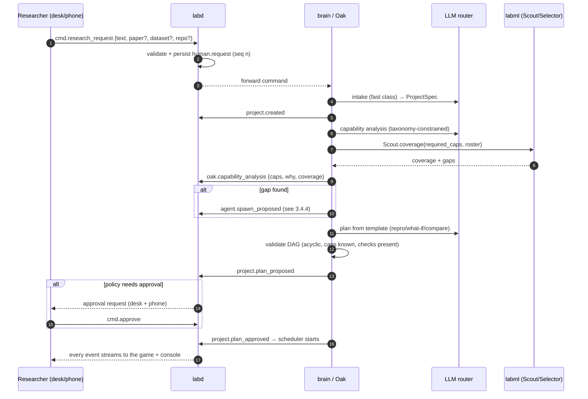
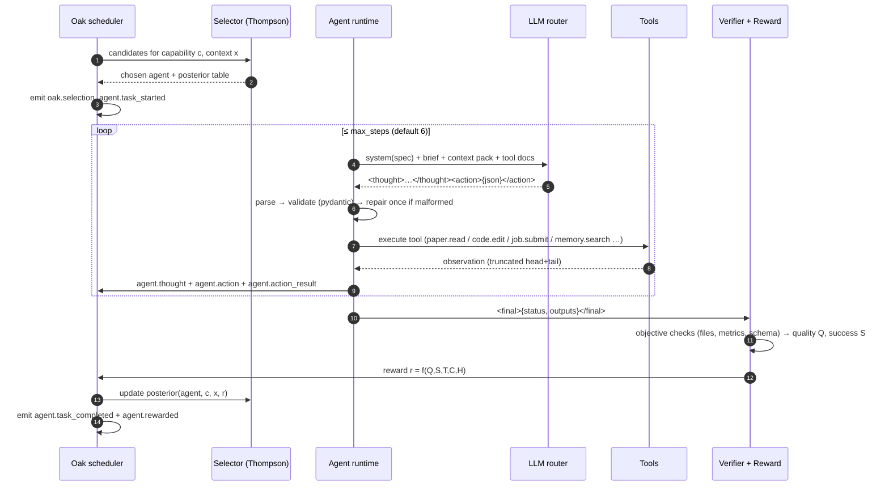
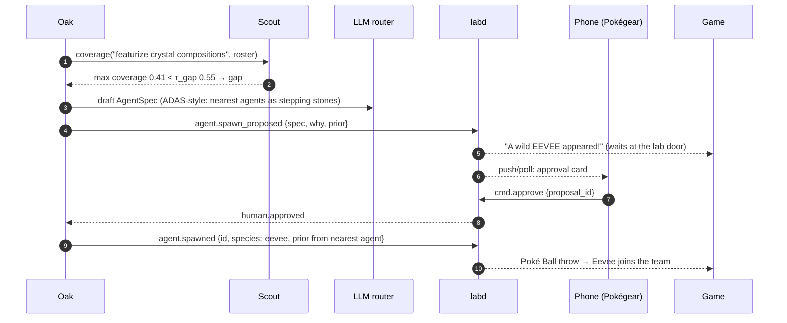
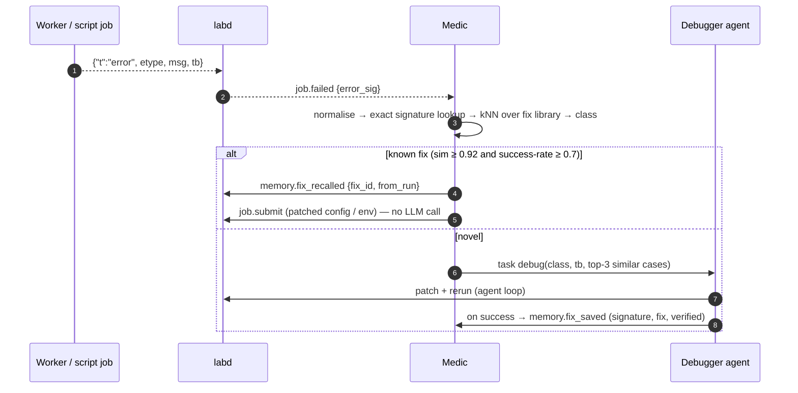
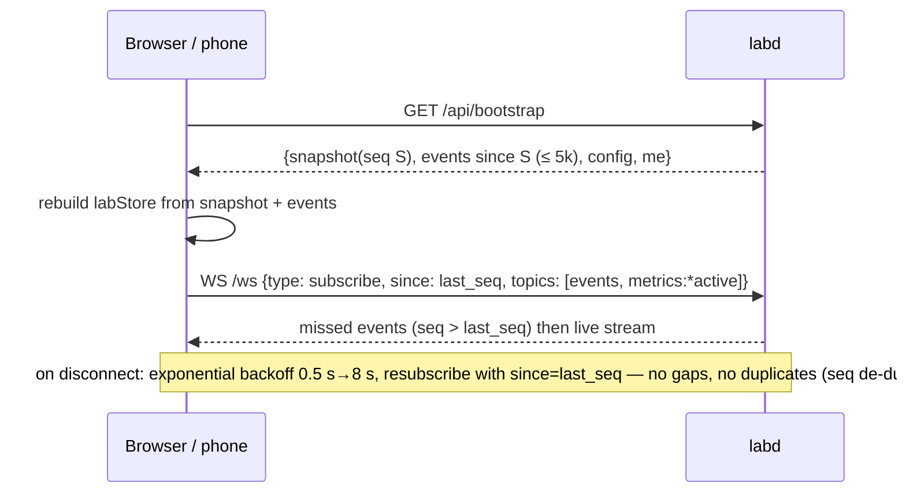

# PART 3 — SYSTEM ARCHITECTURE

## 3.1 The one-page architecture

```
╔══════════════════════════════════════════════════════════════════════════════════════════════════════════════╗
║  PRESENTATION PLANE (TypeScript)                                                                              ║
║  ┌───────────────────────────────────────────────┐  ┌────────────────────────────┐  ┌──────────────────────┐ ║
║  │ Desk browser — web/ (Next 16 static export)    │  │ Phone — /m Pokégear PWA     │  │ Collaborator (view)  │ ║
║  │  Phaser 3.80 + grid-engine: Region/Lab/Gym     │  │  approvals · kill · redirect│  │  read-only reports   │ ║
║  │  Director (event→animation, time compression)  │  │  voice redirect (Whisper)   │  │  & notes link        │ ║
║  │  React console: quests · feed · team/lineage   │  └──────────────┬─────────────┘  └──────────┬───────────┘ ║
║  │  curves(uPlot) · Safari map · Repro · Pokédex  │                 │ HTTPS via LAN/tunnel       │             ║
║  │  Library · Notes · Compute · Budget · Policy   │                 │                            │             ║
║  │  zustand labStore = projection of events       │                 │                            │             ║
║  └──────────────────────┬────────────────────────┘                 │                            │             ║
╚═════════════════════════╪══════════════════════════════════════════╪════════════════════════════╪═════════════╝
                          │ WS /ws (events, metrics, cmds) + HTTP /api/*  (one origin :7700)       │
╔═════════════════════════▼══════════════════════════════════════════════════════════════════════▼═════════════╗
║  CONTROL & DATA PLANE — labd (Rust · tokio · axum)                         one binary, supervises everything   ║
║  ┌──────────────┐ ┌───────────────┐ ┌──────────────────┐ ┌──────────────────┐ ┌───────────────┐ ┌──────────┐ ║
║  │ Gateway      │ │ Event store   │ │ Job engine       │ │ Metrics pipeline │ │ Telemetry     │ │ Auth/QR  │ ║
║  │ WS fan-out   │ │ SQLite WAL    │ │ scheduler(GPU/   │ │ parse JSONL      │ │ NVML/nvidia-  │ │ pairing  │ ║
║  │ HTTP API     │ │ single writer │ │ CPU/remote slots)│ │ ring buffers     │ │ smi, power,   │ │ tokens   │ ║
║  │ static web   │ │ group commit  │ │ warm-pool mgr    │ │ LTTB downsample  │ │ RAM/CPU       │ │ roles    │ ║
║  │ cmd intake   │ │ replay/since  │ │ kill/timeout     │ │ 1 Hz progress    │ │               │ │          │ ║
║  └──────┬───────┘ └──────▲────────┘ └────────┬─────────┘ └────────▲─────────┘ └───────────────┘ └──────────┘ ║
║         │ supervises: brain (restart on crash) · worker pool · remote runners                                 ║
╚═════════╪════════════════╪═══════════════════╪═══════════════════════╪════════════════════════════════════════╝
          │ WS /internal/brain (events⇅, cmds↓, job events↓)            │ stdout JSON-lines ▲   stdin control ▼
╔═════════▼══════════════════════════════════════════╗   ╔══════════════╧═════════════════════════════════════════╗
║  INTELLIGENCE PLANE — brain (Python 3.12 asyncio)   ║   ║  COMPUTE PLANE — workers (Python 3.12 + PyTorch 2.14)   ║
║  ┌──────────────────────────────────────────────┐  ║   ║  Warm pool: w-gpu-0, w-gpu-1 (torch+CUDA preloaded),    ║
║  │ PROFESSOR OAK (meta-controller)              │  ║   ║  w-cpu-0.  Kits: grokking · distill · nerf · materials ·║
║  │  intake → capability analysis → plan DAG →   │  ║   ║  arena · smoke.  Cold "script jobs" for agent-written  ║
║  │  scheduler → selection → lifecycle → reward  │  ║   ║  code (fresh process, sandbox dir, scrubbed env).      ║
║  ├──────────────────────────────────────────────┤  ║   ║  Remote runners: kaggle_runner (kernels push/status/    ║
║  │ AGENT RUNTIME  text action protocol, tools,  │  ║   ║  output) · colab_runner (colab run --gpu T4) — same     ║
║  │  budgets, context packs, verifiers           │  ║   ║  JSON-lines protocol, so remote looks local.            ║
║  ├──────────────────────────────────────────────┤  ║   ║  Telemetry hooks: weight norms, Fourier measures, PSNR  ║
║  │ OAK'S INSTRUMENTS (labml, real ML, ms)       │  ║   ║  maps → used by Oracle & Analysts.                     ║
║  │  Oracle · Navigator · Selector · Medic ·     │  ║   ╚═════════════════════════════════════════════════════════╝
║  │  Scout · Compute Router · Analysts           │  ║
║  ├──────────────────────────────────────────────┤  ║   ╔═════════════════════════════════════════════════════════╗
║  │ LLM ROUTER  Elevate(Luna, DeepSeek V4 Pro,   │──╫──►║  EXTERNAL                                                ║
║  │  GPT-5 Mini) · Groq×2 (gpt-oss, qwen) · cache│  ║   ║  Elevate gateway (800k tok/day) · Groq (2 keys) ·        ║
║  │  rate limiter · JSON repair · budget ledger  │  ║   ║  Kaggle (T4, 30 h/wk) · Colab (T4) · W&B (tracking) ·    ║
║  ├──────────────────────────────────────────────┤  ║   ║  arXiv API (discovery) · Exa (dev-time research only)    ║
║  │ PAPERS (PDF→sections→claims) · MEMORY        │  ║   ╚═════════════════════════════════════════════════════════╝
║  │ (Pokédex: dedup, lessons, fixes, embeddings) │  ║
║  │ SCIENCE: ReproComparator · reports · notes   │  ║        STORAGE (var/)
║  └──────────────────────────────────────────────┘  ║        lab.db (events, jobs, metrics — labd writes)
║  reads lab.db read-only · writes only via events   ║        brain.db (embeddings, specs cache, labml registry)
╚════════════════════════════════════════════════════╝        llm_cache.db · runs/<job>/ · notes/ · papers/ · wandb/
```

## 3.2 Processes, ports and ownership

| Process | Language / runtime | Started by | Port / channel | Owns (single writer) | Restart policy |
|---|---|---|---|---|---|
| **`labd`** | Rust (tokio, axum) | you: `make up` (or `./bin/labd`) | `:7700` HTTP + `/ws` + `/internal/brain` + static web | `var/lab.db` (events, jobs, metrics, artifacts, snapshots) | — (it is the supervisor) |
| **`brain`** | Python 3.12, asyncio | labd (child process) | connects to `ws://127.0.0.1:7700/internal/brain` | `var/brain.db`, `var/llm_cache.db`, `var/notes/`, `var/labml/` | labd restarts with backoff 1 s→30 s; state rebuilt from events (§6.12) |
| **`w-gpu-0..N`** | Python 3.12 + torch cu130 | labd (warm pool) | stdin/stdout JSON-lines | `var/runs/<job_id>/` for its current job | restart on crash/exit; recycled after 50 jobs or RSS > 3 GB |
| **`w-cpu-0`** | same | labd | same | same | same |
| **script job** | `python script.py` in the project venv | labd per job | stdout JSON-lines | `var/workspaces/<project>/runs/<job>/` | none (one-shot) |
| **remote runner** | Python (`kaggle` / `colab` CLIs) | labd per remote job | stdout JSON-lines | `var/runs/<job_id>/remote/` | one-shot; status polled |
| **web (dev only)** | Node 22 `next dev` | you | `:3000` (proxies `/api`, `/ws` → `:7700`) | — | — |
| **cloudflared** (optional) | binary | `make tunnel` | → `:7700` | — | manual |

`[DECISION D-01]` **labd is the only process that writes `lab.db`.** Everyone else either *sends events/commands to labd* or *reads* `lab.db` through a read-only connection (WAL mode allows concurrent readers). This removes the whole class of `database is locked` failures and makes the event log a total order.

`[DECISION D-02]` **The web app is a static export served by labd** in demo mode (`next build` with `output: 'export'` → `web/out/` → `ServeDir`). One origin (`:7700`) for desk, phone and tunnel; no Node process at demo time; no CORS.

`[DECISION D-03]` **The event log is the source of truth.** `brain.db` and every client store are projections that can be rebuilt by replaying events. Snapshots exist only to make bootstrap fast.

## 3.3 Key architecture decisions (summary — rationale in the referenced sections)

| # | Decision | Why |
|---|---|---|
| D-01 | Single writer for `lab.db` (labd) | No lock contention; total order; durable group commit (§5.3) |
| D-02 | Static web served by labd | One origin, one process fewer, phone/tunnel trivial (§9.1) |
| D-03 | Event sourcing | Replay, reconnect, crash recovery, REPLAY demo mode, audit trail for "why" (§5.3) |
| D-04 | Rust for the core; Python for intelligence & compute; TS for presentation | Each language where it is strongest (§4.1) |
| D-05 | Agents are data (`AgentSpec`) executed by one generic runtime | Spawn = insert, refine = new version, retire = status — no code generation of agents needed (§6.4) |
| D-06 | Own text action protocol instead of native tool-calling | ⚠️ `[MEASURED]` the Elevate gateway drops `tools` and ignores `response_format`; one protocol works on every provider (§6.3.2) |
| D-07 | Warm worker pool for kit jobs, fresh processes for agent-written scripts | ~0.3 s start for trusted kits; isolation for untrusted code (§8.1) |
| D-08 | Small ML models (ms) for numbers, statistics and routing; LLMs for language and code | Each tool where it beats the other; no LLM in the per-second loop (Part 7) |
| D-09 | Same JSON-lines protocol for local, Kaggle and Colab jobs | Remote compute looks identical to the UI and the ML layer (§8.8) |
| D-10 | Contracts generated from one source (Pydantic → JSON Schema → TS; Rust mirrors + fixture tests) | No drift across three languages (§10.1) |
| D-11 | Offline-first: every asset, dataset, model weight and paper pre-downloaded; LLM cache; REPLAY mode | Campus Wi-Fi blocks sites; hotspot RTT measured at 1.6 s on 10 Oct (§11.3) |

## 3.4 The seven core flows

### 3.4.1 A research request becomes a running project



### 3.4.2 One task executed by one agent



### 3.4.3 An experiment run with Oracle early stopping

```mermaid
sequenceDiagram
    autonumber
    participant E as Experimenter agent
    participant CR as Compute Router
    participant L as labd job engine
    participant W as warm GPU worker
    participant O as Oracle
    participant UI as Game/console
    E->>CR: job spec (kit, config, budget)
    CR-->>E: target=local (pred 14 s) | kaggle | colab
    E->>L: job.submit
    L->>L: config_hash → Pokédex dedup check (memory hit → return immediately)
    L->>W: {"t":"job",…} on stdin
    W-->>L: {"t":"metric",…} lines (10–50 Hz)
    L-->>UI: downsampled metrics (≤ 10 Hz/series) + job.progress (1 Hz)
    L-->>O: progress stream (via brain subscription)
    O-->>L: job.forecast {p_success, eta_steps, final_q10/50/90} every 2 s
    alt p_success < 0.05 for 3 checks and progress > 20 %
        O->>L: cmd.kill_job {reason: oracle_early_stop}
        L->>W: {"t":"stop"} → graceful stop ≤ 2 s
        L-->>UI: job.killed → "Got away safely! saved 48 GPU-s"
    else finishes
        W-->>L: {"t":"done", final}
        L-->>UI: job.completed
    end
    O->>O: add curve to library; retrain in background (< 1 s)
```

### 3.4.4 Spawning a specialist with phone approval



### 3.4.5 A failure, triaged by the Medic



### 3.4.6 Client bootstrap and reconnect



### 3.4.7 A remote job on Kaggle

```mermaid
sequenceDiagram
    participant L as labd
    participant K as kaggle_runner.py
    participant KG as Kaggle
    L->>K: spawn with job spec (kit + config)
    K->>K: build kernel dir (kit code + config + entry that prints JSON lines)
    K->>KG: kaggle kernels push -p dir --accelerator NvidiaTeslaT4
    loop every 10 s
        K->>KG: kaggle kernels status
        K-->>L: {"t":"log","msg":"queued|running"}
    end
    K->>KG: kaggle kernels output → log JSON
    K-->>L: replays the remote {"t":"metric"} lines, then {"t":"done"}
    Note over L: metrics arrive in bursts (no live streaming on Kaggle) — the UI shows "remote, syncing"; Colab runner streams live via `colab run`
```

## 3.5 State machines

**Project:** `draft → analysing → planned → (awaiting_approval) → running ⇄ paused → reporting → completed | failed | cancelled`. Redirect moves `running → planned (revision n+1) → running` with a plan diff event.

**Task (plan step):** `pending → ready → assigned → running → verifying → done | failed → (retry ≤ 2 | escalated)`.

**Job:** `submitted → deduped (memory hit) | queued → starting → running → (stopping) → completed | stopped | killed | failed | timeout`. Remote adds `uploading → remote_queued → remote_running → syncing`.

**Agent:** `proposed → active ⇄ busy → (refining → active as vN+1 | refine_rejected) → retired | merged`. A proposal can be `rejected` (by the human) and is then archived with the reason.

**Approval:** `requested → approved | rejected | expired (policy default applied)`.

---
